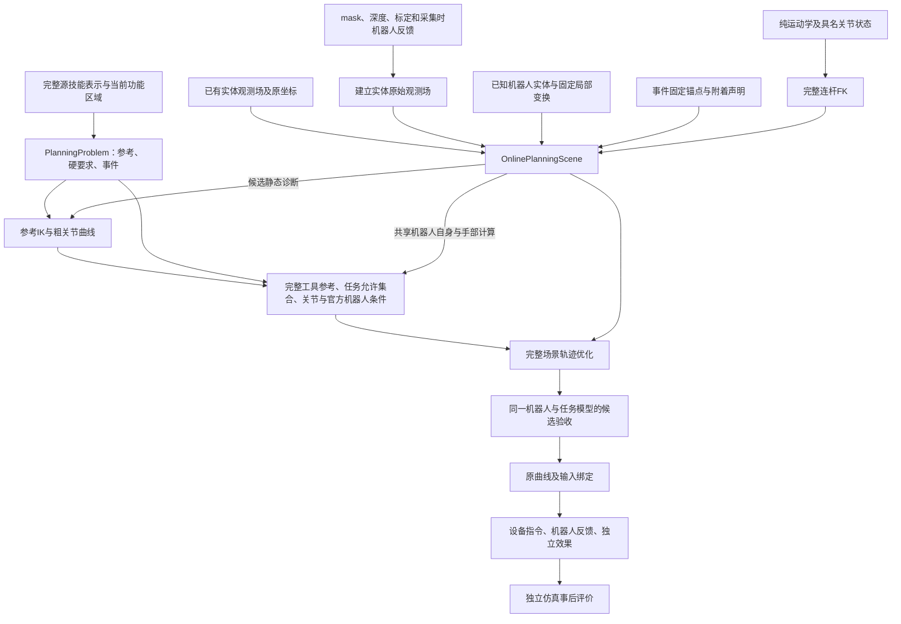

# FUNCTO 运动规划器架构

代码基线：`c84b34a`（连续初始化 A/B 实际实现提交；本次仅文档更新引用该代码基线，文档提交与实现提交分别记录）。组件正文描述实现的输入、计算、输出和调用关系；阶段运行结果与计划对照保存在项目外的 `sim-version-plans`。

系统输入完整源技能表示、经标定的 RGB-D 与实体像素分区、已有实体观测模型、具名机器人关节反馈、固定机器人官方碰撞实体、纯运动学模型和任务声明。规划器产生具名关节曲线及模型验收报告；设备执行记录与仿真事后评价分别描述实际控制过程和任务效果。

## 组件与数据流

| 组件 | 输入、计算和输出 |
|---|---|
| [输入与任务模型](docs/planner-architecture/01-inputs-and-task-model.md) | 源区域、轨迹、功能坐标、关系和事件经 grounding 与参考生成形成 `PlanningProblem` |
| [观测与碰撞](docs/planner-architecture/02-observation-and-collision.md) | mask＋深度建立实体原始观测场，或直接接收已有场；已知机器人实体与任务原场直接查询距离 |
| [附着、接触与手指](docs/planner-architecture/03-attachment-contact-and-hand.md) | 固定关系预测实体运动并确定工具组合体成员；源任务特征定义有限接触；手指指令与名义几何共享时钟 |
| [数值求解与搜索](docs/planner-architecture/04-solver-and-search.md) | 成功参考 IK 观测拟合粗曲线，有限补查询后在任务与官方机器人范围细化初值；完整场景优化、连续关节检查与有限 OMPL 搜索产生并比较候选 |
| [验收与执行](docs/planner-architecture/05-acceptance-and-execution.md) | 同一模型完整验收并绑定候选，在既有预算内改善和保留最佳合格曲线，执行消费机器人反馈和独立效果 |
| [API 契约](docs/planner-architecture/06-api-contracts.md) | 公共接口的前置数据、返回值及实际消费者 |
| [实现索引](docs/planner-architecture/07-implementation-index.md) | 当前源码的类、函数、精确签名、返回表达式与直接调用 |
| [文件语义](docs/planner-architecture/08-external-files-and-data-roles.md) | 技能、观测、模型、控制与评价文件的职责 |

## 坐标、时间与实体

`T_A_B` 将 B 坐标中的列向量变换到 A 坐标。位置以米计，角度以弧度计，物理时间以秒计。NumPy 位姿为 4×4 矩阵；Torch 位姿为位置与 `wxyz` 四元数。具名关节列通过名称匹配。工具位姿为 `T_reference_base @ T_base_link(q) @ T_link_tool`。

源时间、技能进度 `s` 和执行物理时间 `t` 分别保存。`_ProgressMap` 将归一化执行时间映射到技能进度；事件保留 `(skill_id,event_id,occurrence)` 身份。机器人及手指在同一物理时刻求值，释放后的实体保持该候选释放时刻的预测位姿。调用者的原关节曲线保留自身时长和进度映射；原生改善使用已绑定的固定三次基时钟。两类候选各自将曲线、事件、手指和场景关系保存为完整记录。

`FrozenObservedField` 保存实体坐标中的原始 TSDF 样本、权重和观测支持。`CollisionOwner` 为该场绑定身份及运动；`NativeSolid/NativePrimitive` 将原机器人碰撞实体绑定到具名连杆。新实体可以由 RGB-D 建立，已有实体可以原样传入；模型复用不要求当前图像、mask 或可见深度。静态背景保留世界坐标，已测自由射线不会随实体移动。

场景以显式 `tool_geometry_names` 声明完整工具组件。`Attachment.active(s)` 在实际技能进度 `s` 上同时确定实体的刚性跟随与组合体成员资格。工具组件与当前附着实体之间、同一 TCP 上共同附着的实体之间不产生内部碰撞查询；各成员仍以原机器人形状或原观测场检查背景、其余机器人及其他实体。显式释放时成员退出组合体，没有释放声明时附着跨越规划窗口终点继续。机器人自身配对沿用原模型策略。

## 几何计算与数值求解

八个角点均受观测支持的单元内使用三线性插值，以 `φ≤0` 定义已表示的占据集合。任务场查询的非穿透规则检查未获许可部分是否存在体积交叠。空间框与实际占据点对提供诊断距离界；只有原表示中的共同占据开邻域才能产生 `intersection` 证据。单纯零距离、边界接触或空间框交叠不构成这项证据。`clear` 的结论限于已表示的查询域；`unresolved` 保留未能判定的域，不被写成已分离。

机器人与任务观测场、任务场与任务场在静态 IK 筛选、优化和候选验收中使用同一非穿透规则。`components` 始终返回实际几何分项；已确认体积交叠对应分类残差 1，场配对未决保存在查询报告中。优化另由 `LocalGeometryModels` 在一次迭代块的实际起点捕获材料点、原场零点和法向，形成固定的可微标量。`query_role='optimization'` 令 `evaluate` 返回这些局部目标及其他连续场景项，`query_role='acceptance'` 返回硬分项之和。实际硬分项独立决定候选资格；局部目标不参与跨块候选排序。机器人自碰撞、任务接触、初始支撑和移动实体覆盖保留各自的模型条件。

cuRobo 提供纯运动学 FK、IK 和 L-BFGS。完整机器人几何姿态由包含名义手指坐标的关节树计算。`CubicBasis` 保留测得入口位置、速度及固定物理时钟；`CubicJointDomain` 从同一原机器人声明绑定连续位置、速度、加速度及 jerk 四类边界，初始化、拟合、线搜索和恢复使用同一域。SciPy、quadprog 和 OMPL 分别提供多项式运算、系数二次规划及有限搜索。正式候选对实际保存曲线完成任务采样与连续关节极值，再用原实体距离下界和连续运动界检查几何区间。已证明分离、实际交叠和未决区间各自保存。

`NativeReferenceCost` 在普通有效物理时刻读取完整工具参考，沿已声明的 TCP 标定调用原生 `ToolPoseCost`。位置平方误差和等权 Lie 旋转平方误差按物理时间作梯形平均；原生关节正则项使用同一积分权重，其成本时间系数在请求内固定。事件硬允许集合、场景硬证据和功能增广项分别计算。完整候选在固定归一化网格上取得 `fixed_objective`，以相同普通目标比较不同种子、原始关节曲线和改善曲线。

合格初值先完成完整验收、执行绑定与独立记录，再在原请求预算内执行一次主改善。固定评分更低且已完成资格的新候选替换记录。改善预算耗尽时交付此前在预算内完成的最佳候选；取消、外部截止时间和计算异常保留各自失败类型。最终账本记录整次请求的实际工作，返回候选的资格时间单独保存。

`PoseEventRequirement` 显式声明材料原点的位置精度及姿态允许集合。未声明轴时计算完整 SO(3) 相对转角；声明目标局部 `yaw_axis/yaw_tolerance_rad` 时，分别计算绕轴转角与剩余倾斜。yaw 容差 π 表示整周自由。事件 IK 关闭原生名义姿态跟踪，直接优化同刻声明的连续允许集合，并在返回关节候选后计算任务与场景证据。参考 IK 继续拟合完整源工具参考。源完整姿态、功能区域与轨迹保留其原有职责。定义和数据流见[输入与任务模型](docs/planner-architecture/01-inputs-and-task-model.md#41-目标坐标中的可设置-yaw-容差)。

`SupportRequirement` 保存间距 `gap`、整体高度 `body`、平面内投影范围 `footprint` 和法向 `normal` 四项完整几何。实例字段 `hard_components` 明确硬要求，默认值为 `("body","footprint")`；其余分量按原容差和原几何提供 `quality` 阶段偏好。当前生产求解使用 `feasibility` 阶段，支持计算由声明的硬分量参与。事件 IK、功能增广拉格朗日、搜索、候选保留和轨迹验收读取同一声明，并分别在其可计算的点或轨迹范围内求值。

普通参考 IK 使用全轴 Lie 姿态成本及四倍旋转权重，独立收敛指标保留真实转角。静态候选、单个跟踪状态和完整候选链共用原报告中的资格前缀：明确任务失败、明确模型失败、原生参考失败、任务结论未建立、模型结论未建立。同次有限正违反量形成明确失败，缺失或未决证据保留其来源。每次查询向下一次传递至多一个数值跟踪状态，其他种子由原生采样器产生。完整图逐项累计共同前缀，再比较失败能量、归一化速度能量和成功能量。

原候选图保留已收敛、合法近似和插值状态及其生产查询身份；只有 `observation_mask` 标记的原生成功行进入关节观测拟合。测得 `q0` 重复为自由系数提议，经统一物理域构造符合测得 `q0/dq0` 和固定时钟的入口曲线；全部拟合使用该固定先验。没有成功观测时使用入口曲线，拟合失败保留相应实际原因及原候选。

完整曲线细化前，每个现有轨迹种子槽从原粗曲线的普通网格中选一个尚未查询、已含物理积分权重的参考贡献最大点。新查询成功时可再热启动其右侧最近原查询一次；原生调用总数不超过轨迹种子数的两倍，候选池容量沿用 `ik_seeds`。补查询共用累计 IK 账本，且只在初始化份额对应的剩余时间窗口内启动。随后统一重选链和重拟合，在相同任务、机器人、物理域与初始 AL 参数下逐槽比较原曲线和新曲线，再启动一次完整曲线优化生命周期。

`_refine_reference_seeds` 在相同三次曲线、测得入口、物理时钟和 TCP 标定上，使用已有原生优化器评价完整参考、原关节成本、过程关系及完整有序轨迹上的事件不等式。初始化的 `geometry_scope="robot"` 运行与完整场景共享的官方机器人自身配对和名义手部条件；任务观测场状态为 `not_evaluated`。原独立指标的 `cspace_cfg` 同时装入优化约束，同次 `optimizer_evidence` 为初始化和中间候选槽提供实际硬证据；约束罚项参与优化，跨块排名使用固定普通目标。实际返回系数进入完整候选评价和主优化。`diagnostics.joint_state_computation.effort` 根据实际 transition 的 `compute_inverse_dynamics` 记录力矩计算方式；当前机器人关闭动力学计算，状态为 `not_computed`。

原生动作通过 `CubicBasis.hermite_nodes → _controls_curve` 在原多项式断点生成 binary64 位置和速度，现有 `JointTrajectory`、归档与控制继续使用该 Hermite 定义。全部原生候选及诊断在保存曲线评分前取得独立所有权；候选按固定普通目标排序，再统一经过保存曲线的原生指标、连续位置及一至三阶导数界和区间场景评价。原优化采样记录保存在 `optimization_diagnostics`，正式报告描述实际保存多项式。

正式评价通过现有请求账本登记开始的验证尝试，并在每批采样、锚点和区间查询完成后立即累计点数。次数、查询量及时间受原额度限制；已有在预算内完成资格和绑定的最佳曲线，在改善预算用尽时按原记录交付。恢复类型来自所选保存曲线的正式场景证据，对应原生密集见证保留其采样身份并可增加恢复查询。

一次原主求解的更新额度按原生内迭代块分为初始化部分与完整场景部分：前者取总块数的一半向下取整，后者使用剩余块数，二者共用首次轨迹求解额度和请求账本。目标范围切换时重新初始化原生历史、功能乘子和候选保存状态。`reference_initialization` 保存原粗曲线、补查询提议、逐槽选定曲线与实际返回曲线的系数、物理多项式、普通目标、完整优化目标、功能残差及连续导数检查；计算完成、当前范围采样合格和完整可执行资格分别记录。

原生内迭代块尾对连续停滞步数大于零的活动种子尝试同一物理域 QP 和 Armijo 恢复。接受时更新探索点、梯度并清零停滞；失败时仅尝试前已经达到整块停滞的种子停止当前目标搜索。部分停滞失败保留原探索点与候选，以新算梯度和清空的 L-BFGS 历史继续原更新额度。每次真实前向仍按同次硬证据维护采样合格候选，功能乘子与局部几何的更新时间保持在原块边界。

场景查询先选择整批中至少有一个有效样本的时间列，计算后回填原张量布局，再按各候选的有效样本掩码归约。机器人自碰撞仅查询原模型策略中的 `required_pairs`。原叶节点的局部占据点和原生形状的局部范围跨调用保存；完整实体范围另提供与有限许可独立的距离下界。模型捕获及块边界重复基准计算共享数值查询记录，每个粒子从自身张量计算导数；普通试探保持完整原查询。固定候选的区间验收只计算一次所需释放锚点。`PlanningBudget.interpolation_dt` 是请求允许的最大采样间隔，绑定后保存满足该上限的实际三次曲线时钟。

## 数据职责与执行

源示教区域、轨迹、相对关系、任务几何、交互与释放事件完整参与技能计算。当前 RGB-D、关节反馈、标定和声明关系形成规划输入。当前固定机器人的官方本体及官方固定末端执行器模型可以包含 mesh，并跨任务复用；模型位姿由关节反馈、运动学与标定计算。任务物体、环境和其他对象的 mesh/CAD 不属于规划模型输入，它们使用现场 RGB-D 原场及观测支持域。

仿真实际运行环境中的真实物体位姿、真实分割、接触和效果由独立事后评价消费。末端相对预测目标的位姿误差属于该评价范围。执行器按绑定时钟应用命令，分别检查机器人关节、速度、指令跟踪、已知机器人模型碰撞和显式独立效果依赖。

`OnlinePlanningScene.to_execution_binding()` 保存 `native_robot_observed_scene_v1` 快照；单个任务场保留原样本恢复接口。每次组件修改同时更新本文、对应组件正文及 API 索引；实际运行和计划差异集中放在阶段文档。
