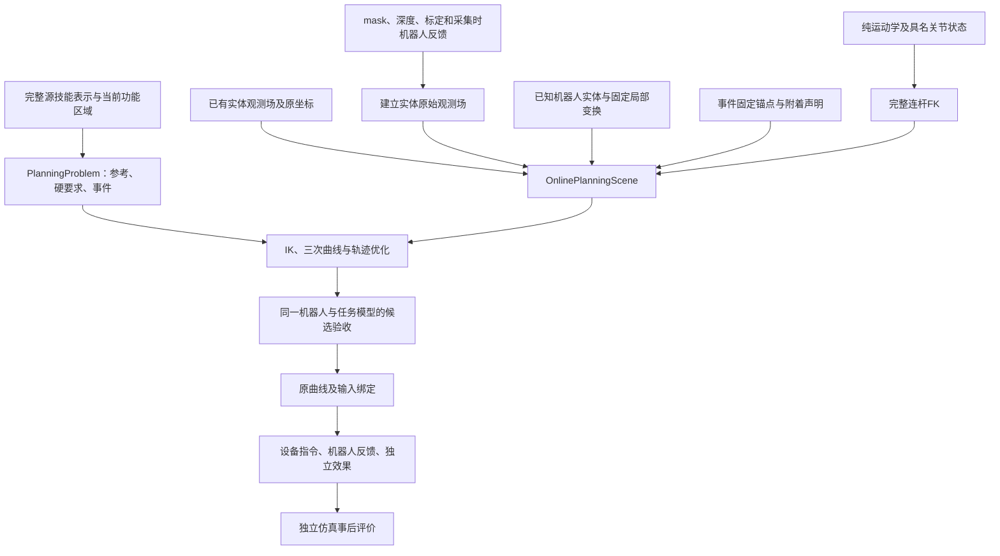

# FUNCTO 运动规划器架构

代码基线：`9e8b365`。组件实现与架构正文在该提交同步维护；其后的文档提交仅补记此代码引用，代码与该基线相同。组件正文描述当前实现的输入、计算、输出和调用关系。阶段运行结果保存在项目外的 `sim-version-plans`。

系统输入完整源技能表示、经标定的 RGB-D 与实体像素分区、已有实体观测模型、具名机器人关节反馈、已知机器人碰撞实体、纯运动学模型和任务声明。规划器产生具名关节曲线及模型验收报告；设备执行记录与仿真事后评价分别描述实际控制过程和任务效果。

## 组件与数据流

| 组件 | 输入、计算和输出 |
|---|---|
| [输入与任务模型](docs/planner-architecture/01-inputs-and-task-model.md) | 源区域、轨迹、功能坐标、关系和事件经 grounding 与参考生成形成 `PlanningProblem` |
| [观测与碰撞](docs/planner-architecture/02-observation-and-collision.md) | mask＋深度建立实体原始观测场，或直接接收已有场；已知机器人实体与任务原场直接查询距离 |
| [附着、接触与手指](docs/planner-architecture/03-attachment-contact-and-hand.md) | 固定关系预测实体运动并确定工具组合体成员；源任务特征定义有限接触；手指指令与名义几何共享时钟 |
| [数值求解与搜索](docs/planner-architecture/04-solver-and-search.md) | IK、连续关节域、三次曲线、L-BFGS 和有限 OMPL 搜索产生候选 |
| [验收与执行](docs/planner-architecture/05-acceptance-and-execution.md) | 同一机器人与任务模型验收候选，保存原曲线及输入，执行消费机器人反馈和独立效果 |
| [API 契约](docs/planner-architecture/06-api-contracts.md) | 公共接口的前置数据、返回值及实际消费者 |
| [实现索引](docs/planner-architecture/07-implementation-index.md) | 当前源码的类、函数、精确签名、返回表达式与直接调用 |
| [文件语义](docs/planner-architecture/08-external-files-and-data-roles.md) | 技能、观测、模型、控制与评价文件的职责 |

## 坐标、时间与实体

`T_A_B` 将 B 坐标中的列向量变换到 A 坐标。位置以米计，角度以弧度计，物理时间以秒计。NumPy 位姿为 4×4 矩阵；Torch 位姿为位置与 `wxyz` 四元数。具名关节列通过名称匹配。工具位姿为 `T_reference_base @ T_base_link(q) @ T_link_tool`。

源时间、技能进度 `s` 和执行物理时间 `t` 分别保存。`_ProgressMap` 将归一化执行时间映射到技能进度；事件保留 `(skill_id,event_id,occurrence)` 身份。机器人及手指在同一物理时刻求值，释放后的实体保持该候选释放时刻的预测位姿。

`FrozenObservedField` 保存实体坐标中的原始 TSDF 样本、权重和观测支持。`CollisionOwner` 为该场绑定身份及运动；`NativeSolid/NativePrimitive` 将原机器人碰撞实体绑定到具名连杆。新实体可以由 RGB-D 建立，已有实体可以原样传入；模型复用不要求当前图像、mask 或可见深度。静态背景保留世界坐标，已测自由射线不会随实体移动。

场景以显式 `tool_geometry_names` 声明完整工具组件。`Attachment.active(s)` 在实际技能进度 `s` 上同时确定实体的刚性跟随与组合体成员资格。工具组件与当前附着实体之间、同一 TCP 上共同附着的实体之间不产生内部碰撞查询；各成员仍以原机器人形状或原观测场检查背景、其余机器人及其他实体。显式释放时成员退出组合体，没有释放声明时附着跨越规划窗口终点继续。机器人自身配对沿用原模型策略。

## 几何计算与数值求解

八个角点均受观测支持的单元内使用三线性插值，以 `φ≤0` 定义已表示的占据集合。任务场查询的非穿透规则检查未获许可部分是否存在体积交叠。空间框与实际占据点对提供诊断距离界；只有原表示中的共同占据开邻域才能产生 `intersection` 证据。单纯零距离、边界接触或空间框交叠不构成这项证据。`clear` 的结论限于已表示的查询域；`unresolved` 保留未能判定的域，不被写成已分离。

机器人与任务观测场、任务场与任务场在优化、静态 IK 和候选验收中使用同一非穿透规则，`query_role` 只记录调用阶段。已确认体积交叠产生前向值为 1 的分类残差，并附同一观测场局部法向给出的优化方向；该值不是米制穿透深度。场配对的未决状态只进入查询报告，不产生碰撞正残差。机器人自身检查沿用原实体配对及 Coal 数值边界；任务接触、初始支撑和移动实体覆盖分别保留自己的条件。任务间隙和姿态容差保留各自定义。接触许可只影响其明确实体对和有限区域。机器人几何由已知本体模型提供，视域覆盖记录为 `not_queried`。

cuRobo 提供纯运动学 FK、IK 和 L-BFGS。完整机器人几何姿态由包含名义手指坐标的关节树计算。`CubicBasis` 和物理关节域管理器保留入口位置、速度及连续关节限制。SciPy、quadprog 和 OMPL 分别提供数值运算、局部二次规划及受预算约束的搜索。几何验收发生在所记录的有限时刻；关节位置、速度和加速度另有多项式极值检查。

`PoseEventRequirement` 显式声明材料原点的位置精度及姿态允许集合。未声明轴时计算完整 SO(3) 相对转角；声明目标局部 `yaw_axis/yaw_tolerance_rad` 时，分别计算绕轴转角与剩余倾斜。yaw 容差 π 表示整周自由，任务约束与可选居中项按实际受约束分量生成。IK 在允许角度中形成有限完整目标，再通过材料—TCP—原生连杆变换求候选；任务验收使用连续允许集合。源完整姿态和参考继续保留。定义和数据流见[输入与任务模型](docs/planner-architecture/01-inputs-and-task-model.md#41-目标坐标中的可设置-yaw-容差)。

`SupportRequirement` 将有限支撑定义为间距 `gap`、整体高度 `body`、平面内投影范围 `footprint` 和法向 `normal` 四项。四项及其原容差共同参与名义优化和严格优化可行性计算；轨迹验收由 `acceptance_components=("body","footprint")` 选择整体高度与投影范围。`PlanningProblem.residuals(..., for_acceptance=True)` 将这一规则传给静态功能 IK 与原生轨迹指标，优化中的候选保留从同次前向结果读取相同验收子集。间距和法向仍提供优化目标及结果分析数值；其余任务条件、关节要求和场景条件保留原定义。最终结果绑定消费已完成的轨迹验收报告。

场景查询先选择整批中至少有一个有效样本的时间列，计算后回填原张量布局，再按各候选的有效样本掩码归约。机器人自碰撞仅查询原模型策略中的 `required_pairs`；完整配对策略继续保存。`clear`、未决及内部组合体跳过项复用一次构造的批次可导零值，已确认交叠项附加自己的局部运动导数。

## 数据职责与执行

源示教区域、轨迹、相对关系、任务几何、交互与释放事件完整参与技能计算。当前 RGB-D、关节反馈、标定和声明关系形成规划输入。官方随附且跨任务复用的机器人模型提供本体碰撞实体；任务物体保留 RGB-D 原场，不要求逐物体人工制作 mesh。

仿真实际运行环境中的真实物体位姿、真实分割、接触和效果由独立事后评价消费。末端相对预测目标的位姿误差属于该评价范围。执行器按绑定时钟应用命令，分别检查机器人关节、速度、指令跟踪、已知机器人模型碰撞和显式独立效果依赖。

`OnlinePlanningScene.to_execution_binding()` 保存 `native_robot_observed_scene_v1` 快照；单个任务场保留原样本恢复接口。每次组件修改同时更新本文、对应组件正文及 API 索引；实际运行和计划差异集中放在阶段文档。
