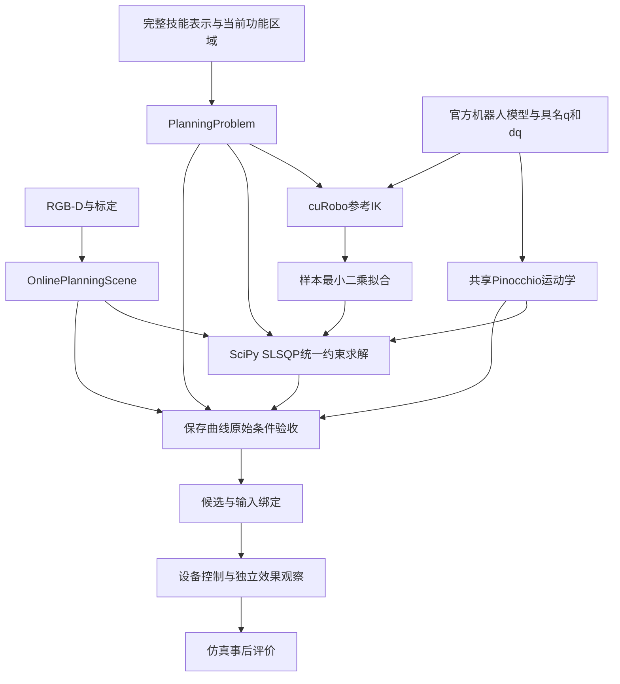

# FUNCTO 运动规划器架构

代码基线：`01a6609`。本次仅文档提交回填实际实现提交号，代码内容与该基线相同。阶段实验与计划对照位于项目外 `sim-version-plans`。

系统将完整技能表示、标定 RGB-D 观测场、具名机器人反馈、固定机器人官方模型和任务声明转化为关节曲线及模型验收报告。规划、设备执行和仿真事后评价分别处理名义模型、机器人反馈和实际任务效果。

## 组件与调用关系

| 组件 | 输入、计算和输出 |
|---|---|
| [输入与任务模型](docs/planner-architecture/01-inputs-and-task-model.md) | 源区域、轨迹、功能坐标、相对关系和事件经过 grounding 与参考生成，形成 `PlanningProblem` |
| [观测与碰撞](docs/planner-architecture/02-observation-and-collision.md) | RGB-D 建立实体 TSDF 及观测支持域；官方机器人实体和任务原场提供几何目标及独立验收证据 |
| [关系、接触与手指](docs/planner-architecture/03-attachment-contact-and-hand.md) | 声明关系使用事件固定锚点预测原场运动；有限接触、工具成员和手指曲线共用物理时钟 |
| [求解与搜索](docs/planner-architecture/04-solver-and-search.md) | cuRobo IK 产生参考关节样本，最小二乘转为三次系数；SciPy SLSQP 联合求解任务和连续关节约束，OMPL 提供预算内几何路径提议 |
| [验收与执行](docs/planner-architecture/05-acceptance-and-execution.md) | 保存多项式接受原任务、连续关节和原场检查；合格曲线绑定后交给设备执行 |
| [API 契约](docs/planner-architecture/06-api-contracts.md) | 各接口的必要输入、输出及实际消费者 |
| [实现索引](docs/planner-architecture/07-implementation-index.md) | 当前源码定义、精确签名、读取属性及直接调用 |
| [文件语义](docs/planner-architecture/08-external-files-and-data-roles.md) | 技能、观测、模型、控制和评价文件的职责 |

## 坐标、时间与模型

`T_A_B` 将 B 系列向量映到 A 系。位置单位为米，角度为弧度，物理时间为秒。NumPy 位姿采用 4×4 矩阵，Torch 位姿采用位置和 `wxyz` 四元数。工具位姿为 `T_reference_base @ T_base_link(q) @ T_link_tool`。`PinKinematics` 复用 `RobotGeometryChecker` 已加载模型，使用完整具名机械臂与名义手指状态计算连杆位姿、速度及其导数。

源时间、技能进度 `s` 与执行时间 `t` 分别保留。`_ProgressMap` 将 `t/T` 映到 `s`；事件身份为 `(skill_id,event_id,occurrence)`。求解变量为固定时钟三次样条的自由位置系数，测得入口 `q0/dq0` 由基函数结构固定；终端状态由任务声明约束。`JointTrajectory` 在原断点保存位置和速度，并通过同一 Hermite 多项式供验收、归档和执行查询。调用者提供的曲线保留自己的时长和进度映射。

`BoundToolReference` 把完整源工具参考与测得 TCP 入口位姿、速度绑定，供参考 IK 产生数值样本。具有任务语义的过程关系、功能区域和事件由 `PlanningProblem` 单独保留。目标函数由原 STATE 关节运动成本、声明的任务质量偏好及固定材料点几何目标组成；硬任务要求以逐分量有符号条件提交给求解器。

功能位姿参考中的 `is_initial_relative_rotation_rpy` 选择材料功能坐标的初始旋转基准。三个布尔值按功能参考坐标中的 XYZ 外禀 RPY 排列：真值选择运行初态，假值选择原名义初态；完整矩阵组合保留源相对旋转。连续材料位置保持原函数，物体与工具位姿由固定局部变换逐次计算。交互边界、释放终点和参考 IK 查询同一生成路径，具体接口见[输入与任务模型](docs/planner-architecture/01-inputs-and-task-model.md)。

机器人及其固定末端配置使用官方碰撞模型，形状和固定关系跨任务复用，位姿由关节反馈、运动学和标定计算。任务物体及环境使用现场 RGB-D 的 `FrozenObservedField`。关系建立后继续复用关系前同一 TSDF，以事件处机器人参考连杆的位姿作为固定锚点预测运动，并使用通用距离余量。源技能中的功能区域、任务点和接触定义经 grounding 后参与任务计算。

## 求解与几何结论

`TrajectoryComputation` 在一次请求内固定普通积分时刻及任务、场景锚点。`PlanningProblem.constraint_components` 返回原单位的等式和逐项 `g<=0` 不等式。`CubicJointDomain.signed_constraints` 对每个多项式段分别计算连续位置、速度极值、加速度端值和分段 jerk；其导数来自同一仿射样条映射。SciPy SLSQP 管理数值步、约束子问题和停止条件。

任务场在八角点均受观测支持的单元内按原三线性函数定义占据集合。固定材料点目标在同一实体局部点集上计算原场负值及其解析导数，为数值搜索提供标量。候选资格另由原场与官方机器人实体的查询决定：真实表示中的体积交叠、已证明分离、未决以及观测未知分别记录。材料点未命中交叠时目标可能为零；该值只表示有限采样目标。

`evaluate_candidate` 对同一保存曲线完成有限任务查询、连续关节极值及几何区间检查。报告分别保存已证明区间、交叠见证和未决区间。完整合格且固定质量评分更低的候选成为请求内最佳记录；改善预算耗尽时可交付此前已经完成验收和绑定的记录。完整几何状态和实际工作计数随结果保存。

## 数据职责与执行

源示教区域、轨迹、相对关系、任务几何、交互和释放事件完整保留为技能表示。当前 RGB-D、关节反馈、标定、运动学和任务声明参与规划。仿真实际运行环境中产生的真实物体/目标位姿、真实分割、接触和效果只供独立事后评价。

执行器按绑定时钟下发关节与手指指令，分别检查机器人限位、速度、模型碰撞和独立任务效果。末端相对预测目标的位姿误差属于事后评价。`OnlinePlanningScene.to_execution_binding()` 保存原观测模型和关系快照；执行结果、名义验收和评价记录保持各自数据职责。
