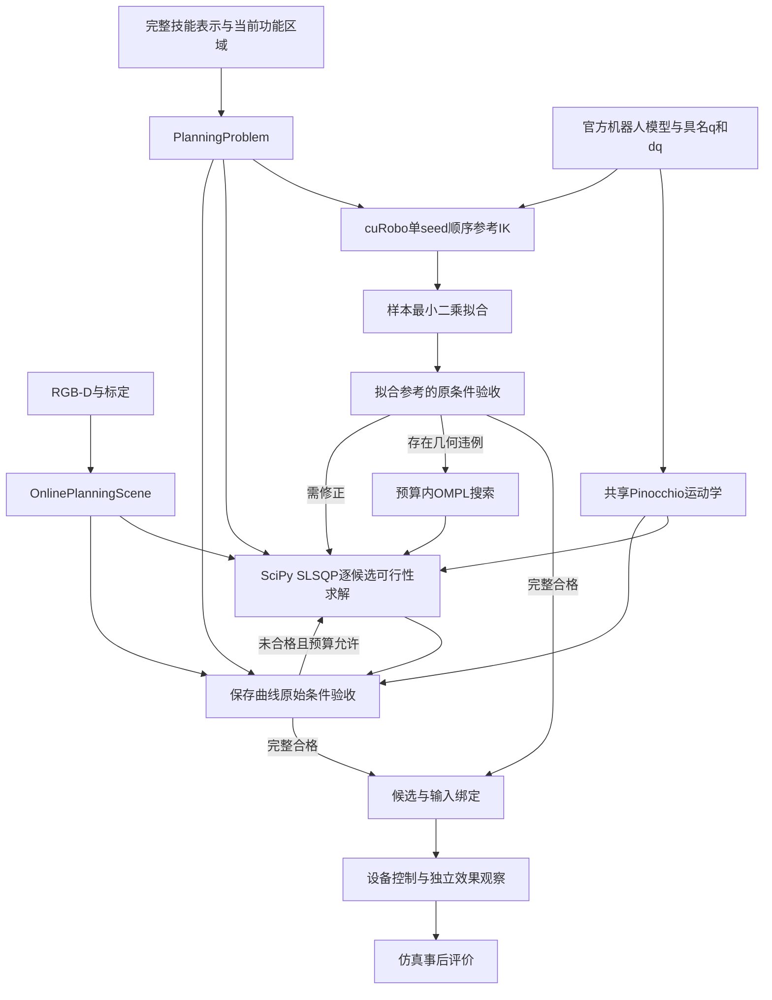

# FUNCTO 运动规划器架构

求解与观测场算法基线为 `be44b54`，官方机器人距离批处理基线为 `12e0ef5`；候选交付、通用包围盒距离与执行绑定数据转换分别以 [planning API](docs/planner-architecture/api/planning.md)、[implicit_distance API](docs/planner-architecture/api/implicit_distance.md) 和 [execution_binding API](docs/planner-architecture/api/execution_binding.md) 所列代码提交为准。组件正文描述当前实现；阶段验证位于项目外 `sim-version-plans`。

各组件 API 页记录实际代码基线；仅文档提交保持所引用组件的生产代码内容。

当前时间预算配置对应实际代码提交 `9602ebb`，本次文档回填保持该实现内容。`PlanningBudget.planning_seconds` 的全局默认值为 60 s，记录式 CLI 和诊断准备入口直接读取这一字段。

系统将完整技能表示、标定 RGB-D 观测场、具名机器人反馈、固定机器人官方模型和任务声明转化为关节曲线及模型验收报告。规划、设备执行和仿真事后评价分别处理名义模型、机器人反馈和实际任务效果。

## 独立规划入口

原 `manipulation.planning.plan_trajectory` 继续使用 `MotionBackend` 和 `_ConstrainedPlanner`。新增 `manipulation.preference_planner.plan_trajectory` 使用 `PreferenceMotionBackend` 和 `PreferencePlanner`，根据显式事件角色处理位姿硬要求与偏好，并使用末段静止消元和原实体证据产生的几何必要条件。两路共享原任务、机器人、场景和执行接口；原分支源码保持原基线。

新增组件及完成证据、纯前向运动学代码基线为 `c289890`，详细输入、坐标、API 和调用关系见 [声明位姿偏好规划器](docs/preference-planner/README.md)。以下原组件章节继续描述原入口；新增组件的覆盖方法与独立生命周期由其文档列明。

## 组件与调用关系

| 组件 | 输入、计算和输出 |
|---|---|
| [输入与任务模型](docs/planner-architecture/01-inputs-and-task-model.md) | 源区域、轨迹、功能坐标、相对关系和事件经过 grounding 与参考生成，形成 `PlanningProblem` |
| [观测与碰撞](docs/planner-architecture/02-observation-and-collision.md) | RGB-D 建立实体 TSDF 及观测支持域；官方机器人实体和任务原场提供几何目标及独立验收证据 |
| [关系、接触与手指](docs/planner-architecture/03-attachment-contact-and-hand.md) | 声明关系使用事件固定锚点预测原场运动；有限接触、工具成员和手指曲线共用物理时钟 |
| [求解与搜索](docs/planner-architecture/04-solver-and-search.md) | cuRobo IK 产生参考关节样本，最小二乘转为三次系数；SciPy SLSQP 联合求解任务和连续关节约束，OMPL 提供预算内几何路径提议 |
| [验收与执行](docs/planner-architecture/05-acceptance-and-execution.md) | 保存多项式接受原任务、连续关节和原场检查；合格曲线绑定后交给设备执行 |
| [API 契约](docs/planner-architecture/06-api-contracts.md) | 各接口的必要输入、输出及实际消费者 |
| [实现索引](docs/planner-architecture/07-implementation-index.md) | 当前源码定义、精确签名、读取属性及直接调用 |
| [文件语义](docs/planner-architecture/08-external-files-and-data-roles.md) | 技能、观测、模型、控制和评价文件的职责 |
| [完成证据与归档](docs/planner-architecture/09-completed-evidence-and-archives.md) | 已完成区间记录的只读共享、正式转换、单份 JSON 证据与完整读取 |

## 坐标、时间与模型

`T_A_B` 将 B 系列向量映到 A 系。位置单位为米，角度为弧度，物理时间为秒。NumPy 位姿采用 4×4 矩阵，Torch 位姿采用位置和 `wxyz` 四元数。工具位姿为 `T_reference_base @ T_base_link(q) @ T_link_tool`。`PinKinematics` 复用 `RobotGeometryChecker` 已加载模型，使用完整具名机械臂与名义手指状态计算连杆位姿、速度及其导数。

源时间、技能进度 `s` 与执行时间 `t` 分别保留。`_ProgressMap` 将 `t/T` 映到 `s`；事件身份为 `(skill_id,event_id,occurrence)`。求解变量为固定时钟三次样条的自由位置系数，测得入口 `q0/dq0` 由基函数结构固定；终端状态由任务声明约束。`JointTrajectory` 在原断点保存位置和速度，并通过同一 Hermite 多项式供验收、归档和执行查询。调用者提供的曲线保留自己的时长和进度映射。

`BoundToolReference` 把完整名义工具参考与测得 TCP 入口位姿、速度绑定。grounding 用原源区间的经过秒数生成从当前夹爪出发的完整参考；规划以自身请求时钟重新绑定原名义操作数，供参考 IK 产生数值样本。名义路径与绑定结果分别归档，保存的绑定记录可由同一接口恢复。具有任务语义的过程关系、功能区域和事件由 `PlanningProblem` 单独保留。搜索目标由原 STATE 关节运动成本、`optimizer_preferences(phase='feasibility')` 的过程关系与方向偏好，以及固定材料点几何目标组成；硬任务要求以逐分量有符号条件表达。固定进度和声明作用域确定的常量行在核对原值后从求解矩阵消去，完整原条件用于验收。候选的固定质量评分单独记录，其有限性属于资格条件。

manipulation 功能位姿参考中的 `is_initial_relative_rotation_rpy` 选择材料功能坐标的初始旋转基准。三个布尔值按功能参考坐标中的 XYZ 外禀 RPY 排列：真值选择运行初态，假值选择原名义初态；完整矩阵组合保留源相对旋转。连续材料位置保持原函数，物体与工具位姿由固定局部变换逐次计算。交互边界、释放终点和参考 IK 查询同一生成路径，grasp 直接组合当前抓取功能坐标与原 `H_g`，完整保留其旋转。grounding 入口绑定、连续归档和场景位姿显示代码基线为 `0620320`；具体接口见[输入与任务模型](docs/planner-architecture/01-inputs-and-task-model.md)。

该编号为实际代码提交；本次文档提交仅回填引用，相关生产代码与此基线相同。

机器人及其固定末端配置使用官方碰撞模型，形状和固定关系跨任务复用，位姿由关节反馈、运动学和标定计算。任务物体及环境使用现场 RGB-D 的 `FrozenObservedField`。关系建立后继续复用关系前同一 TSDF，以事件处机器人参考连杆的位姿作为固定锚点预测运动，并使用通用距离余量。源技能中的功能区域、任务点和接触定义经 grounding 后参与任务计算。

## 求解与几何结论

`TrajectoryComputation` 在一次请求内固定普通积分时刻及任务、场景锚点。`PlanningProblem.constraint_components` 返回原单位的等式和逐项 `g<=0` 不等式。`CubicJointDomain.signed_constraints` 对每个多项式段分别计算连续位置、速度极值、加速度端值和分段 jerk；其导数来自同一仿射样条映射。SciPy SLSQP 管理数值步、约束子问题和停止条件。普通参考由一个固定 seed 的原生 IK 按前次 q/dq 与实际 dt 顺序生成，功能允许集合由独立原生实例处理。任务矩阵按实际行列数选择已有标量反向接口，实际维数用于内存准入。

任务场在八角点均受观测支持的单元内按原三线性函数定义占据集合。固定材料点目标在同一实体局部点集上计算原场负值及其解析导数，为数值搜索提供标量。候选资格另由原场与官方机器人实体的查询决定：真实表示中的体积交叠、已证明分离、未决以及观测未知分别记录。材料点未命中交叠时目标可能为零；该值只表示有限采样目标。

`evaluate_candidate` 对同一保存曲线完成有限任务查询、连续关节极值及几何区间检查。固定查询产生完整实体对证据与该候选的释放历史，区间检查直接复用。`progress_clock._ProgressMap` 为固定查询和区间查询提供同一事件参数、进度及物理时刻；同一时刻的关系前后侧共享一次物理查询计费。区间算法每轮合并当前已知的缺失端点，收到数组查询结果后完成证明或细分，并保存已证明区间、交叠见证、未决区间及完整实际消耗。

输入曲线、参考初值、主求解和恢复求解均在首个候选完成原资格条件及执行绑定后立即交付。生成器的后续候选不再求值。取消、截止与工作预算按原请求账本检查，绑定成功是结束该请求搜索的统一条件。

60 s 是 `plan_trajectory` 原请求的累计墙钟预算：后端绑定、初始化、优化、候选验收及执行绑定共用一个计时器，失败重试保留既有账本消耗。各求解阶段不重新取得 60 s。请求前的 RGB-D 准备、物理执行和结果保存仍在原先各自的计时范围内，阶段报告分别保存实际耗时。迭代次数、求解批次和验证查询上限继续由已有独立字段规定。

连续参考通过 `PosePath.to_record/from_record` 保存与恢复实际表达式。基础路径记录原节点、运动模型、运动坐标、局部刚性变换及父路径；功能旋转偏移记录名义路径、功能路径及旋转矩阵。递归恢复后继续调用相同采样函数，节点间位姿和进度导数保留原含义。

## 数据职责与执行

源示教区域、轨迹、相对关系、任务几何、交互和释放事件完整保留为技能表示。当前 RGB-D、关节反馈、标定、运动学和任务声明参与规划。仿真实际运行环境中产生的真实物体/目标位姿、真实分割、接触和效果只供独立事后评价。

执行器按绑定时钟下发关节与手指指令，分别检查机器人限位、速度、模型碰撞和独立任务效果。末端相对预测目标的位姿误差属于事后评价。`OnlinePlanningScene.to_execution_binding()` 保存原观测模型和关系快照；执行结果、名义验收和评价记录保持各自数据职责。

接受区域到功能坐标的接口在 [输入与任务模型](docs/planner-architecture/01-inputs-and-task-model.md) 中定义。正式入口传入技能表示已有的 `kind`；`manipulation` 的交互区域 F 使用接受区域的观测中心与声明几何方向，`grasp` 保持源功能坐标的 Sim(3) 传播。区域数值推断、源技能运动及后续参考/规划使用各自明确的数据契约。
