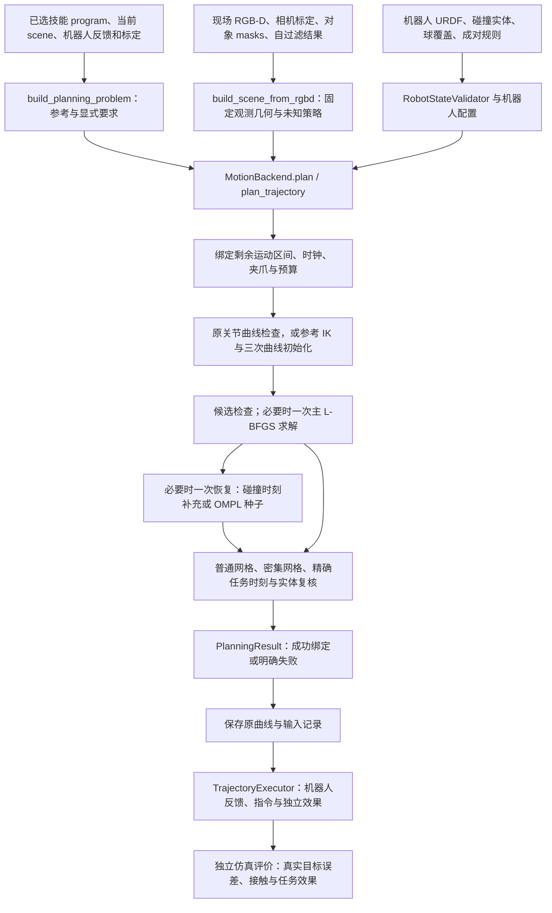

# FUNCTO 当前运动规划器架构

本文描述的代码基线为 **`bc79a78071e464c35ed9839d62595f735ad85465`**，位于本地 `FUNCTO_public` Git 仓库。本文及各组件文档以该提交为实现基准。后续仅文档提交引用这一代码基线；组件实现更新时，同步覆盖更新对应架构。

本文的对象是将一个已经绑定当前场景的技能转化为机器人关节轨迹的计算系统。输入包括技能示教、当前功能区域与目标关系、机器人关节反馈、机器人静态模型、标定、现场 RGB-D 以及显式任务要求。输出为一条通过当前模型检查的关节曲线及其输入绑定，或者带有具体原因的失败结果。`PlanningResult` 描述模型内的规划结果，执行记录描述设备指令与反馈过程，评价记录描述仿真中的物理任务效果。

正文按输入构造、模型建立、数值求解、候选验收和执行绑定组织当前系统。接口与持物改造计划的逐项对应关系集中记录于[架构与计划差异审查](../sim-version-plans/2026-10-19-planner-architecture-audit/plan-comparison.md)。

## 阅读组织与组件边界

| 文档 | 所说明的组件与问题 |
|---|---|
| [输入、参考与任务模型](docs/planner-architecture/01-inputs-and-task-model.md) | 输入从何而来，坐标如何定义，参考轨迹与硬任务要求如何分别生成，任务编译 API 的输入与输出 |
| [观测与碰撞模型](docs/planner-architecture/02-observation-and-collision.md) | RGB-D 分区、TSDF 表示、候选距离场、未知空间、碰撞分项和实体复核的实际关系 |
| [附着、接触与夹爪](docs/planner-architecture/03-attachment-contact-and-hand.md) | 物体如何随夹爪运动，任务允许接触区域如何定义，夹爪指令和名义几何如何区分 |
| [数值求解与搜索](docs/planner-architecture/04-solver-and-search.md) | 请求生命周期、IK、三次曲线、关节可行域、L-BFGS、功能约束、OMPL 和资源预算 |
| [验收、保存与执行](docs/planner-architecture/05-acceptance-and-execution.md) | 候选如何成为可执行结果，绑定保存哪些数据，执行检查与事后评价分别消费什么 |
| [接口契约目录](docs/planner-architecture/06-api-contracts.md) | 按模块逐项解释可调用接口的作用、输入、返回值、前置数据和调用者 |
| [实现符号索引](docs/planner-architecture/07-implementation-index.md) | 对照代码自动提取的精确签名、类型字段、返回表达式及直接调用；含内部函数和工厂内生成的类 |

前六份文档解释数学与计算语义；实现符号索引提供逐函数的查证入口。索引记录 Python 语法树中出现的直接调用；运行分支、动态派发、对象方法的具体实现及原生库内部过程在相应组件章节解释。

## 1. 符号、单位与输入性质

全文采用列向量刚体变换。`T_A_B` 将 B 坐标中的点变换到 A 坐标；矩阵左乘的次序具有实际含义。位置以米计，角度以弧度计，物理时间以秒计。NumPy 位姿通常为 `[...,4,4]`；规划器的 Torch 位姿分别表示为 `[...,3]` 位置和 `[...,4]` 四元数，四元数顺序为 `wxyz`。SciPy 的 `Rotation` 接口使用 `xyzw`，代码在边界处显式换序。

`q` 和 `dq` 分别是具有名称顺序的关节位置和关节速度，数组的第 `j` 列由 `joint_names[j]` 标识。`tool_link` 是运动学模型中的末端连杆；`tool_transform=T_link_tool` 是工具坐标系在该连杆坐标系中的固定标定位姿，将工具坐标中的点变换到连杆坐标；`base_pose=T_reference_base` 将机器人基座表达在任务共同参考坐标中。机器人正运动学先得到 `T_base_link(q)`，再按 `T_reference_tool(q)=T_reference_base T_base_link(q) T_link_tool` 得到任务使用的工具位姿。

规划器同时使用三个参数。源时间是示教记录中的时间；技能进度 `s` 在第 `i` 个参考阶段内取 `[i,i+1]`；归一化执行时间 `u=t/T` 位于 `[0,1]`，其中 `t` 是本次轨迹开始后的物理时间，`T` 是本次轨迹总时长。`_ProgressMap` 保存 `u→s` 的分段关系。事件按原始身份和进度绑定到物理时间，夹爪指令再映射到设备控制步。停留阶段可以让多个物理时刻对应同一技能进度，因此碰撞记录同时保存进度与物理时刻。本文称产生碰撞分项的具体时刻、候选状态和分项身份为“碰撞见证”；恢复步骤据此补充采样时刻。

本文把数据分为观测、声明模型、任务要求和计算结果。RGB-D 与编码器反馈是观测；附着矩阵、机器人模型和未知空间尝试策略是显式声明；目标允许范围、接触区域和时间条件是任务要求；参考路径、逆运动学（IK）解、碰撞候选和规划结果是计算结果。每项输入保留其原始生产者与数据类别，序列化和坐标变换沿用该来源。仿真物体位姿、真实分割、接触和效果评分由独立事后评价接口消费。

碰撞实体 `owner` 由身份、局部几何和位姿构成；对象 `mask` 是 RGB-D 图像中属于该实体的像素分区。机器人 `fixture` 是已知机器人运动学、碰撞模型及标定的集合。请求中的 `ledger` 保存累计规划工作，`continuation` 保存前次执行留下的续接状态。各对象的字段与构造接口见相应组件章节。

## 2. 一次规划请求的完整数据流

图中的箭头表示数据消费关系。已经通过检查的原关节曲线或初始参考曲线直接交付；其余请求在剩余预算内进入优化及必要恢复。独立仿真评价产生结果记录。

| 阶段 | 必需前置数据 | 主要调用 | 产生的数据及下一消费者 |
|---|---|---|---|
| 技能绑定 | 单个技能、源时间、源事件、当前功能关系、当前工具/物体坐标 | `ground_program`；部分入口先使用 `generate_reference` | 参考位姿、功能事件计算和持物时段，供任务编译 |
| 任务编译 | 上项及 `joint_names/start_q/start_dq`、基座/TCP 标定、明确容差 | `build_planning_problem` | `PlanningProblem`，同时保存参考、硬要求、事件和名义附着声明 |
| 机器人绑定 | 已知机器人 URDF、碰撞实体、关节和碰撞对、当前手指 | `RobotGeometryChecker`、`RobotStateValidator` | 独立机器人模型与验证器，供规划入口和执行 |
| 场景准备 | RGB-D、相机内外参、对象分区、自过滤、任务对象身份、未知策略 | `build_scene_from_rgbd` | `OnlinePlanningScene`，供所有候选几何计算 |
| 请求绑定 | 上述对象及预算、可选 continuation/ledger | `plan_trajectory`、`bound_motion_block` | 当前可规划区间、事件时钟、累计工作记录 |
| 数值初始化 | 当前 `q/dq`、参考位姿、机器人模型与固定时钟 | `_CuroboPlanner.reference_seeds`、IK、`fit_cubic_reference` | 固定数量的三次曲线控制参数及失败/缺失记录 |
| 数值求解 | 控制参数、硬要求、场景候选距离、功能约束参数 | `ProcessCostManager.compute_costs`、`PhysicalGradientCore.optimize` | 候选曲线、普通与密集采样的残差 |
| 必要恢复 | 已完成候选的明确碰撞或禁止未知空间分项 | `promote_collision_witnesses` 或 `ompl_seed` | 额外精确采样时刻或新的种子，仍进入同一剩余求解预算 |
| 候选验收 | 同一曲线、同一场景与要求、原生结果 | `select_candidate`、`evaluate_candidate`、`export` | 模型内接受结果；保守球冲突在适用时由源几何复核 |
| 保存与执行绑定 | 已接受候选与检查结果 | `bind_candidate`、`save_curve`、`check_result` | 精确曲线、输入快照、时钟、可执行区间与累计记录 |
| 执行与评价 | 已绑定结果、设备策略、机器人反馈、独立观察器 | `TrajectoryExecutor.execute`；独立 evaluator | 实际运动与事件记录、可续接状态、事后评分；评分不决定继续执行 |

## 3. 几个必须分开的模型

参考路径由示教和当前几何关系生成，作用是提出目标附近的运动形状。`PlanningProblem` 的硬约束来自明确的目标与过程要求。`PosePath` 与 `TransferredPosePath` 表示连续几何参考，机器人可达性由 IK 计算，碰撞由场景与机器人模型联合计算。

当前机器人关节曲线由固定时间轴上的三次基函数表示。优化器调整自由控制参数，入口 `q0/dq0` 由机器人反馈固定。导出的 `JointTrajectory` 使用同一多项式的关节位置和一阶导数构成 `CubicHermiteSpline`，保留原曲线。关节位置、速度和加速度通过连续极值检查；场景碰撞在所列采样时刻检查。

生产场景是 `online_geometry.OnlinePlanningScene`，由当前记录任务入口 `run_recorded_skill.py` 使用。`planning_scene.py` 提供 `CollisionOwner`、`Attachment`、`ContactRule` 等公共数据类型，以及用于独立源几何审计的 `PlanningScene`；`build_audit_scene_from_rgbd` 构造后者。

对于现场物体，截断有符号距离场（TSDF）的已观测单元经分片仿射插值产生零等值面片和负值体积片，本文将这些几何片称为源组件。保守距离场由源组件的空间包围盒产生，提供快速、可微的球查询，其数值语义由包围盒及观测域共同确定。候选球查询出现正冲突量后，状态检查和候选验收等非梯度调用可以使用 Coal 对已登记实体与同一 TSDF 源组件作局部复核。优化器消费可微代理值；实体相交结果、未知空间覆盖和数值查询域覆盖分别输出，并按各自语义参与候选判断。

## 4. 运行组件与依赖

主轨迹优化由 cuRobo V2 的 L-BFGS 执行。项目通过配置扩展、`ProcessCostManager`、`CubicTrajectoryStep` 和 `PhysicalGradientCore` 注入任务计算、入口受约束的三次参数化、关节可行域及功能约束处理。SciPy 提供插值、线性代数、局部投影与几何计算，`quadprog` 求解局部二次规划，OMPL 生成受预算约束的候选种子。

当前 TSDF 场景作为机器人查询的固定目标。运动物体经 `CollisionOwner` 提供局部球覆盖；`OnlinePlanningScene.components` 在其 `geometry_complete=False` 时产生 `unsupported/payload/...` 分项。非机器人 `ContactRule` 消费完整基本体及材料表面的登记信息，`NativeCollisionConfirmation` 使用已登记的完整基本体作为运动作用方。这些类型条件与对应返回状态详见[附着、接触与夹爪](docs/planner-architecture/03-attachment-contact-and-hand.md)。

附着矩阵由调用者提供，经任务编译与场景构造绑定到同一物体身份和进度区间。仓库外实验适配器的参数生产方式及其与当前持物计划的关系记录于[架构与计划差异审查](../sim-version-plans/2026-10-19-planner-architecture-audit/plan-comparison.md)。

执行器检查已接受曲线的绑定完整性、实际机器人关节与速度、指令跟踪、已知机器人模型碰撞及显式独立效果依赖。工具跟踪误差比较同一机器人模型的当前反馈与指令。世界 TSDF 由规划阶段的候选检查消费，执行输入绑定保存其场景记录；执行循环的逐步几何检查由机器人状态验证器承担。末端相对预测目标的位姿误差由独立事后评价记录。

## 5. 文档与计划的关系

当前功能计划位于[抓取前模型复用计划](../sim-version-plans/2026-10-19-grasp-model-support-plan/plan.md)，实际 API 的逐项对照结果见[架构与计划差异审查](../sim-version-plans/2026-10-19-planner-architecture-audit/plan-comparison.md)。组件文档说明指定提交中的计算与接口，阶段计划说明所需变更及实施顺序，差异审查连接二者。已有代码验证记录见[真值边界验证记录](../sim-version-plans/2026-10-19-planner-truth-boundary-audit/validation.md)。

## 6. 持续维护方法

修改组件时，应先确定受影响的输入契约、数据生产者、消费者和返回状态，再覆盖更新相应组件章节和接口目录。新增或删除 API 时同步更新实现符号索引；改变数据含义、时钟或坐标约定时同步改写正文。文档标注对应实现提交，并明确仓库外实验适配器的来源。

代码与架构说明在同一修改交付中维护。文档引用实际代码提交；仅文档提交引用代码内容相同的最近实现提交，并分别说明代码基线与文档提交。阶段性审查记录保存于 `sim-version-plans`，组件的当前架构保存在对应项目中。
