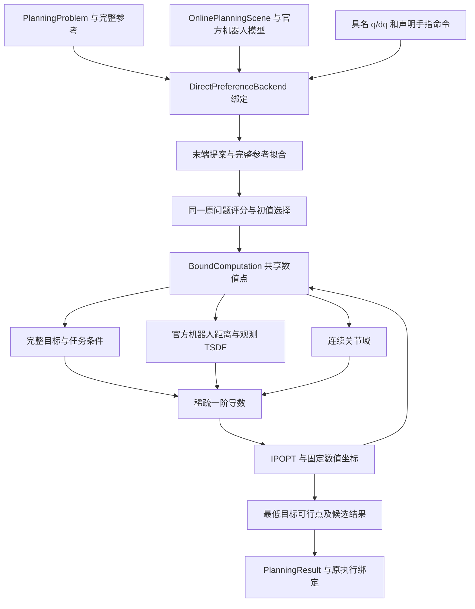

# 直接关节轨迹规划器

`manipulation.direct_planner` 将完整工具参考、具名机器人入口、任务关系和现场观测模型组成一次整段 C² 关节轨迹优化。其公开输出为原 `PlanningResult`：接受的关节/手指曲线、原执行绑定、请求账本，以及能够定位数值失败与几何条件的诊断记录。

库内迁移代码基线为 `e254f61`，候选出口的当前实现将位姿事件精度保存为事后警告。数值来源是独立实验代码基线 `e0245c1`，本组件把其中 25 个计算模块组织为库内包。初始化、目标与约束、数值坐标及 IPOPT 配置保留原计算。模块迁移的独立语法核对记录在 `sim-version-plans/2026-11-01-functo-direct-planner-integration/migration-checks.json`，日期实验记录与原输入对照保存在该独立实验目录。

本组件使用 CasADi/IPOPT/MUMPS 完成数值优化；SciPy 提供有界最小二乘、区间求根及稀疏计算；Pinocchio 提供机器人运动学，Coal 提供官方机器人实体距离，Warp/Torch 提供场批量查询，Numba 编译最近点到关节的一阶导数。FUNCTO 原任务、参考、曲线、连续关节域、声明关系、机器人模型、预算和执行绑定承担各自数据职责。

编译缓存由各数值库及调用方的标准设置管理。`BatchDistance` 调用 `warp.init()`，沿用调用方已有的 `warp.config.kernel_cache_dir` 或 Warp 读取的 `WARP_CACHE_PATH`；库内数值模块不绑定实验目录。Numba 的编译缓存随该模块及运行环境设置保存。

## 计算主线

输入任务和现场模型经后端绑定形成固定物理时钟、曲线基和事件侧。初始化把末端提案拟合到完整参考，按同一原问题的总违反量与目标排序。一个数值点先共享关节状态、连杆位姿和关节导数，再计算完整目标、任务、几何及连续关节条件；稀疏导数交给 IPOPT。求解保留已计算点中目标最低的原条件可行点，候选出口使用其原数值与同一导出曲线形成执行绑定。



全部模块、输入/输出和函数签名见 [API 与实现索引](api.md)。以下各节定义实际计算及相互调用。

## 数据、坐标与时间

`T_A_B` 将 B 中的列坐标变换到 A。机器人 FK 的输出为请求参考系下的具名连杆位姿；`base_pose` 是参考系到机器人根连杆的标定，`tool_transform` 是参考连杆到 TCP 的固定变换。长度为 m，角度为 rad，时间为从本次入口开始的物理秒。关节列由 `joint_names` 定义，滑动关节采用 m。四元数计算采用 wxyz，显示时明确转换为旋转矩阵或角轴。

技能表示保留源区域、原始轨迹、功能坐标、任务点、物体与工具关系、交互及释放事件。调用方读取技能、grounding 功能坐标、声明关系和机器人反馈，并通过原 `generate_reference` 建立完整参考；这些输入由任务装配接口组成 `MotionPhase`、`PlanningEvent`、`SupportRequirement` 和 `PoseEventRequirement`。事件的 `prior/required` 角色与数值尺度由请求中的 `pose_objectives` 显式绑定。普通参考始终作为软目标。

机器人及固定末端配置跨任务复用官方本体碰撞模型，模型形状和组件关系保持注册定义，关节反馈与标定决定其位姿。任务实体和环境采用现场 RGB-D 的 TSDF 标量及其观测支持域。一个附着关系将既有实体表示绑定到事件处的机器人参考连杆；释放后的实体保留首次释放时刻的模型锚点。原示教信息与当前机器人反馈是任务和模型输入；仿真实际运行环境中产生的物体真值、接触与效果由独立评估记录消费。

`_ProgressMap` 连接技能进度和物理时间。`BoundToolReference` 保留原参考组合与入口位置、速度修正。`terminal_clock` 标出参考完成时刻，`bind_terminal_hold` 在原样条系数上消除恒定后缀的自由度。几何查询保留事件精确时刻以及左右关系侧；左右侧的物理时间和关节状态相同，关系与接触许可按原接口取值。

## 请求与初始化

公开入口位于 `manipulation.direct_planner`。`bind_pose_objectives(problem, declarations)` 使用原事件声明接口，将 required/prior 角色和尺度绑定到 `PlanningProblem`。`ReferenceObjective` 显式声明完整参考的位置/旋转尺度、相对权重、工具角运动权重和关节运动权重。`DirectPreferenceBackend(robot, robot_validator=..., budget=..., reference_objective=..., initialization=...)` 持有这些声明及原后端资源，调用 `backend.plan(problem, scene)` 返回原 `PlanningResult`。调用方在请求结束后调用 `backend.close()`。

`initialization` 是原初始化声明字典：`proposal_count` 指定末端提案数，`maximum_evaluations` 指定每个完整参考拟合的函数评估上限，`pose_fit_position_scale_m/pose_fit_rotation_scale_rad` 为提案位姿拟合的数值尺度。任务事件的允许误差由 `PlanningProblem` 自己提供。`plan_trajectory(problem, scene, backend=..., budget=...)` 是同一请求生命周期的显式函数入口；请求账本、取消回调、截止时刻、测量续接和已给定关节参考通过具名参数传入。

前置数据包含完整 `PlanningProblem`、使用原观测/关系接口建立的 `OnlinePlanningScene`、官方机器人配置、`RobotTrajectoryValidator`、具名入口 q/dq 和 `PlanningBudget`。输入文件读取、grounding、现场 TSDF 构建及结果写盘由调用方拥有。场中的 TSDF 数值、支持域、自由空间证据、关系和手指模型继续采用已有库接口；新规划包直接消费这些对象。

`DirectPreferenceBackend.bind_request` 在请求所有权内绑定任务、场景、名义手指模型和求解组件；`plan` 调用 `direct_lifecycle.plan_trajectory`。该生命周期保留累计请求预算、入口诊断、候选选择和执行绑定。传入关节参考仅进入数值初始化，唯一的 optimize 调用也处理零自由度的确定曲线。`DirectPreferencePlanner` 由包内 `DirectSetup` 与原 `_ConstrainedPlanner` 组合，显式持有曲线系数、末段报告与候选出口。当前数值入口由 `DirectPreferencePlanner.reference_seeds` 产生，实测 `q0/dq0` 是原曲线的固定项。`optimize` 对每个实际提供的系数初值调用一次 `solve_trajectory`，返回后由同点候选计算给出数值资格。

`direct_setup.DirectSetup` 接收任务、现场、官方机器人配置、预算、设备及原机器人验证器。`_bind_request_clock` 调用原时钟接口，建立参考节奏、事件时刻、名义手指多项式和具名入口；`_bind_robot_configuration` 使用相同 cuRobo `KinematicsCfg.from_data_dict/get_joint_limits` 取得实际关节顺序及位置、速度、加速度、jerk 界限。该值与原 `RobotStateTransition.get_state_bounds` 的来源相同，原限位 cost manager 只克隆这些数组；物理域继续按原方式将配置的 float32 值转换为 float64。运动代价仍读取原 `trajopt/lbfgs_bspline_trajopt.yml`。官方模型形状和固定关系由场景中的机器人模型保留，当前标定、具名反馈和原模型共同决定 FK。

`_bind_request_computation` 建立原资源预算、在线机器人绑定、入口参考及四阶连续关节域，然后一次构造 `DifferentiablePinKinematics` 并调用包内共同计算绑定。`rebind` 重建本次任务/现场/入口/时钟和计算，保留同一固定机器人配置与关节界限。`_candidate_domain_validation` 对导出多项式调用原位置、速度、加速度及 jerk 极值 API，直接读取 `joint_limits`；`close` 恢复调用方精度设置。初始化的实际数值方法为包内 CasADi FK 与 SciPy 拟合，主优化为 IPOPT，组件生命周期据此保存实际构造和求解状态。

`reference_initialization.SymbolicKinematics` 从 Pinocchio 模型中读取目标参考连杆的祖先关节、固定变换和标量运动子空间，以 SE(3) 指数表达式建立 CasADi FK。`pose/flat/jacobian/sample` 分别返回单个位姿、平移与列展开旋转、它们对具名关节的导数及批量位姿。非目标分支不进入该运动链。`orientation_lift/lift_coordinates/lift_jacobian` 保留关节角半角乘积定义的连续单位四元数，用于分析不同关节路径的整圈转动。

`bounded_pose_fit` 用 SciPy 有界最小二乘产生单个位姿的数值提案。矩阵旋转残差用于平滑求解，报告的位置误差和主值旋转角采用各自实际单位。`event_reference_samples` 从当前关节、关节区间中点和显式随机预算建立末端提案。每个提案通过五次关节连接保留实测入口位置与速度，并在显式事件时间前达到零末端速度和加速度。返回全部样本数组，并记录各提案的末端拟合、归一化关节行程、完整参考误差和累计运动量。`physical_domain.fit_samples` 与末段仿射绑定把每组样本变成原三次曲线系数。

`reference_projection.ReferenceProjection` 接收上述原曲线系数连接、共同状态中的具名关节顺序和名义非优化关节值，并编译一个所有提案共享的稀疏残差函数。完整参考、工具角运动和关节 STATE 项采用 `reference_objective` 的实际定义；当前进度范围内的 required 位姿事件增加原位置、旋转、摆动及转动的归一化几何残差。零宽转动保持 signed-yaw 的弧度残差。`_state_residuals` 保留原配置的边界激活项、速度/加速度/jerk 项及其物理时钟。`component_costs` 输出各残差平方和，以独立 Torch 目标和事件几何核对。

`coefficient_position_box` 利用原局部末段映射中每个完整 B 样条系数仅依赖一个自由行的结构，求出完整系数位于原关节区间的参数盒。其凸包性质为初始化曲线提供位置范围充分条件。`fit` 使用已安装 SciPy 的有界稀疏最小二乘，在这个盒内拟合每个首末连接，记录投影量、残差分项、计算次数和停止状态。主问题继续使用原连续多项式极值域。每次残差和 Jacobian 调用服从原累计请求检查。

`DirectPreferencePlanner.reference_seeds` 随后建立一次 `BoundComputation`，对全部完整参考拟合提案计算原完整目标和原有符号条件。排序键依次为 `sum(max(lower−g,g−upper,0))` 和完整目标值。`fitted_connection_controls` 保留原首末连接；`reference_fits`、`problem_scores` 与 `fitted_proposal_controls` 保存整段拟合及原问题证据；`selected_proposal` 指定本次初值。该排序只选择数值初值；候选资格由主求解出口决定。同一个 `numerical_problem` 继续传入 `solve_trajectory`，其目标、任务、几何、物理域、稀疏结构在初始化与主求解之间相同。初始化计算进入累计请求墙钟和各生产函数计时，实际主求解调用处计入 `trajectory_solves`。

## 曲线、手指与共同状态

原曲线写成 `q(t)=A(t)C+b(t)`，其中 `b(t)` 保留实测入口。`terminal_binding.bind_terminal_hold` 返回末段等式的仿射参数化：`expand` 从自由参数恢复完整系数，`reduce` 在同一参数化中求自由坐标，`pullback` 传递导数。曲线类型、C² 连续性和 Hermite 导出保持原定义。

`nominal_hand_geometry.bind_position_controlled_finger_geometry` 接收原手指指令、条件和事件时钟，构造声明的位置控制模型。已建立的接触/持有区间与释放后的自由手指段分别使用原模型语义；手指编码器、控制目标和持物声明具有各自来源。

`DifferentiablePinKinematics` 封装同一注册模型的批量 FK 与关节导数。`support_linearization.linearized_robot_state` 将 q/dq、名义手指状态、基座标定和 TCP 偏移组合为一个共同机器人状态，同时返回参考连杆 Jacobian。一个数值点的目标、任务和几何共享这批状态。

## 共同目标与任务导数

`reference_objective.ReferenceObjective` 明确声明位置尺度、姿态尺度、相对权重、原关节状态代价倍率和工具角速度平方积分权重。事件拟合尺度由初始化声明独立提供，实际任务事件容差由任务表示提供。`bind` 在原普通物理查询时刻冻结参考值及归一化梯形积分权重；`bind_clock` 为一个明确的候选时钟调用原 `BoundToolReference`。`BoundReferenceObjective.cost` 对平移平方误差和旋转矩阵弦距平方作时间平均。姿态项为 `||R−Rref||²_F/2 = 4 sin²(θ/2)`，以相对四元数的归一化向量部平方计算，正负四元数表示产生相同值；其局部二阶尺度为 `θ²`，在 π 处光滑。硬事件的实际角度容差及事后旋转误差保留原主值角定义。

`trajectory_objective_components` 组合六项：乘显式倍率的原关节运动代价、原任务偏好、显式位姿先验、声明场景关系、完整参考偏好和工具角速度代价。`BoundReferenceObjective.angular_motion_cost` 计算相邻查询姿态的主值相对旋转向量，将其平方除以物理时间间隔与总时长后求和，得到分段旋转速度平方的时间平均。该项的秒平方权重保持显式，梯度通过原共同位姿计算传递。`constraint_weight` 在同一组合点乘一次；当前求解器直接使用这些显式尺度，不按初始目标或初始梯度重新缩放。`scene_relationship_objective` 调用原要求接触和初始支撑关系计算；归一化分母为原查询状态数，关系生效状态由声明时钟确定。

`DirectComputation.shared_context` 建立共同状态，`task_linearization` 调用通用任务 API；`objective_components` 在同一状态上求上述目标。`BoundComputation` 一次绑定固定的任务、几何和物理行结构。`ConstraintEnvelope` 按原注册实体对与声明条件合并几何时刻行：原 gₖ 全部不大于零与组内最大值不大于零等价。每组保留原行身份、全部可能系数列的并集和当前胜出行，`select` 返回最大值，`jacobian_values` 将胜出原行的导数写入该并集。相等时选择原顺序第一行；切换处使用该活动分支的一阶值。原 `GeometryPoint` 仍保存所有时刻、事件侧及区间见证，候选报告直接读取这些未合并数值。`evaluate` 返回 `ComputationPoint`，后者保留目标值、任务行、几何行、关节行以及用于候选结果的独立数值状态。`objective_gradient/jacobian_values` 按需计算一次并缓存；导数消费后释放 Torch 计算图，候选诊断只保留已分离的数值。

`support_linearization.task_linearization` 对现有支撑计算建立解析因子；`SupportLinearization.row_values` 只产生请求的系数列。`normalized_pose_event` 将已声明位置事件写为平方误差除以原容差平方再减一，将全旋转与摆动/有限转动写为等价的四元数弦距条件。零宽转动等式保持原 signed-yaw 值。它只替换任务生产者实际输出的对应不等式，原掩码、行身份和事件容差不变；原任务残差仍用于米制/弧度报告。其他任务项保持原自动微分关系。`SparseTaskRows` 根据原行名称及声明确定实际依赖列；`select_values` 读取同一任务值，`jacobian_values` 将各因子写入固定稀疏槽。`material_hull_indices` 对技能材料点的线性支撑条件取原点集合的凸包索引，保留同一线性极值和未解析仿射厚度。

`SparsePhysicalRows.evaluate` 继续求原三次多项式的连续位置、速度、加速度和 jerk 极值。`PhysicalPoint.jacobian_values` 将实际极值处的导数写入稀疏槽。`SparseRows` 统一行、列和 CasADi CCS 存储；`coefficient_columns` 根据原样条基与具名关节依赖产生列集合。

## 固定批量几何

`GeometryConstraints` 接收共同计算和进度映射。`_query_records` 建立原物理/事件侧查询，`_pair_records` 建立机器人自身、机器人与场、运动实体与场的注册对。`_prepare_materials` 建立一个 `BatchDistance`；活动机器人组件和声明运动的任务实体提供固定局部查询坐标，静态环境只作为被查询的场。固定安装机器人实体通过原生实体对或运动实体对它的查询参与计算。

`BatchDistance` 保留全部原 TSDF 值和支持单元。`PointInventory` 在原单元排除之后去除重复坐标；只含零值边界、没有占据体积的单元不提供源体积样本。任务实体使用原观测材料坐标。`native_volume_points` 对官方机器人原实体内部建立固定局部格点，间距取请求中最小观测体素间距，并保留原可行点和原生凸体顶点。凸体成员关系由原半空间不等式在设备端分块双精度计算，分块成员标记保存在同一设备数组，全部完成后统一回传。原生格点保留少量重复坐标，最大查询值与唯一坐标集合相同，准备阶段省去大型数组排序。格点仅提供同一实体内的数值查询坐标，原实体几何决定其成员关系。

`NativePointQuery` 独立持有注册实体范围，因此固定安装件作为目标时不依赖运动源采样。它对官方注册凸体使用其原顶点构成相同边界的 Warp BVH，对原生 box/cylinder 使用解析有符号距离。凸体边界三角化只针对固定机器人官方模型。`DeviceField.sample` 在 GPU 上计算原 TSDF 三线性标量及支持标记，包含闭单元边界处可用的相邻支持单元；未知支持不被赋予自由空间意义。

`gpu_field.submit_pair_maxima` 接收固定源坐标、两实体的各时刻位姿、原有限接触许可和目标字段或原生实体。`_pair_inputs` 形成 `T_B⁻¹T_A`；世界许可平面 `n·x≤b` 转为源坐标下的 `(R_Aᵀn)·a≤b−n·t_A`，两侧区域的交集及不同区域的并集保持原定义。单个 Warp 核完成源点到目标坐标的变换、许可成员判断和目标标量查询，每个 CUDA 计算块处理 256 个原源点，用 Warp 的 `tile_max/tile_min/tile_sum` 保留块最大值、原最小胜出索引及查询/未知计数，再对小型块结果完成行归约。CPU 按其实际单 SIMT lane 执行同一核。求解过程中不建立整批世界点、目标局部点和多平面投影中间张量。

`BatchDistance.submit` 按源、目标和原单元排除集合组织所有实际查询。原生实体范围与原场标量子水平范围用于排除整行无法产生正违反的状态；`submit_pair_maxima` 在同一刚体关系下排队计算距离及接触许可，小型位姿/许可输入与核使用同一异步流，最大值、胜出索引和支持计数留在设备端。返回的 `PendingDistance` 持有原行数组和有序组结果；`finish` 将所有组的小结果集中一次回传，按原正向/反向顺序和严格大于比较更新见证，再由原标量接口计算胜出点导数。相等值保留原首个胜出点。原生/原生实体对行与场查询行互不重叠，CPU 可以在设备运行期间直接填写同一结果数组。常量尾项为 -1，未知支持保留独立计数。报告中的场耗时为主机提交、结果等待和胜出导数的合计，提交至消费的跨段时长另行记录。

`BoundGeometry` 预绑定每行的当前或首次释放参考连杆、物理样本索引、样条系数和原生实体对表。同一绑定同时保存完整查询时刻、任务/许可进度、位置/速度样条矩阵及官方实体固定偏置；`GeometryConstraints._context` 接收这一绑定和当前系数，复用已算的 FK，仅计算新增物理/关系查询状态。`evaluate` 调用原许可接口决定活动、内部装配或未建模运动状态，执行批量距离，再把刚体导数映射到关节。`evaluate` 先提交 GPU 场查询，再计算独立的 CPU 原生端点和区间驻点，随后消费场结果并完成刚体到关节的导数映射。相同有序查询列和手指不确定性依赖的机器人实体对共用一个 `NativePairTable`；一次调用接受多状态、多实体和多实体对，原行矩阵将结果恢复至各原条件。不同查询时钟或活动规则分别成组。标量区间根查询继续使用各原实体对表。原生机器人自身距离由这一批量接口计算，其米值 d 按观测体素长度 h 映射为 `max(−d/h,−1)`。距离大于 h 的行具有常量值 −1 和零导数；`native_distances_m` 保留截断前的带符号米制距离。该映射的可行集合仍为 `d≥0`，原实体形状和距离零点保持相同。

设源点 `a` 经 `x=T_A a`、`y=T_B⁻¹x` 查询原目标标量 `f_B(y)`，并令 `g=R_B∇f_B(y)`。点值对两实体平移/转动的导数分别为 `(g,(x-t_A)×g)` 和 `(-g,-(x-t_B)×g)`。约束 `-f/h` 按相同因子缩放。导数经对应连杆 Jacobian 和样条基传递；已释放实体使用释放时刻的系数行。

`native_interval_distance.NativeIntervalDistance` 在注册机器人实体对的相邻物理时刻之间查询距离驻点。输入为原曲线系数、端点实体距离、完整具名 q/dq、参考系中的连杆 Jacobian 和名义手指多项式。`_joint_gradient` 调用 `native_gradient.native_joint_gradient`，将原 Coal 最近点法向转换为距离对关节的导数；与同一时刻 dq 相乘得到距离时间导数。两实体的共同祖先关节只产生共同刚体运动，对应距离导数严格为零。 共同祖先掩码在模型绑定时建立。该 Numba CPU ufunc 输入原 12 项距离记录、两参考连杆原点、两组参考坐标 Jacobian 及结构掩码，按原叉积和三项求和次序计算 `−g_A+g_B`，输出完整具名关节列。标量、批次和非连续数组使用同一通用核；`fastmath=False` 保持原浮点运算顺序。编译缓存属于该本包模块，实际模型、FK、距离与求根仍由各原 API 计算。

`NativeIntervalDistance` 从官方实体局部范围调用原 `build_geometry_motion_bound` 建立点速度系数。构造时，相同物理区间共用原样条系数支持集合，相同区间时钟共用原多项式段成员表；实体对的行身份和相对速度系数分别保存。原曲线在各原多项式段的连续速度极值与固定名义手指多项式给出速度范围。每个根区间取与其闭区间相交的原多项式段速度范围，并在相同物理时钟的实体对之间共享；共同祖先项消去后，端点距离和相对速度可排除整个区间位于常量尾项的根查询。优化中的滑动关节若超出这些系数使用的位置域，该试点继续直接查询。包围范围的作用是速度计算，实际几何值来自原实体距离。

`evaluate` 以固定区间数组选择端点胜出和距离导数负到正的区间，再调用 SciPy Brent；同一原曲线的 `polynomial_weights/polynomial_velocity` 在每个系数点组合为物理秒制 SciPy PPoly，所有根查询共享其 q/dq 计算，保留原入口、C² 多项式和时钟。`_at` 用原曲线、同一个 Pinocchio 模型和名义手指 `sample` 得到根处机器人位姿及 Jacobian，再查询相同 Coal 实体。每个区间行取左端点、右端点与内部驻点的最小距离；胜出右端点和胜出驻点分别使用自己的物理时刻、原关节 Jacobian 与样条基。原左端点行承载该区间值，原右端点行继续保留。实际计算范围为原时刻和被括住的距离驻点。初始化、主求解和候选结果使用该同一生产函数。

`GeometryPoint.values/spatial_values` 保留各原现场行与原生区间极小值行。原生区间行的稀疏列覆盖整段原三次多项式支撑，其 `jacobian_values` 使用胜出驻点的样条基和关节导数；距离驻点的时间导数为零，极值包络公式消除根时间变化项。场查询和首次释放实体保留原局部支撑。实体内部有限材料点按同一时刻的最大穿透值归约。`native_distances_m`、`query_times` 和 `interval_winners` 保存实际距离、时刻及区间；最大条件分别标注实际查询身份和固定行身份，网页直接定位实际时刻的空间见证。保存曲线的数值诊断可通过同一已绑定 API 读取原端点和区间证据。

## 数值求解与候选出口

`coefficient_coordinates.coefficient_coordinates` 接收初值点的完整具名关节状态、原样条映射和完整参考尺度，以同一官方机器人模型计算参考残差对关节的 Jacobian。每个自由系数的关节块取 `M = diag(1/joint_range²) + 2 J_blockᵀ J_block`。原物理时间积分、位置尺度、姿态尺度和参考倍率组成 J 的权重；自然关节区间项使工具运动零空间中的数值坐标仍有确定单位。Cholesky 因子的逆给出分块对角矩阵 S，满足 `Sᵀ M S = I`。`BoundComputation.solver_coordinates` 在请求检查之间建立这一个固定变换。块大小与具名关节数相同，原样条在时间上的局部依赖保持不变。

`shared_solver._Oracle` 以精确相等的原系数共享同点值和导数，`_Jacobian` 把固定稀疏数值交给 CasADi。`solve_trajectory` 接收初始化已建立的 `BoundComputation`，以 `C = C_initial + S z` 将 IPOPT 的 z 映射为原系数 C；初始 z 为零。目标、任务、几何和连续关节域都在 C 上调用原生产函数，CasADi 对固定线性变换应用导数链。迭代记录、返回系数和候选点均经同一个坐标函数恢复，报告保存实际块条件数与准备时间。

唯一数值求解器为 IPOPT，线性子问题由 recovery 中已安装的 MUMPS 分解。外部几何提供一阶导数，完整拉格朗日曲率采用 IPOPT 的六对有限记忆更新；目标直接使用显式物理尺度。变量变换只定义数值坐标。原约束界限保持不变，数值约束容差为 1e−9，常规停止精度为 1e−6。库内可接受停止要求整体最优性误差与对偶误差不高于 1、原约束违反不高于 1e−9、互补误差不高于 1e−3、目标相对变化连续三次不高于 1e−3。求解中的任务和场景可行性按原零界限计算。`iteration_records` 为每次迭代保存原不等式违反、完整目标和累计求解秒数，首次原数值可行迭代单独标注；IPOPT 含松弛变量的内部残差属于原生统计。原累计时间、取消和资源检查覆盖回调与生产函数边界。原生 IPOPT 返回后先保存统计，再处理请求中断；失败保存最后完整点和原异常。

`_Oracle.point` 对每个完整点检查原零界限并保存本次调用中目标最低的可行点；`feasible_improvements` 记录实际目标、时间、试点身份和约化系数。求解继续使用声明迭代预算与原 IPOPT 停止条件。`solve_trajectory` 优先交付最低目标可行点；若全部点不可行，则交付末点及其数值失败记录，由候选出口按各条件的职责形成结果。数值收敛状态、库停止原因和选择可行状态分别记录。当前点的状态、原几何结果和全控制系数共同交给候选出口。

`DirectPreferencePlanner.evaluate_candidate` 显式调用 `candidate_result.evaluate_candidate`，读取本次求解保留的同一系数、机器人状态和几何结果。原任务残差给出米制/弧度错误，原 `_candidate_domain_validation` 给出连续关节极值，`_hold_polynomial_report` 检查原终端后缀。`scene_conditions` 计算声明接触、初始支撑、名义手指及运动实体的观测/条件未知区域。该候选出口形成一次原执行绑定所需的验证元数据，并将选中点自己的完整几何报告设为本次导出记录，使网页空间见证与交付曲线相同。几何结论覆盖原有限物理查询与固定局部坐标，关节范围覆盖连续多项式。候选结果直接使用这一计算范围及相应空间见证。

位姿事件的 `function_pose:*` 超限单独进入 `pose_accuracy`：`status` 为 `within_tolerance` 或 `warning`，`residuals` 保留原超限，`maximum_absolute_measurements` 保留每个事件的米制位置与弧度旋转误差，`goals` 保留事件身份、进度与原分量容差。这是候选完成后的精度分析；优化中的高精度名义约束继续由同一任务生产函数提供。正式 `residuals` 和执行绑定 `validation.violations` 使用其余任务、连续关节、入口及现场条件。目标有限且这些条件满足时交付曲线，位姿警告与候选历史一同归档。

`DirectPreferencePlanner._candidate_objective` 在导出曲线的真实时钟上调用同一共同目标。`diagnostic_snapshot` 保存目标声明、几何完成状态、求解和候选记录。`direct_lifecycle.plan_trajectory` 将通过的候选交给原 `bind_candidate/export`；规划事件约束保留在名义曲线中，执行时的关节/模型碰撞及独立任务证据按原执行接口工作。相对预测目标的 FK 位姿误差用于结果分析。


## 调用方式

```python
from manipulation.direct_planner import (
    DirectPreferenceBackend, ReferenceObjective, bind_pose_objectives,
)

problem = bind_pose_objectives(problem, pose_declarations)
objective = ReferenceObjective(**reference_objective_declaration)
backend = DirectPreferenceBackend(
    robot, robot_validator=robot_validator, budget=budget,
    reference_objective=objective, initialization=initialization_declaration,
)
try:
    result = backend.plan(problem, scene)
finally:
    backend.close()
```

示例中的 `problem/scene/robot/robot_validator/budget` 均由调用方按上述数据契约建立。声明中的尺度、权重、数量及预算是当前请求的显式数据。返回曲线的字段、执行绑定格式和实际设备调用由原 FUNCTO 接口消费。

## 验证、计时和结果解释

`tests/direct_planner` 保存独立目标表达式、任务值与导数、连续关节极值、符号/原生运动学、CPU/CUDA 场值与支持域、官方实体距离、空间见证、区间驻点、初始化、累计请求账本及候选出口的检查。测试直接导入本包；测试数据使用库内小型机器人和观测场夹具。

`BoundComputation.produce` 的计数覆盖同一数值问题的初始化评分与主求解。IPOPT 入口计时记录实际值/导数回调；同点共享会把计算计入首先请求它的入口。目标子项包含于目标父项，几何子阶段包含于几何父项。生命周期墙钟分别记录绑定、入口核验、初始化、主求解及候选交付；调用方另行记录输入准备与写盘。

求解器的最优性停止状态、原约束可行性和实际候选交付为不同字段。几何条件对应原查询时刻、有限材料点与被括住的机器人距离驻点；关节条件对应连续三次多项式。完整曲线与参考的全程形态由已归档位姿和中间记录分析。实际物理执行及其事后结果由设备/评价组件产生，规划结果保持自身来源和范围。
