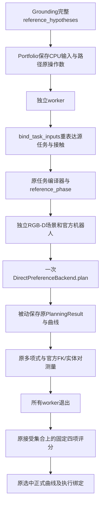

# Grounding参考的独立规划、完成记录与固定偏好选择

代码引用：本组件的正式实现提交由本次合入主流程统一登记；合入前代码基线为 `96ee2dc`。本页描述当前 `planning_request.py`、`planning_inputs.py`、`planning_records.py`、`planning_portfolio.py`、`trajectory_metrics.py` 与 `trajectory_selection.py` 的实际调用。

## 研究对象与数据职责

组件将 grounding 已计算的完整参考候选集转化为各自独立的 `PlanningResult`，在所有分支结束后比较其正式接受集合，交付选中候选原有的关节曲线。候选身份为调用方给出的 `id`；它贯穿源输入、任务坐标绑定、参考表达式、规划报告、曲线、指标和选择结果。功能坐标 F 放置任务区域，工具运动锚点 B 放置完整源工具运动 H_g，E 是该候选的工具交互目标。

源任务的区域、物体与工具关系、接触面、容差、完整轨迹、功能事件和释放事件属于技能表示。当前 RGB-D、标定、具名关节反馈和数学运动关系声明提供本次计算的现场输入。机器人本体及固定末端采用官方模型；其形状和组件固定关系跨任务复用，位姿由标定和具名关节前向运动学计算。任务实体与环境通过当前 RGB-D 建立的 TSDF 及其观测支持域参与同一规划场景。

所有矩阵 `T_A_B` 把 B 坐标映到 A。位置单位为 m，角度为 rad，时间为 s。机械臂关节位置、速度及其导数采用 rad 及其时间导数；当前固定机器人的棱柱手指采用 m 及其时间导数。源绝对时间、技能进度和本次保存曲线的物理时钟分别保留。

## 公共输入与坐标绑定

`plan_grounding_hypotheses(grounding_result, planning_request)` 消费 `grounding_result.reference_hypotheses`。每项提供 `id`、完整 `reference`、`T_world_function`、`T_world_tool`、`tool_reference_anchor_world` 和 `source`。`reference` 保留 `eef_path`、其原节点与源时间、帧身份、边界和全部源事件。共享 `generate_reference` 已将 B 与 F 分别作为工具运动和任务几何的操作数。

`planning_request` 的字段及职责如下。

| 字段 | 实际输入与消费者 |
|---|---|
| `skill_id` | 本次任务实例身份；原任务编译器、事件和执行绑定共同使用 |
| `task` | `program`、源 `scene`、源 `contact_bindings`；`bind_task_inputs` 保留原任务声明并重表达坐标 |
| `task_binding` | 当前 `owner_id/owner_role`、`T_world_owner`、源 `L_source_owner_region`、`T_task_owner_source_owner`、解析材料行 `current_material_contacts`、当前 typed `scene` 和 `source`；其他接触实体以 `other_contact_owner_bindings` 显式给出 |
| `feedback` | 本次入口的完整具名机械臂/手指 q、dq，当前命令、标定、工具身份、反馈身份和物理时刻 |
| `capture_feedback` | 图像采集时刻的具名机器人反馈；只用于图像自过滤中的机器人几何放置 |
| `observations` | 具名相机的 `image/depth/K/T_output_camera/owner_masks` 与可选 `background_mask`；值为已加载的 CPU 数组 |
| `robot_fixture` | 当前固定机器人官方配置、具名关节与工具、设备间隔及机械范围 |
| `finger_targets/execution_limits` | 原独立手指命令值和执行物理合同；手指参考在后端确定的同一时钟上构造 |
| `mapper/unknown_policy` | 显式中心、范围、分辨率、深度误差、自过滤参数和未知区域策略 |
| `budget` | 原 `PlanningBudget` 字段；两个分支分别得到相同的工作和时间额度 |
| `resources` | `torch_memory_mib/torch_cpu_threads/planner_cpu_threads/mapping_memory_mib/max_host_rss_bytes/max_device_used_bytes`；父进程与子进程共用整批主机和设备范围 |
| `reference_objective/initialization/pose_objectives` | 原直接规划器参考尺度、初始化声明及显式任务目标角色 |
| `calibration` | 跨候选集固定的四项指标、单位、方向、参考值、改善区间与偏好权重 |
| `output_directory` | 本次独立结果根目录；每个候选保存到同名子目录 |

可选 `observed_owners` 引用关系建立前已有观测场及其声明关系；`inherited_initial_state`、`fine_regions`、`continuation`、`rebind` 和 `request_ledger` 分别延续已有场景、观察细化和同一任务请求账本。各字段继续由其原生产接口解释。

`bind_task_inputs` 对抓取使用原数值顺序：

`mapping = inverse(T_world_owner) @ F @ inverse(L_source_owner_region)`；

`relocation = mapping @ inverse(T_task_owner_source_owner)`。

`T_task_owner_source_owner` 将源技能 owner 坐标映到原任务接触声明所用的 owner 图表；原抓取输入中的该值就是 `source_scene.region_transform`。相同角色在所有表示中共用这次坐标绑定。

原接触区域的 `patch_origin` 与 `patch_axes` 分别受 target owner 的 relocation 刚性点变换和旋转作用，区域尺寸、间隙、法向容差、事件和激活区间保持源声明。机器人材料行使用当前官方 TCP 特征；非机器人材料行保存源 actor 图表内的任务特征，使用 actor 自身的 `T_current_source` 变换点、法向和已声明的线性映射，并绑定当前 actor 身份。目标 patch 与 actor feature 分别使用各自实体坐标。原 `build_material_contact_rules` 统一组成 `ContactRule`。独立目标通过原 `grasp_goal.T_carrier_eef = inverse(T_world_owner) @ E` 进入原任务编译器；原任务精度保留。完整工具参考通过 `reference_phase` 进入规划，不再额外叠加 `grasp_reference_prior`。

对于 manipulation，当前 typed scene 显式提供 A、J 对应的材料关系、机构坐标、支撑或内部空间以及功能事件绑定。区域所属实体的完整功能帧经相同 mapping 重表达；各功能事件的当前 carrier/reference 身份与 scene 同步，原事件身份、source 和允许集合保持原声明。标量机构沿其已声明的坐标与模型接口计算。`reexpress_contact_bindings` 使用显式源 owner 到当前 owner 的图表变换，因此多实体接触使用同一接口。

## 单请求装配与生命周期

`planning_request.bind` 先调用 `bind_task_inputs`，再调用原 `build_planning_problem`。原任务编译器产生独立目标、允许集合、附着、过程关系和事件；共享 `reference_phase` 提供完整连续路径，并合并该阶段的原任务元数据。源时间映射继续由生成参考的 `eef_timestamps` 和原连续路径进度定义。

`planning_request.plan` 为当前候选创建官方机器人验证器、自过滤、独立设备手指参考、观测 TSDF、支持域及 `OnlinePlanningScene`。采集时刻 feedback 决定图像自过滤中机器人几何，入口 feedback 决定规划 q/dq；两者的来源和时钟分别归档。`DirectPreferenceBackend` 接收原 `ReferenceObjective`、初始化声明和请求预算。其 `plan` 通过被动归档器调用一次，`close` 在本次调用结束时释放该分支模型。

`planning_inputs` 保存原通用手指、反馈身份和观测 owner 绑定函数。手指命令与几何继续使用后端确定的同一设备量化事件时钟，原始语义 mask 与实际 TSDF 融合 mask 分别保存。记录式 CLI 在自己的文件边界解析路径，随后复用这些生产函数。

## CPU 文件、进程隔离与资源范围

`planning_portfolio.save_inputs/load_inputs` 将 NumPy 数组保存为不压缩 NPY，以原 dtype 和二进制数值恢复；`PosePath.to_record/from_record` 保存并恢复连续父路径、材料旋转偏移和机构原操作数。每个工作进程重新创建原生对象，具名文件是分支间的只读输入。

父进程先准备完整候选集，再启动所有独立 worker。各 worker 完成自己的任务编译、场景准备、一次后端调用和指标计算。父进程等待所有进程实际退出，再形成统一比较。某分支返回接受结果不会终止另一分支的职责。各分支具有自己的工作账本、优化器、机器人 data、几何查询缓存、释放历史和候选证据。

父进程以显式进程树根统计总 RSS，以 `nvidia-smi` 统计整张设备的已用内存；两秒采样一次。单次请求中的原资源准入也绑定该根，包含父进程和兄弟工作进程。主机上限为调用方声明且至多12 GiB，整卡上限至多10 GiB。超出资源范围时停止并回收仍在运行的 worker，已形成的正式记录继续保留。

## 完成记录及原曲线身份

`planning_records.plan_and_record` 调用后端一次，保存其原 `PlanningResult`。正式曲线保存为 `planning/trajectory.npz`，拒绝诊断曲线保存为 `planning/diagnostic-trajectory.npz`，缺失曲线保持缺失。原完整候选证据经 `evidence_archive` 共享归档，原累计请求账本单独保存。`save_curve` 保存同一 q/dq Hermite 多项式、手指多项式、事件、进度映射和执行绑定。

`load_curve_archive` 恢复同一个多项式与事件时钟；`load_planning_result` 恢复生产者原 success、诊断、执行绑定和请求账本。选中结果直接引用该分支的正式曲线。工作进程的早期导入、输入装配、规划和指标异常均保存实际阶段、原异常与已完成证据；进入 Python 主体前退出的进程由父进程标为 `preimport`，原日志保留。

## 轨迹测量与固定评分

`trajectory_metrics.measure` 消费完成结果、原保存曲线、同一机器人配置和反馈。它保留原总代价 J，并计算以下量。

| 指标 | 实际计算与范围 |
|---|---|
| `original_objective` | 原规划器保存的 `fixed_objective`，包含该假设自身参考项与原其他目标 |
| `minimum_joint_position_margin_rad` | 保存机械臂三次多项式每段端点及全部实驻点到原关节上下界的最小余量 |
| `minimum_required_robot_pair_clearance_m` | 官方机器人所有 `required_pairs` 在1001个均匀时刻、原节点与原场景见证时刻的查询，并对已括定局部极小值作原标量细化 |
| `tool_rotation_length_rad` | 保存关节曲线在相同测量时刻经官方 URDF FK 所得工具旋转，累加相邻 SO(3) 测地角 |

位置、速度、加速度及分段 jerk 的连续极值和平方积分使用原多项式计算。工具位置弧长及累计旋转采用上述明确采样。required-pair 间隙只描述官方机器人实体对；原任务 TSDF、未知支持和混合归一化残差另外保留各自含义。`metrics-arrays.npz` 保存测量时刻、全部工具位姿和原机器人实体对距离，供独立结果显示消费者使用。

`trajectory_selection.select` 仅按原 `PlanningResult.success` 定义正式接受集合。第 i 项分数为 `weight_i * cost_sign_i * (value_i-reference_value_i)/improvement_interval_i`，使用固定改善区间。每个候选均保留完整分项；候选次序和子集变化不改变同一轨迹的数值。位姿精度 warning 仍为原诊断。

唯一最小项产生 `selected`；全部精确最小项产生 `tie_requires_user_choice`；无正式接受项产生 `no_accepted_plan`。已接受但指标计算未完成时保存原接受身份并返回 `incomplete_metrics`，同时保存失败现场。worker 失败、预算不足和资源中止分别保留原状态，并在比较中列出未完成的覆盖范围。

## 公开 API 与实际调用

| API | 输入及输出 |
|---|---|
| `planning_request.reexpress_contact_bindings` | 源接触、官方材料和实体图表关系 → 当前原数值接触声明 |
| `planning_request.bind_task_inputs` | 单个 F/E/B 身份和源/当前任务声明 → typed program、scene 和接触 |
| `planning_request.bind` | 完整候选参考与请求 → 原 `PlanningProblem` 和来源记录 |
| `planning_request.plan` | 候选与请求 → 一次后端产生并已归档的 `PlanningResult` |
| `planning_records.plan_and_record/save_curve` | 一次原结果与执行合同 → 正式/诊断多项式及原证据档案 |
| `planning_records.load_curve_archive/load_planning_result` | 原档案路径 → 同一曲线及同源结果 |
| `planning_portfolio.save_inputs/load_inputs` | CPU 观测/关系和路径表达式 ↔ 具名数值文件 |
| `planning_portfolio.plan_grounding_hypotheses` | 完整候选集与共同任务请求 → 所有分支、比较、选择和原选中结果 |
| `trajectory_metrics.measure` | 完成结果和原曲线 → 固定四项值、全程描述与机器人几何见证 |
| `trajectory_selection.metric_values/score_metrics/select` | 完成指标与固定标定 → 分项成本及完整选择状态 |

## 核对依据

`test_planning_portfolio` 检查连续父路径节点间圆弧、数组二进制恢复、源任务 F 与工具锚点 B 分离、原任务数值容差、连续关节内点极值、固定评分的子集/顺序不变性、精确并列和早期失败无曲线记录。`test_planning_request_relations` 将完整功能帧、标量机构和有限支撑输入交给实际任务编译器，核对独立 actor/patch 图表、当前实体身份、源精度、机构目标和支撑几何。原 `test_reference_planning_handoff` 继续检查完整源轨迹、非节点事件、旋转杆臂与机构标量插值；原归档和请求账本测试检查后端调用次数、诊断来源、正式绑定和累计工作。真实观测模型重放与并行规划记录属于对应阶段实验交付。
