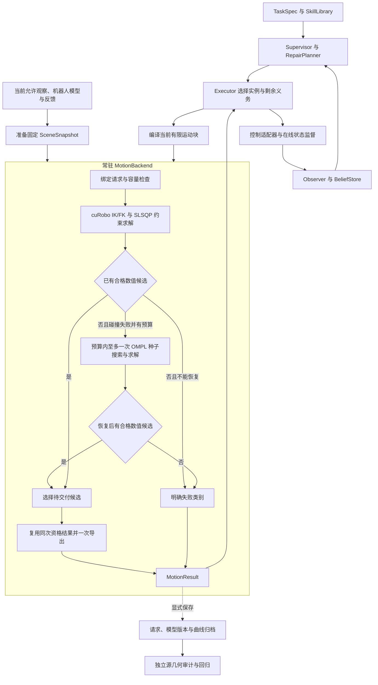

# FUNCTO Motion Planner PRD

<!-- BEGIN 共享约束求解与当前实现说明。 -->
**共享运动后端为 TaskFlux 的非单调进度与恢复提供有限、可解释的运动服务：常驻 IK/FK、有限运动块、统一物理约束和一次结果交付。实际任务事实由执行反馈与观察决定，详细源几何链只作为独立审计工具。**

本文规定共享运动后端的架构与运行合同。当前实现见 [README 的运动规划与执行说明](README.md#robot-motion-planning-and-execution)：cuRobo 提供 IK/FK，SciPy SLSQP 联合求解 `PhysicalCurve` 与 signed 场景约束。§10 对应现有模块职责；性能门槛与实际测量分别记录。

生产只使用这一套曲线、场景和数值资格合同。详细源几何工具独立调用，不作为兼容层、生产模式开关或失败后的自动回退。历史文档与旧测试不增加本文之外的隐含准入条件。
<!-- END 共享约束求解与当前实现说明。 -->

## 1. 研究范围与职责

### 1.1 服务于剩余任务，不接管任务决策

TaskFlux 的主线是：外部变化后，根据当前事实和完整剩余要求重新判断有效进度；接纳正向收益，处理负向变化，必要时通过 SkillLibrary 中已有技能撤销仍然正确但阻碍接续的中间成果。[全局职责说明](../2026-09-21-taskflux-reading-notes.md)

这里的**任务进度**是当前证据支持哪些接续选择，不是阶段序号、历史完成步数或运动曲线参数。运动后端只求解已经选定技能的当前运动块，不组合额外技能、不发明库外动作，也不预先保证后续技能一定可达。下一技能被选中后，从当时真实状态重新绑定。

不训练 policy，不新增触觉设备、精密装配研究或新的碰撞引擎。使用已有 cuRobo V2、OMPL、SciPy 和现有几何/控制适配；MoveIt、Tesseract 等只作为接口设计参考，不增加依赖。所有环境操作沿用 `recovery`，运行命令默认 `PYTHONNOUSERSITE=1`，不自行安装库或修改 editable 三方源码。

| 组件 | 输入 → 输出与职责 | 边界 |
| --- | --- | --- |
| Supervisor / RepairPlanner | 当前事实、剩余要求、技能库 → 继续、跳过、等待或库内修复选择 | 不枚举关节种子、不控制轨迹细化 |
| Executor | 已选 SkillCall、当前绑定、实际事件 → 运动块、设备命令、执行事实与剩余义务 | 管理技能内接续与显式同目标重试，不把整段任务历史交给求解器重新证明 |
| MotionBackend | 当前运动块、固定场景、机器人状态与预算 → 轨迹或明确失败 | 只判断登记模型内的运动有效性，不发布 Holding/Supported 等事实 |
| Observer / BeliefStore | 带时刻和来源的真实观察 → T/F/U 与受影响关系 | 规划成功、命令下发、曲线完成不能覆盖观察 |
| 独立审计/评价工具 | 保存的模型、请求、曲线或实验实际结果 → 几何差异、回归证据与评分 | 不自动进入生产控制或修复决策 |

上表中的 TaskFlux 任务层名称表示既定架构职责；当前仓库尚未提供完整 Supervisor、RepairPlanner、BeliefStore 运行实现，不得把本规范视为这些组件已接通的证明。FUNCTO 当前已有技能、规划、执行及实验适配逻辑。

### 1.2 目标运行结构

<!-- BEGIN 同一求解与交付路径。 -->

<!-- END 同一求解与交付路径。 -->

`MotionBackend`、`SceneSnapshot`、`MotionRequest`、`MotionResult` 是职责简称，不要求新增同名框架。优先收敛现有 `PlanningProblem`、`PlanningScene`、`PlanningResult` 与执行绑定，不平行维护两套大格式。

## 2. 运动块、任务要求和输入契约

### 2.1 请求单位

一个 **SkillCall** 是 Executor 对一个已选技能的本次调用；一个**运动块**是其中能够在当前证据与时间关系下联合求解、授权执行的运动范围。一条 SkillCall 可含多个运动块，但本身的原始义务、累计等待和实际效果不能被切分抹掉。

运动块边界来自真实事件和约束依赖，通常可以在需要新抓持、释放或重新观察证据的位置结束。纯参考阶段、每个示教 waypoint 或固定一秒间隔不自动产生新请求。

若跨候选边界存在非零速度连续性、不可中断的过程关系或真实时间耦合，应联合求解，不能为了缩小问题增加停车点或改变任务时序。若后续又确实依赖未知事实，须能在原声明允许的位置取得证据或合法停止；两者不相容时返回具体时间/执行能力冲突，不能先无条件授权后缀。

复用 `next_verification`、`executable_until`、原事件和真实 continuation 表达边界。可以保存条件后缀，但必须另列它的验证与授权范围，不能用前缀成功标记整 skill 合格。此条替代旧版“一次请求必须联合规划完整 skill”的统一规定。

### 2.2 六类输入及共用绑定

| 内容 | 现有承载与用途 | 必须保留的语义 |
| --- | --- | --- |
| 当前状态 | `PlanningProblem.start_q/start_dq/joint_names`、实际手指与控制状态、base/TCP 标定 | 从真实入口开始，不清零非零速度、不对称化手指、不改入口迁就参考 |
| 功能目标与允许集 | `pose_events/coordinate_events/supports/interiors` 等 | 保留自由度、精度、作用对象及事件；不收缩为首个名义位姿或任意六轴小框 |
| 必须保持的过程 | `pose_relations/mechanisms/couplings` 及区间要求 | 保留机构限位、方向、圈数、持续接触、内部/支撑等原始含义 |
| 当前几何关系 | 场景 owner、有限接触规则、附件、夹爪状态与策略 | 指定何时、哪个部位、哪个对象、什么范围有效 |
| 事件与真实时间关系 | 原事件身份、命令、条件、硬时限与已发生记录 | 区分源时间和真实任务时限；不重放已经消费的同一次事件 |
| 参考运动 | `MotionPhase/PosePath`、源时间与来源 | 用于初始化、必要的软偏好和偏离诊断；普通参考不是逐点硬约束 |

共用绑定还包含：请求/SkillCall/运动块身份、场景与模型版本、当前证据及有效范围、原始要求标识、预算和取消代次。版本用于识别同一输入，不要求内容哈希或新增配置服务。

<!-- BEGIN 任务语义与物理资格分别消费。 -->
每项 requirement 必须在编译时映射到**名义目标/过程残差、设备物理约束、场景许可/观察诊断、实际证据义务**之一或明确列出的组合，并说明消费模块。无法映射必须返回具体缺项或能力冲突，不能静默忽略。参考和诊断不通过改名成为必要要求。

名义位姿、放置、支撑及机构过程保留原作用对象、区间、自由度和残差，进入运动目标与质量报告；它们的预测误差不独立否决物理合格曲线。具名关节位置/速度/加速度/jerk、`JointCoupling`、显式 stop 及已登记场景/控制器要求进入共同物理约束。仅启用现有动力学配置时，`ConstrainedTrajectory` 还加入 effort 界（转动关节 N·m、移动关节 N）；未启用时不声明已校核力矩或力。实际任务是否完成仍由执行事实和独立效果证据判断。
<!-- END 任务语义与物理资格分别消费。 -->

<!-- BEGIN 参考语义不新增物理门槛。 -->
### 2.3 参考、机构与容差

- pre-grasp、approach、retreat 可以保留为参考阶段；不计算固定偏移 pregrasp pose，不要求来源帧或阶段末位姿作为必经点。退回只有在明确要求离开接触或清出区域时才产生功能义务。
- 细分、合并、改名或增加普通参考采样，不得改变目标集、事件、停止要求、请求划分及验收容量。真实功能事件和危险区间的检查点不属于可随意丢弃的普通参考。
- 当前机构坐标必须明确零点、正方向、绝对目标或相对入口增量，以及需要的展开分支/圈数。净位移方向、区间单调和局部速度方向分别表达；模 `2π` 终点不能代替完整转动过程。
- 未约束轴不补目标；保留名义要求原含义，物理约束须共同满足，冲突不平均、不放宽。目标成员搜索失败不能证明整个允许集无解。
- 任务允许集、设备物理限制、模型近似/接触误差、数值容差及采样分辨率分别记录。碰撞激活距离是优化引导参数，不自动变成硬净空；球外扩和粗体素误差不能转嫁为任务接触容差。
- `T_parent_child` 将 child 坐标变换到 parent；平移用米，关节按类型用弧度/米，四元数顺序在库边界转换。源帧、数组索引、源秒、曲线进度和执行秒不得混用。

参考 IK 不收敛只表示未找到该初始化；失败解不能标为成功 waypoint 继续传播，也不能据此否定实际目标。目标及必要过程由现有技能/绑定步骤提供，本文不新增“自动从未标注演示识别所有必要语义”的研究前提。
<!-- END 参考语义不新增物理门槛。 -->

## 3. 固定场景与统一在线几何

### 3.1 `SceneSnapshot` 的含义

它是一次求解使用的不可变场景视图，至少固定：观察身份与时刻、坐标标定、owner 分区、已观察/自由/占据/未知信息、各对象在线几何、附件及释放假设、操作区分辨率和查询有效范围、机器人覆盖模型版本、有限接触与未知策略。

求解中不能因姿态轻微变化重新建图、添加 TSDF 组件或改变粗细层选择。新观察形成新版本，相关假设失效使旧结果授权撤销；世界并未因 snapshot 固定而冻结，无关对象更新也不应无差别废弃当前绑定。名义附件共同运动不伪装成新的测量，物体移走的区域不自动变成观测自由区。

### 3.2 各对象的生产表示

<!-- BEGIN 完整实体与观察场明确分工。 -->
| 对象 | 在线表示与查询 | 不属于生产热路径的工作 |
| --- | --- | --- |
| 机器人及已知安装件 | 登记的完整机器人实体与具名碰撞对，Pinocchio FK + Coal signed distance；球仅用于观察 ESDF 查询 | 请求内重新拟合球、对环境逐片源实体扫描 |
| 已知完整场景实体 | 由同一 native collision model 查询已支持的完整几何；保留组成、身份与坐标 | 将凹实体或薄/空心材料无条件替换成凸包 |
| RGB-D 背景与 owner | Mapper GPU 距离场及项目保留的观察有效性/自由空间数据，按 owner 分开 | 为正常请求构造、索引并枚举数万 TSDF 凸片 |
| 附着物 | 完整登记实体参与 native 查询；球覆盖用于观察场，按附件/释放模型变换 | 把遮挡部分当不存在，或用未来抓取结果提前挂载 |
| 操作区域 | 请求准备阶段选定的固定细分辨率数据与有限交互区域 | 求解中反复细化、因查询失败静默退回粗图 |
| 详细源材料/表面组件 | 独立审计输入 | 自动回灌 IK、metrics、交付检查或执行循环 |
<!-- END 完整实体与观察场明确分工。 -->

本地已有 cuRobo SceneCollision/Mapper、SciPy 曲线及几何适配可复用。公开 `SceneCfg` 有某种形状类型不等于所有原生碰撞存储都直接支持该形状；必须核对实际消费者。当前公开 voxel 距离输出也不自动提供完整自由/占据/未知语义，见 §11。

### 3.3 操作区和机器人模型的准入

<!-- BEGIN 固定查询支持不等于覆盖拒绝门槛。 -->
操作区由当前对象、机器人与载荷包络、距离插值支撑范围共同准备，包含实际会靠近目标的掌部、腕部、前臂和附着物。一次求解使用固定的区域与查询规则。观察场范围之外没有碰撞测量，必须保留 invalid/unknown 诊断，不得补成自由空间，也不在求解内切到粗场或扩图。缺少请求必需的登记模型、数值输入或观察来源应报告具体输入缺项；单纯观察覆盖缺口不自动升级为实体碰撞或曲线拒绝。
<!-- END 固定查询支持不等于覆盖拒绝门槛。 -->

分辨率不统一拍定为 1 mm，也不允许用 15 mm 粗场裁决无法表达的接触间隙。设备/场景配置验收必须说明几何外扩、有效支撑和近似误差是否能表达声明的任务允许集，并用已有近桌面、掌腕、目标移动/旋转正反例检验。不能把 voxel size 直接声称为表面精度。

机器人覆盖修正属于共享配置工作，使用原实体与已有近障案例离线确认，之后所有技能共用。禁止在线缩球、删碰撞对或靠接触让步吞掉代理外扩。若预算内可用模型不能同时覆盖原实体并表达任务间隙，返回 `UNSUPPORTED_MODEL`；不能宣称换回粗球场已经解决原误拒。

<!-- BEGIN 注册实体距离与观察场共用一个场景合同。 -->
机器人、已知安装件和完整场景实体由 `native_collision.NativeCollisionModel` 直接查询 signed distance。机器人实体使用同一 URDF 的 Pinocchio FK；Coal 返回分离/穿透距离及其导数。已登记实体对只保留这一条碰撞判据，优化、候选资格及 OMPL 使用相同几何、变换和配对策略；球重叠不能为该对增加第二次否决或触发另一条清除链。

`FrozenESDF` 是观察几何的近似距离场，保留球查询及有效性。registered solid 与 observed field 是两种明确的模型语义，不能把保守代理的可能碰撞声称为已登记实体确定相交。`signed_constraints` 分别返回 signed slack、valid、结构固定/变量槽以及固定输入失败；当前梯度为零不构成结构固定的证据。无有效测量的零占位不表示净空，ESDF 的有效零距离也不表示自由空间。

有限权限在请求绑定时映射到完整登记部件；只选中部件一部分的声明不能扩大为整部件豁免。未知未来手指位置保留模型不确定状态，已知手掌、手臂和安装件仍按原配对检查。场景检查只覆盖声明的有限采样，不构成连续时间或未观察空间安全证明。完整源组件枚举与覆盖布尔证明保留为独立审计。
<!-- END 注册实体距离与观察场共用一个场景合同。 -->

### 3.4 自由、占据和未知分别处理

几何中的 F/O/U 分别是观测自由、占据、未知；任务事实中的 T/F/U 是成立、不成立、未知，两者不是同一个三值变量。

<!-- BEGIN 观察状态是诊断而非碰撞事实。 -->
在线查询分别保存模型碰撞余量、查询有效性与观察覆盖诊断，并说明有限模型范围。有效观测 mask 不是自由空间；距离缺失、零占位或查询超限不能当作无碰撞证据，观察缺口也不能当作确定碰撞。

当前运动后端根据有效场景查询求解，观察缺口不另设全局硬否决。任务层可以依据实际依赖决定补充观察；允许继续尝试不产生自由空间证书或实际效果 T。真实入口机器人占据体只说明该登记状态下机器人所在范围，不证明外部邻域、未来附件或卸载区域自由。
<!-- END 观察状态是诊断而非碰撞事实。 -->

### 3.5 同一套语义，不要求同一种查询输出

<!-- BEGIN 共同物理向量复用。 -->
优化需要 signed slack 与导数；候选资格复用同次完成的规范向量，OMPL 消费相同模型的状态/边结果；完整实体对与源组件证据属于审计。各规划接口必须使用同一版本模型、权限及适用范围。执行器核对规划绑定身份和当前设备、任务证据，不重新查询冻结世界，也不另设一套几何许可。
<!-- END 共同物理向量复用。 -->

布尔查询不附带求整个世界精确全局最近距离的义务。Tesseract 的 FIRST/CLOSEST/ALL 区分可作为接口职责参考，不据此引入该库，也不把其性能数字当作本项目性能。[官方查询类型](https://tesseract-robotics.github.io/tesseract/collision.html)

<!-- BEGIN 机器人自碰不追加出口判定。 -->
机器人模型自碰已在相同 native signed 场景中参与求解与资格，不另加出口自碰确认。实际执行的 `RobotStateValidator` 独立消费当前关节反馈及登记实体对，不通过这一职责绑定冻结世界或恢复源场景审计。
<!-- END 机器人自碰不追加出口判定。 -->

## 4. 有限接触、附件与实际效果

### 4.1 接触许可的最小完整契约

每条规则必须固定 actor 的有限材料部位、target owner、有限目标区域、适用事件/区间、相对法向/方向、间隙范围、建模让步及 `required`。机器人机械接触、原生碰撞过滤和本次任务许可分开登记。

<!-- BEGIN 有限权限按声明模型解释。 -->
在线适配保留 owner、部位、区间和材料身份。完整实体权限必须映射到完整登记部件，部分部件选择报告能力冲突，不能扩大到整 link 或整 owner。观察 ESDF 权限按原声明球子集和目标生效，明确其近似范围；这不证明球内材料的精确布尔差集，也不证明真实接触。区域、方向和间隙的名义要求保留在任务表达及目标残差中。
<!-- END 有限权限按声明模型解释。 -->

有限区域的交叠/包含要求按原规则解释：不是只检一个中心点，也不统一要求整个指垫必须完全位于目标小区域内。必要的点、边、面及坐标关系可复用现有数值计算；不再为每个材料点枚举整个观察 owner 的凸片。

<!-- BEGIN 接触意图与实际效果分开。 -->
**允许接触**不要求必须触碰；`required` 保留指定时刻/区间的名义接触要求，不能从权限激活反推它已满足。目标残差保留原语义和观察/模型来源；负体积封帽、抽象区域重叠或整 owner 距离为零不能成为实际接触证据。是否真实抓稳、释放或形成支撑，仍需实际反馈和观察。
<!-- END 接触意图与实际效果分开。 -->

建模让步保留原材料界限：`0 ≤ modeling_allowance_m ≤ geometry_error_m`，且 `modeling_allowance_m < minimum_thickness_m / 2`。数值位置/转角容差独立，不用 epsilon、球外扩或机器人跟踪容差替换这些界限。零让步可省恒零运算，不能省规则本身的方向、范围和必要接触语义。

### 4.2 替换旧整夹爪许可

<!-- BEGIN 有限许可与永久执行边界。 -->
整夹爪—目标整对免碰不作为默认权限。技能绑定使用有来源的有限部件/区域规则；权限只改变所声明模型对的查询范围，不发布接触或任务完成事实。

末端相对预测目标的位置/姿态误差仅用于独立仿真事后评价。关节编码器经 FK 后与冻结预测目标相减，不是独立测得的真实末端—目标关系，不能要求“到达才闭爪”，也不能据此拒绝继续执行、触发停止或要求重规划。缺失目标位姿、目标到达时间窗不能间接恢复这一门槛。close 按原事件时钟和当前独立依赖执行；在线关节限位、速度、登记机器人模型碰撞及独立任务效果证据各自保留。普通移动闭合不被改成全段静止。
<!-- END 有限许可与永久执行边界。 -->

不得直接采用 `plan_grasp` 的固定 approach/lift 偏移与 link 碰撞关闭来替代这些语义；该 API 的便利操作比本项目有限许可更宽。未知手指几何也不能自动激活一条确定材料位置的许可。

### 4.3 附件与释放

入口已确认的 Holding 附件与当前技能未来交互后才成立的候选附件分别保存。名义附件按声明区间参与载荷运动检查，不提前挂载，也不要求执行前证明未来抓取已经成功。

释放事件可切换候选的预期物体模型，但 open 下发不等于实际已释放。当前事实和执行依赖由真实反馈更新；明确否定附件假设后不得继续使用失效模型。名义释放位姿要从完整相关事件历史得到，不能用分块检查的局部第一帧替代。

若某技能确实需要任意观察凸片上的精确区域布尔运算，而现有有限在线表示无法表达，编译/登记阶段返回 `UNSUPPORTED_CONSTRAINT`。不忽略要求、不偷偷放宽，也不自动转入源审计生产回退。

<!-- BEGIN 常驻 IK/FK 与请求状态隔离。 -->
## 5. 常驻生命周期与共享约束求解

### 5.1 资源与生命周期

模型加载、机器人配置、固定容量缓冲、原生求解器构造及预热在后端启动/明确重配置阶段完成；服务就绪后，请求只绑定当前状态、目标、场景版本和任务数值。一次正常请求不得重复完整 `_initialize` 或因一个新失败时间重建求解器。

沿用已有机器人、seed、控制点、目标集合及任务锚点容量；以少量明确容量支持当前需求，不建无限实例池。超出容量返回资源/能力结果，或在下一请求前完成显式重配置并记入等待，不在本次优化循环反复扩容。较小请求的 padding 不进入任务或几何判定。

只读在线几何与 GPU 缓冲可复用；候选状态、当前 goal、附件阶段、SLSQP 请求状态、取消标志和诊断必须按绑定重置，防止前一次请求污染下一次。场景在请求边界原子更新，同一设备同一时刻仅一个有效求解拥有可变缓冲。

CUDA graph 是原生 GPU 工作的可选实现机制，不能捕获 Python 场景重建或 CPU 审计。启用前核对任务 cost 和容量可捕获性；不支持时仍服从同一预算，不能另设无限慢模式。重感知与规划串行，常驻内存也计入全进程与整卡额度；若需释放后重新预热，明确计作冷启动等待，不伪报热启动。
<!-- END 常驻 IK/FK 与请求状态隔离。 -->

<!-- BEGIN 一个 SLSQP 物理求解路径。 -->
### 5.2 共享求解与模型职责

所有运动请求使用同一 `ConstrainedTrajectory`，不按目标型/路径型或 skill 名称维护不同主求解器。cuRobo 提供批量 IK、机器人 FK 及其导数；现有 SciPy `minimize(method="SLSQP")` 更新自由三次系数。类型化目标、过程残差与软偏好组成名义目标 F；`PhysicalCurve` 和 `OnlinePlanningScene.signed_constraints` 共同提供物理余量 g 与 Jacobian。g 的每行是带符号余量，非负表示满足该模型条件；Jacobian 是这些余量对自由系数的导数矩阵。

不能把未约束轴补成固定目标，不能把多个合法目标成员改成第一个固定代表。有限种子未找到合格运动不证明整个允许集无解。不修改第三方库，不恢复原生轨迹有限罚函数、自定义功能乘子或物理投影求解链。

### 5.3 初始化、实际曲线与固定数值合同

`CubicSeed` 将参考 IK 或关节参考拟合为自由系数，保留实际 `q0/dq0`。IK 成功/失败记录只说明初始化质量；有限失败参考可以继续作为数值初值，不能标成已满足目标。waypoint 不能直接冒充自由系数，不能覆盖首尾数组或清零入口速度。

`PhysicalCurve` 定义实际交付的 Hermite64：固定时钟上的 float64 q/dq 节点及其 `CubicHermiteSpline` 多项式。连续位置、速度、加速度和 jerk（三阶时间导数）检查包含内部极值与节点左右侧；`JointCoupling` 和显式 stop 沿用原 numerical joint/velocity band。signed 场景保留有符号余量，在固定采样与精确交互锚点查询；有限场景采样不等于连续碰撞证明。

规范余量向量在请求绑定时固定。仅解析消去结构上恒为零的边界因子，采用一 SI 单位尺度（角度 rad、长度 m 及相应时间导数单位）；同一向量的负余量绝对值总和不得超过 `1e-6`，SLSQP 的 `ftol` 也是 `1e-6`。这一容差不是每行各有 `1e-6`。原始物理超界、signed slack、valid 和缺失状态分别保存；在数值范围内接受但仍有负余量时保留 warning。

优化可探索不可行初值与中间系数。不可变入口或固定模型输入的失败单独报告；初值整条轨迹不可行本身不拒绝请求。最终资格由共同物理向量决定，不能以低 F 或 `SLSQP.success` 代替。候选排序使用求解中的同一 F；目标数值单位转换必须同时作用于全部 F 与梯度，保留相对权重和原始 F 报告，不改变 g、物理边界或资格阈值。

### 5.4 固定调度与预算内 OMPL 种子

每个请求使用：**参考种子 → 主约束求解 → 物理资格与同 F 排序 → 必要且有预算时一次 OMPL 种子搜索及约束求解 → 一次结果交付。** IK、SLSQP 内部迭代、场景求值、搜索和打包共享原请求预算，不各自领取新额度。

主求解没有合格候选且存在碰撞失败时，剩余预算可支持一次 OMPL 搜索。它使用同一登记几何和阶段权限，离散路径经 `CubicSeed` 转换后仍由相同 SLSQP/PhysicalCurve 求解；它不证明实际任务成功或最终三次曲线合格。不叠加 PRM、额外 attempts、功能乘子恢复或隐藏 finetune。

已完成候选按同一物理向量资格检查后，以 F 排序选定一条。交付复用该求值，不另作独立验收、碰撞加密、可行后质量精修或时间压缩。诊断可保存失败候选，但没有执行授权，也不构成历史候选替换框架。
<!-- END 一个 SLSQP 物理求解路径。 -->

### 5.5 时间合同

区分演示源秒、运动块/参考路径进度 `s`、曲线归一化参数 `u`、绑定执行秒和真实反馈时钟。这里的 `s` 不表示 TaskFlux 的任务进度。普通源时间只提供参考；显式任务时限或已绑定执行时钟必须保留。

后端可在建立绑定时选择允许的执行时长；绑定后换 seed、使用 OMPL 或数值恢复不能偷偷改钟。需要合法重计时则建立新绑定，同步目标/过程/附件/夹爪和事件，沿用原硬时限及累计预算。

<!-- BEGIN 物理时钟由共享曲线固定。 -->
自由系数更新不改变 `PhysicalCurve.times`、knot interval 或总时长。事件、附件/释放、手指控制和场景查询都绑定该时钟；导出保留原 float64 节点，不经过第三方重新定时或重采样。
<!-- END 物理时钟由共享曲线固定。 -->

手指命令与手臂使用同一绑定时钟。保留命令意图时刻、控制 tick 量化后的激活时刻及实际 applied/superseded/unapplied；不可提前激活，必要顺序落在同 tick 而无法表达时返回冲突。非网格末步和末端事件必须按实际下发/推进记录，不能把参考到终点当作已经执行。

<!-- BEGIN 时限不得包装目标到达门槛。 -->
硬时限须注明检查的是命令激活、独立可测设备条件还是实际效果，并保留原时基与起算事件；按实际证据判断，非网格末步覆盖到的 tick 不豁免逾期。预测目标位姿到达时间不能成为在线拒绝条件。屏障同刻依赖未确认事实的事件属于未授权后缀，末步不能顺带下发。
<!-- END 时限不得包装目标到达门槛。 -->

<!-- BEGIN 同次物理资格与一次交付。 -->
## 6. 共同物理资格与返回契约

### 6.1 次数和位置

优化中的求值、返回候选的资格和最终导出共享实际 Hermite64 及同一规范余量向量。每个返回种子完成共同物理求值后参加排序；选定一条后，交付复用其原始 q/dq 节点和结果，不再次查询几何或运行另一套完整曲线验收。成功结果只绑定一次，失败诊断不获得执行授权。

结果属于同一候选、场景/模型版本、时间和明确检查范围。实际入口发生相关变化时重新绑定；新增运动块按新请求计入 SkillCall 累计。不能通过换 request ID 无限重试，也不能以旧曲线的成功授权新增未核范围。

### 6.2 同一求值的内容

1. 具名关节、实际 q0/dq0、同步手指、原事件身份和固定时钟在绑定中一致；交付保留原 float64 节点，不重新平滑或改时长。
2. `PhysicalCurve` 计算连续 q/dq/加速度/jerk 界、coupling 与显式 stop。解析导数是参考曲线导数，不是实际测得加速度；离散 open/close 或原生 ctrl 仍按设备合同解释，不强行增加连续导数条件。
3. `OnlinePlanningScene.signed_constraints` 在固定时间和交互锚点共同计算机器人、安装件、附着物及控制器/模型条件。registered solids 使用同一 native 距离，观察 ESDF 保留近似与 valid，不追加球代理清除或出口源自碰。
4. 名义位姿、过程、放置和支撑残差完整进入 F 与质量报告，保留原任务意义，但不另设预测目标误差否决。实际效果证据不由名义规划代替。
5. 总负余量按 §5.3 的同一规则资格检查；保留原始负 slack warning、invalid/unknown、失败与缺失状态。选定合格候选后直接绑定和序列化。

精确事件、交互区间和固定场景采样在请求中明确，不因失败临时加点或删点。历史见证用于回归，不永久累积为以后每次请求的证明义务；容量不足应明确返回资源结果。

有限场景采样只在报告的模型和时间分辨率内成立。OMPL 状态/边及其插值不等于最终三次曲线；转换后的曲线进入共同求解与资格。若使用 swept/CCD，必须覆盖真实关节曲线或正确包络，不能用 link 两端直线插值冒充等价。[OMPL 状态与运动验证](https://ompl.kavrakilab.org/stateValidation.html)
<!-- END 同次物理资格与一次交付。 -->

### 6.3 输出与失败分类

继续以 `PlanningResult/JointTrajectory/execution_binding/request_ledger` 为基础收敛。逻辑输出包含：请求与输入版本、状态/首因、具名曲线及解析采样、时间映射、同步命令、已验证/可执行范围、后续证据依赖、原始任务与在线检查摘要、消耗/剩余预算和取消状态。无需另建冗余数据协议。

<!-- BEGIN 结果类别沿用共同物理资格。 -->
| 结果类别 | 精确含义 | 不能推导的结论 |
| --- | --- | --- |
| `SUCCESS` | 当前登记模型和已声明范围通过共同物理资格，且授权未失效 | 实际 Holding/Supported=T、整个 skill 完成或后续一定可行 |
| `INVALID_REQUEST` / `ENTRY_CONFLICT` | 绑定缺失、身份/时间矛盾或起点与声明运动合同不相容 | 物理任务全局无解 |
| `SCENE_UPDATE_REQUIRED` | 请求必需的登记模型、数值输入或观察来源缺失；普通覆盖缺口单列诊断 | 真实碰撞或目标不可达 |
| `UNSUPPORTED_MODEL/CONSTRAINT` | 现有登记表示或求解适配无法表达要求 | 可静默删掉要求或调用旧审计回退 |
| `NO_SOLUTION_WITHIN_BUDGET` | 有限搜索/数值工作未找到合格候选 | 理论不可达或实际效果为 F |
| `VALIDATION_REJECTED` | 返回曲线未通过共同物理资格，或交付绑定失效 | 其他目标成员均不可行 |
| `DEADLINE_EXCEEDED` / `CANCELLED` | 超时或调用者撤销本次结果授权 | 迟到候选仍能执行 |
| `RESOURCE_EXCEEDED` / `BACKEND_ERROR` | 容量、物理资源或库调用失败 | 可以通过放宽要求制造成功 |
<!-- END 结果类别沿用共同物理资格。 -->

名称是规范分类，可对应现有诊断字段，不要求机械新增一套枚举。失败结果不带可执行授权；诊断候选可以另存，不能靠文件名、分类字符串或重载升级为成功。

## 7. 执行、证据和 non-monotonic recovery

### 7.1 接管与持续监督

Executor 接收通过验收的同一曲线，绑定实际控制器策略、时钟、`FixedFingerTargets` 和 `ExecutionLimits`。核对当前入口、模型相关性、关节顺序、base/TCP 与指命令覆盖；不能用新反馈修补旧报告后继续声称同一绑定。

<!-- BEGIN 物理执行与预测目标误差的永久边界。 -->
继续使用已有控制适配器，沿同一连续参考曲线采样 q/dq/ddq，离散手指命令按同步事件及设备合同下发。`RobotStateValidator` 负责当前机器人关节限位、具名模型/FK 一致性及已登记机器人/固定安装件 required 原生碰撞对；不绑定或查询冻结场景。`TrajectoryExecutor` 保留实际关节速度、跟踪、时钟、观察新鲜度、Holding 附件依赖及独立效果要求。

末端相对预测目标的位置/姿态误差只进入独立仿真事后评价。编码器 FK 与冻结目标之差不构成真实末端—目标关系测量，不得据此拒绝闭爪或继续执行、停止运动或要求重规划；缺失目标位姿和目标到达时间窗也不得间接恢复门槛。名义目标仍参与规划 F，实际效果依据独立证据判断。

依赖附件推算位姿的 owner 必须有当前 Holding 证据、当前观察位姿或明确授权的绑定模型假设；假设按来源单列，不能覆盖明确相反或未知的实际证据，入口事实不得自动沿用到后续 tick。当前位姿本身也不发布 Holding 成功事实。

执行预检只检查绑定相关性、实际入口和控制状态，不重复验收名义整条曲线。物理执行不重建 `OnlinePlanningScene`，不查询冻结距离场或占据体素推断当前接触。实际环境变化由允许的当前观察和设备反馈报告；独立仿真评价不回灌为在线控制门槛。
<!-- END 物理执行与预测目标误差的永久边界。 -->

手指状态按已声明控制器解释；允许接触导致的闭合停止、双指不对称或名义手形偏差不能一律当作位置跟踪故障，也不代表抓稳。MuJoCo 积分状态和 Python 控制器状态分别记录；冻结仿真积分不等于物理停止。

### 7.2 事件、屏障和接续

| 情况 | 推进规则 |
| --- | --- |
| 纯参考阶段边界或普通效果检查 | 不自动停臂、不增加位姿目标或新运动块 |
| 原 open/close 命令 | 按合法时钟和原依赖激活；移动 close 保留 |
| 效果 U 且当前后缀不依赖该事实 | 当前模型与运行义务仍有效时可继续；该必需效果不能计作完成 |
| 后续确实依赖尚未确认的事实 | 不执行依赖事件/后缀，等待、补观测或按已有流程停止 |
| 明确违例或相关模型失效 | 按统一设备规则保持/停止、记录实际结果，再决定重绑 |

需要等待时，必须在允许位置满足真实保持/停止条件；非零速度处截断曲线不能伪装成暂停。若证据及时取得且状态/场景/时钟仍相容，可消费已授权且已验证范围；否则从 actual 为剩余义务建立新绑定，不能平移旧事件并复用旧验收。

`continuation` 是真实执行事实：最后已确认状态、实际时钟、已发生事件、部分成果、未完成要求和累计预算。同次余段不重放已应用事件；Executor 显式发起同目标重试时，重复操作记录为新的 occurrence 并关联原事件，不能把旧记录改回 pending。失败和重试不默认复原物体，也不抹掉真实部分成果。

任务层可以重新评价当前成果对剩余要求的价值，并调用库内技能主动撤销某成果；这是实际世界动作，不是删除账本。显式要求全程保持的关系不能以“之后会恢复”为理由违反。运动后端只返回本块的事实范围、信息需求与失败原因，不自行选择这类修复动作。

### 7.3 计划、在线事实与独立评价

T 表示有证据成立，F 表示有证据不成立，U 表示未核或证据不足。U 不等于 F，也不默认触发物理修复。运动块通过、执行区间完成、单项效果成立、SkillCall 完成分别报告；skill 完成要求全部必需目标、过程、事件、终止条件及实际效果满足。

<!-- BEGIN 实际任务义务不由预测位姿评分替代。 -->
`result-only` 表示不阻塞当前执行推进，不表示实际任务成功评价可选。真实过程和效果义务保持原声明；保存原误差、时刻及 T/F/U。预测目标位姿误差统一属于事后评价，不因目标类别、diagnostic 标签或到达依赖而取得在线否决权。独立的当前任务效果证据仍按原依赖决定接续。
<!-- END 实际任务义务不由预测位姿评分替代。 -->

规划器只消费声明的感知场景和机器人反馈，不能在求解、碰撞验收或路径恢复中额外查询仿真隐藏环境形状、真实接触或成功结果。显式授权的仿真感知对照可以用 GT 辅助物体模型、位姿和像素归属等感知输入，但必须标明来源、经普通场景接口冻结提交，不伪装成视觉估计，也不授予求解器仿真查询权限。具名机器人 q/dq 可以作为设备编码器反馈替身，TCP 明确为已知模型 FK 估计；已知机器人 CAD/URDF 与候选关节值的模型碰撞计算不属于查询当前环境 GT。离线技能/已登记模型保留声明来源，独立仿真评分不反向修正候选。

独立材料几何评分需有来源的静态 body→material 映射，不用当前视觉对齐真值以消除感知误差。评价采集异常记录为评价缺失，不反向改变控制；真正必需在线观察异常仍按监督合同处理。显式授权的仿真测试可以用独立结果关卡决定是否提交下一技能，但不得把该关卡包装成生产视觉事实或夹带对象位姿/接触几何。

## 8. 全请求预算、取消与性能门槛

### 8.1 工作和物理资源

请求绑定、IK、主求解、一次恢复、在线验收、打包共享同一截止时间；每一步必须为后续交付留出已声明容量。不能每个子模块各拿一份新预算。父 SkillCall 记录全部运动块、重绑和显式重试的次数/等待与总额度，换 ID、切小运动块或重建后端不能清零。

沿用现有 `PlanningBudget` 资源维度。默认本地上限为 **8 GiB 主存、6 GiB 整卡显存**，感知与规划重负荷串行，超限先减少并发/种子或明确拒绝，不私自安装、改环境或扩大上限。模块工作区、PyTorch allocator 与整进程/整卡实际占用分别计量；常驻缓存、场景准备和结果副本不能漏算。

正常执行、等待保持和故障制停共享单独的实际物理步数额度。每次尝试先计账，保守扣账与已确认推进分开；无法确认的推进保持未知，不伪造实际时钟或自动续接。规划预算耗尽本身不禁止合法设备停止，但停止也不能突破物理总额度。

### 8.2 截止时间不是 GPU 抢占承诺

原生 CUDA 调用不保证立即可抢占。调用者必须能在截止时撤销本请求授权并得到超时/取消结果；迟到返回带原请求代次，不能转为可执行成功。

后端在原生工作真正结束前保持 busy，禁止复用仍被占用的缓冲或堆积新请求。下一请求可在其自身预算内等待或明确返回忙；不得假称取消已释放 GPU。复用已有调用者/监督机制隔离结果授权，不要求新建分布式服务。测试同时报告响应截止、原生实际退出延迟及资源回收，不把“等返回再看时间”说成已满足 10 秒响应。

### 8.3 性能验收目标

<!-- BEGIN 性能目标与实际结果分开。 -->
以下是架构的性能目标，**不是当前实测结果**：
<!-- END 性能目标与实际结果分开。 -->

| 指标 | 门槛/统计要求 |
| --- | --- |
| 常驻且场景就绪的正常请求 | 中位数目标 1–3 秒，P95 ≤ 5 秒；低于 1 秒不视为失败 |
| 含一次恢复的请求 | 整个在线请求响应预算 ≤ 10 秒，包括唯一交付验收和打包 |
| 无合格轨迹 | 预算内返回明确类别，不继续隐藏审计/质量循环 |
| SkillCall 规划成本 | 统计所有运动块、重绑、重试的累计等待；不只报最快一段 |
| 请求触发场景准备 | 单列建图/场景准备耗时，并计入用户实际等待；不藏在预处理 |
| 冷启动与重配置 | 单列加载、预热、释放后恢复耗时，就绪前不算热请求 |
| 成功率与误判 | 固定样本分母，同时报告模型规划通过、实际执行、功能成功、误拒、已知漏判、U 和各失败类别 |
| 延迟分布 | 分别报告全部请求、成功请求、超时/失败请求，给出样本量与统计口径；不能靠快速失败优化 P95 |

场景准备加在线请求不被不实宣称为必然 10 秒内；用户端到端等待必须同时报告。没有达到门槛就记录差距，不将性能目标改写为已具备能力，也不能通过降低任务精度、换更容易的样本或删除危险时刻达标。

## 9. 独立审计和最小生产记录

源机器人/物体对、观察 TSDF 表面/负体积组件、精确区域布尔查询、完整覆盖差集、代理差异和全量曲线记录保留独立工具入口。人工/实验明确调用后可读取保存请求与曲线，输出回归证据；不能在生产失败、取消、执行 tick 或后台回调自动调用它们。

审计可发现在线模型误拒、漏判或能力不足，结果用于下一次模型登记/配置修正。它不在执行后追认之前缺失的授权，也不要求新模型与旧审计器全部距离、中间见证或接受集合逐位一致。几何表示和接受合同发生了变化，必须记录版本与适用边界。

生产只记录请求/SkillCall 身份、相关输入版本、路线、种子/恢复次数、各阶段计时、最终曲线/命令、一次验收摘要、首个失败、事件/授权范围和预算。保存方式复用 JSON/NPZ；默认不生成全状态源组件数组、重复场景快照或逐候选大文件。需要完整审计资料时显式采集，额外耗时/资源单列，不污染生产性能统计。

旧归档保留来源和原判据；没有新模型/时间/控制契约的旧成功文件不能直接获得新生产授权。可显式重新绑定和验收，但不增加静默兼容加载或自动回退。

<!-- BEGIN 当前生产模块与独立审计边界。 -->
## 10. 当前模块职责

模块职责与 [README 当前实现](README.md#robot-motion-planning-and-execution) 一致；阶段计划、实验数据和性能差距放在 `sim-version-plans`，不从本表推导所有场景已经成功。

| 代码位置 | 职责 | 边界 |
| --- | --- | --- |
| [`planning_problem.py`](manipulation/planning_problem.py) | 类型化名义目标/过程、coupling、stop、事件与证据依赖 | 参考不能自动新增硬目标或停止 |
| [`planning_observation.py`](manipulation/planning_observation.py) | 准备固定观察场、owner 和有效性 | 不在求解内重建源组件或逐技能改精度 |
| [`online_geometry.py`](manipulation/online_geometry.py) / [`native_collision.py`](manipulation/native_collision.py) | 共用 signed 场景向量、注册实体距离与观察 ESDF | 无球代理后二次清除链，不把观察缺口或零占位当实体结论 |
| [`planning.py`](manipulation/planning.py) / `MotionBackend` | 常驻 cuRobo IK/FK、请求绑定、预算、候选选择与交付 | 不重建整模型或自动启动历史审计链 |
| `reference_seeds` / [`cubic_seed.py`](manipulation/cubic_seed.py) | 有限 IK/关节参考拟合，保持 q0/dq0 | 初值不冒充可行证书；失败 IK 不否定任务 |
| [`physical_curve.py`](manipulation/physical_curve.py) | 实际 Hermite64、连续关节界、coupling/stop 和规范余量 | 不裁剪系数，不另建导出曲线 |
| [`constrained_trajectory.py`](manipulation/constrained_trajectory.py) | 同一 F、g/J、SLSQP 与已完成求值缓存 | 无自定义 AL/QP/物理投影框架，无历史候选恢复池 |
| `ompl_seed` | 原预算内一次替代离散路径初始化 | 不证明最终定时曲线或实际任务成功 |
| `select_candidate/export` | 同 g 资格、同 F 排序、复用选定求值导出 | 不再查询几何、不做第二套验收或可行后优化 |
| [`robot_geometry_check.py`](manipulation/robot_geometry_check.py)、[`contact_geometry.py`](manipulation/contact_geometry.py)、[`robot_coverage.py`](manipulation/robot_coverage.py) | 独立源审计及现有可分离几何工具 | 完整 TSDF/材料布尔证明不进入生产求解或失败回退 |
| [`robot_validation.py`](manipulation/robot_validation.py) | 当前反馈、机器人模型与登记自碰/安装件检查 | 不绑定冻结世界，不把 FK−预测目标当到达证据 |
| [`execution.py`](manipulation/execution.py) / [`execution_binding.py`](manipulation/execution_binding.py) | 设备绑定、原事件、独立证据和 continuation | 预测目标误差不阻断闭爪/继续；取消结果无执行授权 |
| [`recorded_task_planning.py`](tests/planning/recorded_task_planning.py) 等脚本 | 独立实验、记录与回归 | 记录器不再启动求解或资格检查 |

架构修改必须保持可运行的最小端到端通路，再覆盖登记关系；不能只跑自由接近就宣称实际接触与效果成功。独立审计可复现，生产入口不自动指向它。
<!-- END 当前生产模块与独立审计边界。 -->

<!-- BEGIN 现有库承担数值与几何算法。 -->
## 11. 库能力与使用限制

复用 `recovery` 环境中的现有库，不安装新优化框架或修改 editable 第三方源码。库能力与项目实际接入范围分别说明。

| 能力 | 接口/实现 | 本项目的使用范围 |
| --- | --- | --- |
| IK 与机器人 FK | cuRobo `IKSolver`、kinematics 与导数 | 常驻模型及有限参考初始化；不把 IK 状态当完整运动资格 |
| 约束优化 | SciPy `minimize(method="SLSQP")`；[API](https://docs.scipy.org/doc/scipy/reference/optimize.minimize-slsqp.html) | F/梯度与显式 g/J 共同输入；使用固定 ftol，返回状态不代替物理资格 |
| 实际曲线 | SciPy `CubicHermiteSpline` / `PPoly`，`PhysicalCurve` | 导出同一 float64 q/dq 节点，解析连续极值与节点两侧 |
| 注册实体碰撞 | Pinocchio FK、Coal signed distance、`NativeCollisionModel` | 原几何、部件身份、owner 变换与配对策略；不把每个新 skill 变成模型调参 |
| 观察场 | cuRobo Mapper 与 `FrozenESDF` | 冻结近似距离及查询 valid；不自动提供自由/未知的完整证明 |
| OMPL | `StateValidityChecker` / `MotionValidator`；[官方说明](https://ompl.kavrakilab.org/stateValidation.html) | 原预算内替代 seed；离散状态/边不替代实际三次曲线资格 |

不使用 `plan_grasp` 的固定偏移或全 link 关闭代替有限权限，不调用高层默认 PRM/finetune 循环，不把球采样覆盖率称为完整实体证明。薄、空心、凹结构仍按其登记几何能力说明。
<!-- END 现有库承担数值与几何算法。 -->

## 12. 生产验收

验收分为调用边界、任务语义、几何与执行、性能四类。修改文档、字段检查或静态搜索通过不等于实际运行通过。

### 12.1 可直接检查的架构约束

<!-- BEGIN 共同求值与交付的回归标准。 -->
| 检查 | 通过标准 |
| --- | --- |
| 全链路源查询禁入 | 场景准备、入口、IK 初始化、SLSQP 求值、候选资格、OMPL、交付、执行 preflight/tick 的完整 TSDF/source-component 构建/枚举调用均为零；专用低成本机器人自碰不带世界查询 |
| 不只替换函数名 | 对旧 `components` 接触组件路径、`evaluate_source`、源 scene checker、`RobotCoverage.check_state` 重型布尔路径设置计数/拒绝探针，实际生产正例仍可完成 |
| 无自动审计回退 | 主求解失败、缺证据、超时、取消及验收拒绝均不触发审计；独立审计可显式运行 |
| 有界数值工作 | 每请求主求解一次，碰撞失败时原预算内至多一次 OMPL seed 与约束求解；无 AL 恢复、隐藏 PRM/finetune/可行后质量阶段 |
| 唯一交付验收 | 全部返回候选按共同 g 资格后以同 F 排序；选定求值仅交付一次，export 新增几何查询为零，失败候选无执行授权 |
| 常驻与隔离 | 热请求不重载模型/重建整求解器；连续不同目标/附件请求不串状态；取消未结束时不复用缓冲 |
| 无技能专用代码 | 新技能仅新增记录、绑定或已支持关系数据，不新增 `if skill == ...`、固定接近距离或逐技能权重 |
<!-- END 共同求值与交付的回归标准。 -->

### 12.2 功能与几何正反例

<!-- BEGIN 名义任务与模型物理结果分开验证。 -->
| 用例 | 必须观察到的行为 |
| --- | --- |
| 无独立 pregrasp；参考改名、细分、弯曲或密度改变 | 不增加必经点、停止、硬目标、验收容量或独立请求；实际目标和事件仍保留 |
| 普通参考 IK 失败，目标其他 realization 可行 | 可以继续有限目标求解；失败解不能假装成功，也不能据此否定允许集 |
| 功能目标改变或带机构/圈数/方向过程 | 名义 F 与原始残差同步变化，coupling/stop 等物理行独立保留；规划资格不冒充实际任务成功 |
| 非零入口速度、靠近物理 q 界 | 保留 actual；合法问题有实际求解进展，不相容入口明确拒绝而非 clip/清零 |
| 目标移动/旋转、近桌面、掌腕/前臂进入操作区 | 固定操作区有足够模型支持；无静默粗层回退和在线缩球；旧代理误拒案例纳入登记回归 |
| 同一 finite contact 的相切、抬离、穿透、侧壁、错误 owner、区间外 | 许可范围与 required 名义要求分别记录；实际效果独立判断，错误部位/区域不被整对豁免 |
| 材料横跨许可和禁止区域、未知手形、负体积封帽 | 完整实体的部分部件许可报告能力冲突；ESDF 球权限标明范围，不把未知材料位姿或封帽当接触证据 |
| 已知自由、已知占据、允许未知、禁止未知、无有效图支撑 | 保留模型距离、valid 和观察状态；观察缺口只作诊断，不能缺查询当 free 或所有未知当碰撞 |
| 附件/释放和同一时刻模式边界 | 两侧模式及完整事件历史正确，未来附件不提前挂载，open 不自动变实际释放 |
| 已保存危险时间与相邻区间 | 实际交付曲线仍覆盖必要事件、两侧模式与运动界采样；不靠删点提速 |
| 源审计与在线判断不同 | 记录模型差异和回归归因；不逐位等价强绑旧审计，不允许已知漏判被性能收益掩盖 |
<!-- END 名义任务与模型物理结果分开验证。 -->

### 12.3 实际执行与恢复正反例

<!-- BEGIN 执行永久边界的回归标准。 -->
| 用例 | 必须观察到的行为 |
| --- | --- |
| 移动 close、两 tick 之间事件、同 tick 硬顺序冲突 | 原时钟与真实激活保留；不新增停车、不提前事件，不可表达顺序报冲突 |
| 效果 U 的无依赖后段与有依赖后段 | 前者在其他义务有效时可继续但不记 skill 完成；后者不越屏障 |
| 等待停止、actual 偏移后续接、显式 retry | 真实 hold/stop；不平移旧曲线骗过时钟；continuation 不重放，retry 新发生，预算和成果保留 |
| 预测目标误差超差、缺失目标位姿、到达时间窗；独立实际效果 F/U | 前者只记事后评价，不阻断闭爪/继续或触发停止/重规划；后者按原真实证据依赖处理 |
| 评价采集异常、生产观察异常 | 前者不改变控制且评分范围缺失；后者按当前实际义务处理，均不补 pass |
| 超时/取消时原生调用未返回、随后迟到成功 | 截止时撤销授权，迟到结果不执行，不叠加新 GPU 请求 |
| 正向扰动已完成要求、负向扰动破坏前提、库内暂撤成果修复 | 任务层依据真实剩余要求选择接续；不按最大阶段号、不抹掉仍成立成果、不生成库外技能 |
| 保存与重载、旧失败/旧格式结果 | 曲线、时钟、命令和验证范围不升级；没有新有效绑定就不执行 |
<!-- END 执行永久边界的回归标准。 -->

<!-- BEGIN 回归报告分开模型资格与实际任务效果。 -->
冻结支持范围、允许来源、任务精度、模型版本、资源、样本分母与计时口径，再运行原演示实例及已保存移动/旋转、持物释放、未知证据、过程约束、停止接续和库内恢复案例。报告所有失败和 U，不按结果删样本。已知模型物理违例和未授权事件不得错误放行，名义残差不得假称实际任务成功；有限回归通过也不声称所有未来场景得到证明。
<!-- END 回归报告分开模型资格与实际任务效果。 -->

首个端到端验收必须包含实际接触和效果反馈，随后覆盖全部声明支持关系。性能同时满足 §8 的正常/恢复门槛并报告功能成功情况；未达到就保留明确差距。此后性能优化围绕本生产架构进行，不再以旧全源 verifier 加速倍数作为主线完成标准。
