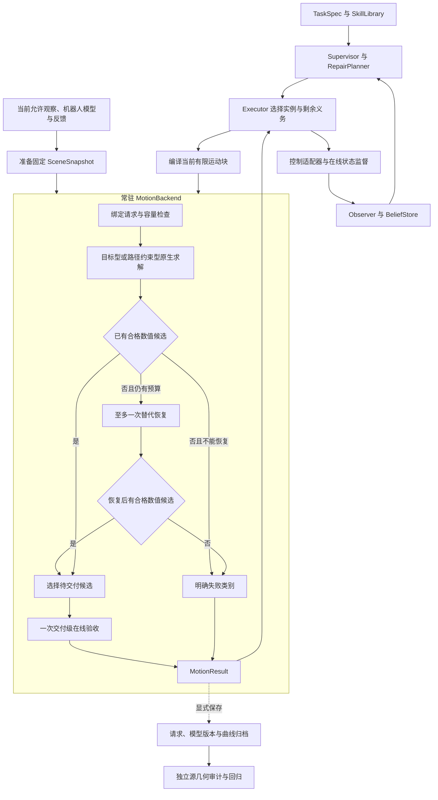

# FUNCTO Motion Planner PRD

**共享运动后端为 TaskFlux 的非单调进度与恢复提供有限、可解释的运动服务：常驻求解器、有限运动块、统一在线几何、一次交付验收。实际任务事实由执行反馈与观察决定，详细源几何链只作为独立审计工具。**

本文是运动后端的目标规格，依据 [motion_planner_debug.md](motion_planner_debug.md) 整体重写，替代旧版中与本架构冲突的规定。本文规定应当实现的行为，不代表代码已完成迁移或性能已达标。当前代码事实见 [运行期架构说明](../sim-version-plans/2026-10-07-motion-planner-runtime-architecture.md)，本文件 §10 明确对应实现的保留、改造与退出生产位置。

本轮仅修改文档；现有运行代码全部保留。目标生产架构只有本规范所述一套，旧重型链保留为可独立调用的审计工具，不作为兼容层、生产模式开关或失败后的自动回退。历史文档与旧测试不增加本文之外的隐含准入条件。

## 1. 研究范围与职责

### 1.1 服务于剩余任务，不接管任务决策

TaskFlux 的主线是：外部变化后，根据当前事实和完整剩余要求重新判断有效进度；接纳正向收益，处理负向变化，必要时通过 SkillLibrary 中已有技能撤销仍然正确但阻碍接续的中间成果。[全局职责说明](../2026-09-21-taskflux-reading-notes.md)

这里的**任务进度**是当前证据支持哪些接续选择，不是阶段序号、历史完成步数或运动曲线参数。运动后端只求解已经选定技能的当前运动块，不组合额外技能、不发明库外动作，也不预先保证后续技能一定可达。下一技能被选中后，从当时真实状态重新绑定。

不训练 policy，不新增触觉设备、精密装配研究或新的碰撞引擎。使用已有 cuRobo V2、OMPL、SciPy 和现有几何/控制适配；MoveIt、Tesseract 等只作为接口设计参考，不增加依赖。所有环境操作沿用 `recovery`，运行命令默认 `PYTHONNOUSERSITE=1`，不自行安装库或修改 editable 三方源码。

| 组件 | 输入 → 输出与职责 | 边界 |
| --- | --- | --- |
| Supervisor / RepairPlanner | 当前事实、剩余要求、技能库 → 继续、跳过、等待或库内修复选择 | 不枚举关节种子、不控制轨迹细化 |
| Executor | 已选 SkillCall、当前绑定、实际事件 → 运动块、设备命令、执行事实与剩余义务 | 管理技能内接续与显式同目标重试，不把整段任务历史交给求解器重新证明 |
| MotionBackend | 当前运动块、固定场景、机器人状态与预算 → 轨迹或明确失败 | 只判断登记模型内的运动有效性，不发布 Holding/Supported 等事实 |
| Observer / BeliefStore | 带时刻和来源的真实观察 → T/F/U 与受影响关系 | 规划成功、命令下发、曲线完成不能覆盖观察 |
| 独立审计/评价工具 | 保存的模型、请求、曲线或实验实际结果 → 几何差异、回归证据与评分 | 不自动进入生产控制或修复决策 |

上表中的 TaskFlux 任务层名称表示既定架构职责；当前仓库尚未提供完整 Supervisor、RepairPlanner、BeliefStore 运行实现，不得把本规范视为这些组件已接通的证明。FUNCTO 当前已有技能、规划、执行及实验适配逻辑。

### 1.2 目标运行结构

`MotionBackend`、`SceneSnapshot`、`MotionRequest`、`MotionResult` 是职责简称，不要求新增同名框架。优先收敛现有 `PlanningProblem`、`PlanningScene`、`PlanningResult` 与执行绑定，不平行维护两套大格式。

## 2. 运动块、任务要求和输入契约

### 2.1 请求单位

一个 **SkillCall** 是 Executor 对一个已选技能的本次调用；一个**运动块**是其中能够在当前证据与时间关系下联合求解、授权执行的运动范围。一条 SkillCall 可含多个运动块，但本身的原始义务、累计等待和实际效果不能被切分抹掉。

运动块边界来自真实事件和约束依赖，通常可以在需要新抓持、释放或重新观察证据的位置结束。纯参考阶段、每个示教 waypoint 或固定一秒间隔不自动产生新请求。

若跨候选边界存在非零速度连续性、不可中断的过程关系或真实时间耦合，应联合求解，不能为了缩小问题增加停车点或改变任务时序。若后续又确实依赖未知事实，须能在原声明允许的位置取得证据或合法停止；两者不相容时返回具体时间/执行能力冲突，不能先无条件授权后缀。

复用 `next_verification`、`executable_until`、原事件和真实 continuation 表达边界。可以保存条件后缀，但必须另列它的验证与授权范围，不能用前缀成功标记整 skill 合格。此条替代旧版“一次请求必须联合规划完整 skill”的统一规定。

### 2.2 六类输入及共用绑定

| 内容 | 现有承载与用途 | 必须保留的语义 |
| --- | --- | --- |
| 当前状态 | `PlanningProblem.start_q/start_dq/joint_names`、实际手指与控制状态、base/TCP 标定 | 从真实入口开始，不清零非零速度、不对称化手指、不改入口迁就参考 |
| 功能目标与允许集 | `pose_events/coordinate_events/supports/interiors` 等 | 保留自由度、精度、作用对象及事件；不收缩为首个名义位姿或任意六轴小框 |
| 必须保持的过程 | `pose_relations/mechanisms/couplings` 及区间要求 | 保留机构限位、方向、圈数、持续接触、内部/支撑等原始含义 |
| 当前几何关系 | 场景 owner、有限接触规则、附件、夹爪状态与策略 | 指定何时、哪个部位、哪个对象、什么范围有效 |
| 事件与真实时间关系 | 原事件身份、命令、条件、硬时限与已发生记录 | 区分源时间和真实任务时限；不重放已经消费的同一次事件 |
| 参考运动 | `MotionPhase/PosePath`、源时间与来源 | 用于初始化、必要的软偏好和偏离诊断；普通参考不是逐点硬约束 |

共用绑定还包含：请求/SkillCall/运动块身份、场景与模型版本、当前证据及有效范围、原始要求标识、预算和取消代次。版本用于识别同一输入，不要求内容哈希或新增配置服务。

每项 requirement 必须在编译时映射到**功能目标、过程要求、场景许可/覆盖规则、实际证据义务**之一或明确列出的组合，并说明消费模块。无法映射必须返回具体缺项或能力冲突，不能静默忽略。参考和诊断不通过改名成为必要要求。

### 2.3 参考、机构与容差

- pre-grasp、approach、retreat 可以保留为参考阶段；不计算固定偏移 pregrasp pose，不要求来源帧或阶段末位姿作为必经点。退回只有在明确要求离开接触或清出区域时才产生功能义务。
- 细分、合并、改名或增加普通参考采样，不得改变目标集、事件、停止要求、请求划分及验收容量。真实功能事件和危险区间的检查点不属于可随意丢弃的普通参考。
- 当前机构坐标必须明确零点、正方向、绝对目标或相对入口增量，以及需要的展开分支/圈数。净位移方向、区间单调和局部速度方向分别表达；模 `2π` 终点不能代替完整转动过程。
- 未约束轴不补目标；相容要求共同满足，冲突不平均、不放宽。目标成员搜索失败不能证明整个允许集无解。
- 任务允许集、设备物理限制、模型近似/接触误差、数值容差及采样分辨率分别记录。碰撞激活距离是优化引导参数，不自动变成硬净空；球外扩和粗体素误差不能转嫁为任务接触容差。
- `T_parent_child` 将 child 坐标变换到 parent；平移用米，关节按类型用弧度/米，四元数顺序在库边界转换。源帧、数组索引、源秒、曲线进度和执行秒不得混用。

参考 IK 不收敛只表示未找到该初始化；失败解不能标为成功 waypoint 继续传播，也不能据此否定实际目标。目标及必要过程由现有技能/绑定步骤提供，本文不新增“自动从未标注演示识别所有必要语义”的研究前提。

## 3. 固定场景与统一在线几何

### 3.1 `SceneSnapshot` 的含义

它是一次求解使用的不可变场景视图，至少固定：观察身份与时刻、坐标标定、owner 分区、已观察/自由/占据/未知信息、各对象在线几何、附件及释放假设、操作区分辨率和查询有效范围、机器人覆盖模型版本、有限接触与未知策略。

求解中不能因姿态轻微变化重新建图、添加 TSDF 组件或改变粗细层选择。新观察形成新版本，相关假设失效使旧结果授权撤销；世界并未因 snapshot 固定而冻结，无关对象更新也不应无差别废弃当前绑定。名义附件共同运动不伪装成新的测量，物体移走的区域不自动变成观测自由区。

### 3.2 各对象的生产表示

| 对象 | 在线表示与查询 | 不属于生产热路径的工作 |
| --- | --- | --- |
| 机器人及已知安装件 | 登记的碰撞球与具名部件/碰撞对策略；必要的低成本源实体自碰作明确补充 | 请求内重新拟合球、对环境逐片源实体扫描 |
| 已知完整场景实体 | 本地后端已经验证支持的解析体或原生 mesh；保留组成与坐标 | 将凹实体或薄/空心材料无条件替换成凸包 |
| RGB-D 背景与 owner | Mapper GPU 距离场及项目保留的观察有效性/自由空间数据，按 owner 分开 | 为正常请求构造、索引并枚举数万 TSDF 凸片 |
| 附着物 | 登记完整模型或已验收的保守覆盖，按附件变换 | 把遮挡部分当不存在，或用未来抓取结果提前挂载 |
| 操作区域 | 请求准备阶段选定的固定细分辨率数据与有限交互区域 | 求解中反复细化、因查询失败静默退回粗图 |
| 详细源材料/表面组件 | 独立审计输入 | 自动回灌 IK、metrics、交付检查或执行循环 |

本地已有 cuRobo SceneCollision/Mapper、SciPy 曲线及几何适配可复用。公开 `SceneCfg` 有某种形状类型不等于所有原生碰撞存储都直接支持该形状；必须核对实际消费者。当前公开 voxel 距离输出也不自动提供完整自由/占据/未知语义，见 §11。

### 3.3 操作区和机器人模型的准入

操作区由当前对象、候选运动域、机器人与载荷包络、距离插值支撑范围共同确定。必须包含实际会接近目标的掌部、腕部、前臂和附着物，不能只包住物体/指尖。一次求解使用固定的区域与查询规则；需要未准备数据的状态/曲线不能放行。单个探索候选出域可以被淘汰，并在固定范围内继续有限搜索；确认请求必需范围缺少支撑时返回 `SCENE_UPDATE_REQUIRED`，不得切到精度不足的粗场继续给出合格结论。

分辨率不统一拍定为 1 mm，也不允许用 15 mm 粗场裁决无法表达的接触间隙。设备/场景配置验收必须说明几何外扩、有效支撑和近似误差是否能表达声明的任务允许集，并用已有近桌面、掌腕、目标移动/旋转正反例检验。不能把 voxel size 直接声称为表面精度。

机器人覆盖修正属于共享配置工作，使用原实体与已有近障案例离线确认，之后所有技能共用。禁止在线缩球、删碰撞对或靠接触让步吞掉代理外扩。若预算内可用模型不能同时覆盖原实体并表达任务间隙，返回 `UNSUPPORTED_MODEL`；不能宣称换回粗球场已经解决原误拒。

<!-- BEGIN 球候选与原生实体确认的统一接受语义。 -->
机器人对场景的正球残差是保守碰撞候选，不能单独证明实体相交。规划最终候选验收通过 `online_native_confirmation.OnlineCollisionConfirmation`：只对正球所属的原生机器人实体及其目标，查询同一冻结场的完整占据体素或已登记解析体。冻结体素的空间索引在确认适配器内准备一次；只检查与当前原生实体包围盒相交的局部体素。有限接触必须使用同次查询最终有效的规则、完整材料身份及当前 owner 位姿，只删除规则完整包含的体素。全部疑似实体对均证实分离后才清除对应普通机器人/目标碰撞项；数值边界、不支持结果和非有限值保留拒绝。优化器保留球距离梯度；未知空间、模型支撑、接触条件、自碰撞及非机器人附件碰撞不由该确认清零。该查询只说明离散观测模型中的几何关系，不证明未观察表面或连续轨迹安全，也不重建源 TSDF 组件审计链。物理执行期间不调用该确认器，也不以冻结占据体素的外包推断当前实际接触。
<!-- END 球候选与原生实体确认的统一接受语义。 -->

<!-- BEGIN 机器人自碰撞代理与设备实体的职责。 -->
机器人自碰撞使用相同原则，但与机器人对环境的确认分开：正球覆盖残差触发 `RobotStateValidator.check_planning_self`，输入同一候选时刻的关节位置、夹爪模型和已知设备 CAD/URDF，使用 Pinocchio 正运动学及 Coal 查询已建模的必检实体对。只有该时刻的实体检查通过，才能清除对应球代理否决；夹爪解析几何、非有限值、未知手指和其他任务约束保留各自语义。入口、离散路径状态、普通/加密候选及精确事件时刻遵守同一规则，不为某技能删除连杆对。完整覆盖与配对合同支持零球残差的既有快速路径；正代理触发的实体确认不查询仿真接触或隐藏环境，也不构成连续时间安全证明。
<!-- END 自模型计算不需要仿真真实碰撞辅助求解。 -->

覆盖引导点仅用于梯度时必须标注其用途。现有每体少量采样的 `robot_coverage_guidance` 不能直接升级为完整体积覆盖证明。原始实体布尔差集和逐来源覆盖解释退出在线调用；替代覆盖查询必须明确其登记几何和离散支撑范围。

### 3.4 自由、占据和未知分别处理

几何中的 F/O/U 分别是观测自由、占据、未知；任务事实中的 T/F/U 是成立、不成立、未知，两者不是同一个三值变量。

在线查询对碰撞、证据覆盖、必要接触分别输出通过、违例或缺证据，并说明有限模型范围。有效观测 mask 不是自由空间；距离缺失、TSDF weight 不足、零返回值、查询超限不能当作无碰撞或证据通过。

未知策略在请求编译前由通用设备/操作契约声明：哪些范围禁止进入，哪些遮挡或可能发生变化可作为显式条件尝试，以及何时需要再观察。禁止未知区域返回信息需求，不伪装成目标不可达；允许尝试未知也不产生自由空间证书或实际效果 T。不得把所有遮挡统一变成障碍，也不得全局放行未知。

真实入口机器人占据体仅说明该已登记状态下机器人所在范围，不证明外部邻域自由；不得将其外扩球、未来附着物或未来卸载区域扩大为自由区。当前 `RobotCoverage` 的 free deficit/`attempt_allowed` 和场景中对部分 unknown 项的过滤不是新合同的直接实现，须显式重构。

### 3.5 同一套语义，不要求同一种查询输出

优化需要距离/梯度；规划候选合法性与 OMPL 通常只需通过/首个违例；完整最近点、所有实体对与完整组件证据属于审计。各规划接口必须使用同一版本模型、接触规则、未知策略与适用范围。执行器核对该规划绑定的身份与当前设备、任务证据，不重新查询冻结世界，也不另设一套几何接触许可。

布尔查询不附带求整个世界精确全局最近距离的义务。Tesseract 的 FIRST/CLOSEST/ALL 区分可作为接口职责参考，不据此引入该库，也不把其性能数字当作本项目性能。[官方查询类型](https://tesseract-robotics.github.io/tesseract/collision.html)

机器人源实体自碰如保留为交付补充，必须是固定规模、明确预算的专用检查，不能通过它隐式绑定源世界、进入 TSDF 组件或恢复整条旧 validator。登记时明确球引导与最终自碰判据的分工，不能运行中按有利结果随意切换判据。

## 4. 有限接触、附件与实际效果

### 4.1 接触许可的最小完整契约

每条规则必须固定 actor 的有限材料部位、target owner、有限目标区域、适用事件/区间、相对法向/方向、间隙范围、建模让步及 `required`。机器人机械接触、原生碰撞过滤和本次任务许可分开登记。

在线适配将这些数据转成 owner/部位选择及少量区域、方向、间隙数值关系。过滤只用于选中应比较或允许的**有限材料范围**，不能用整 link 或整 owner 免碰替代局部规则。一个球覆盖许可部位和禁止部位时，不能整球豁免；模型须能够区分，否则报能力冲突。

有限区域的交叠/包含要求按原规则解释：不是只检一个中心点，也不统一要求整个指垫必须完全位于目标小区域内。必要的点、边、面及坐标关系可复用现有数值计算；不再为每个材料点枚举整个观察 owner 的凸片。

**允许接触**不要求必须触碰；`required` 另行要求名义曲线在指定时刻/区间满足接触关系。必要接触须有已绑定观察表面或完整模型表面提供支持，负体积封帽、抽象区域重叠或整 owner 距离为零不能代替表面依据。是否真实抓稳、释放或形成支撑，仍需实际反馈和观察。

建模让步保留原材料界限：`0 ≤ modeling_allowance_m ≤ geometry_error_m`，且 `modeling_allowance_m < minimum_thickness_m / 2`。数值位置/转角容差独立，不用 epsilon、球外扩或机器人跟踪容差替换这些界限。零让步可省恒零运算，不能省规则本身的方向、范围和必要接触语义。

### 4.2 替换旧整夹爪许可

当前代码与旧 PRD 的“到位后完整夹爪—指定目标整对解除软件避碰”不作为新生产默认行为继续保留。现有技能的相关绑定必须转换为有来源的有限部位/区域规则并通过登记验收；本轮文档修改不删除旧代码，也不宣称两种接受集合等价。

已有到位条件和 close 的顺序仍保留：需要到位才可闭合的操作，执行器必须用新鲜机器人反馈核对同一绑定目标后再下发命令；有限几何许可属于规划模型，不在执行期间维护其激活锁存。名义时间到达、旧成功或 close 命令本身不是到位证据。普通移动闭合不被改成全段静止。

不得直接采用 `plan_grasp` 的固定 approach/lift 偏移与 link 碰撞关闭来替代这些语义；该 API 的便利操作比本项目有限许可更宽。未知手指几何也不能自动激活一条确定材料位置的许可。

### 4.3 附件与释放

入口已确认的 Holding 附件与当前技能未来交互后才成立的候选附件分别保存。名义附件按声明区间参与载荷运动检查，不提前挂载，也不要求执行前证明未来抓取已经成功。

释放事件可切换候选的预期物体模型，但 open 下发不等于实际已释放。当前事实和执行依赖由真实反馈更新；明确否定附件假设后不得继续使用失效模型。名义释放位姿要从完整相关事件历史得到，不能用分块检查的局部第一帧替代。

若某技能确实需要任意观察凸片上的精确区域布尔运算，而现有有限在线表示无法表达，编译/登记阶段返回 `UNSUPPORTED_CONSTRAINT`。不忽略要求、不偷偷放宽，也不自动转入源审计生产回退。

## 5. 常驻生命周期与两条求解路线

### 5.1 资源与生命周期

模型加载、机器人配置、固定容量缓冲、原生求解器构造及预热在后端启动/明确重配置阶段完成；服务就绪后，请求只绑定当前状态、目标、场景版本和任务数值。一次正常请求不得重复完整 `_initialize` 或因一个新失败时间重建求解器。

沿用已有机器人、seed、控制点、目标集合及任务锚点容量；以少量明确容量支持当前需求，不建无限实例池。超出容量返回资源/能力结果，或在下一请求前完成显式重配置并记入等待，不在本次优化循环反复扩容。较小请求的 padding 不进入任务或几何判定。

只读在线几何与 GPU 缓冲可复用；候选状态、当前 goal、附件阶段、功能乘子、取消标志和诊断必须按绑定重置，防止前一次请求污染下一次。场景在请求边界原子更新，同一设备同一时刻仅一个有效求解拥有可变缓冲。

CUDA graph 是原生 GPU 工作的可选实现机制，不能捕获 Python 场景重建或 CPU 审计。启用前核对任务 cost 和容量可捕获性；不支持时仍服从同一预算，不能另设无限慢模式。重感知与规划串行，常驻内存也计入全进程与整卡额度；若需释放后重新预热，明确计作冷启动等待，不伪报热启动。

### 5.2 按约束结构选择路线

| 路线 | 选择条件 | 原生求解和项目适配 |
| --- | --- | --- |
| 目标型 | 只要求到达目标/允许集，不含必须保留的中间过程；在线接触/附件等仍须可表达 | 批量目标 IK 与原生位姿/关节目标轨迹求解；真实边界目标进入原生接口，最终核原始允许集 |
| 路径约束型 | 含机构、相对运动、方向、持续关系、中途功能事件或其他非末端要求 | `TrajectoryOptimizer` 加现有 `ProcessCostManager` 的任务数值部分；在线几何替换原源审计 |

两条路线共享同一在线模型、预算、曲线和交付判据，不能按 skill 名称分支。目标不能被原生接口准确表达时，使用已有类型化残差适配或报告能力冲突，不把未约束轴补成固定目标。合法目标集合可在同一问题的多种子/goalset 中探索；有限个代表未找到不证明全集无解。

这里复用 cuRobo 的高层目标规划能力，但**不直接照搬 `MotionPlanner.plan_pose/plan_cspace` 的默认循环**：本地高层调用包含额外时间细化，无法仅靠 `max_attempts=1` 关闭。目标型也须通过常驻原生 `IKSolver`/`TrajectoryOptimizer` 组件实现受控调用；这仍是目标型路线，不是第三套求解器，也不修改三方库。API 核对见 §11。

### 5.3 初始化、物理域与功能目标

普通参考用于初始化；实际功能目标可生成多个合法 IK realization。失败参考解明确标注，不能传播成成功节点，不能让参考失败解参加“已满足目标”的候选排序。

轨迹 action-space 的自由 controls 与关节 waypoint 不是一回事。任何参考链或 OMPL 路径必须通过同一三次曲线映射的合法 seed 转换，保留实际 `q0/dq0`；直接覆盖数组首尾或把 waypoint 当 B-spline controls 不合格。入口只约束瞬时位置和速度，不因第三方内核的固定前缀而额外规定整段匀速运动。FUNCTO 的轨迹生成组件、物理域检查、种子拟合与导出使用同一仿射样条；cuRobo 保留优化器、机器人运动学和代价计算职责。时钟和终止边界独立声明，释放多余入口约束不得隐式改时长。

复用原生 L-BFGS 和 FUNCTO 已完成的物理域适配，不重写优化框架。合法初始化、被评估的试探点及交付曲线须符合声明的具名关节物理域；仅 clip、出口拒绝或永远不离开起点不算完成求解能力。非零入口速度与物理界不相容时报告入口/表示冲突，不清零速度或断言目标理论无解。目标型改用原生组件时也须验收这些行为。

路径型保留功能残差和必要的 `FunctionalAugmentedLagrangian`：它通过有界乘子/惩罚状态帮助满足显式不等式，不改变目标容差。不能因为它已存在就重做，也不能保留由它驱动的无界外层重建。自定义 cost 必须实际进入 `compute_costs/CostCollection`；仅注册名字不等于已执行，更不等于硬约束已满足。

### 5.4 固定调度与一次替代恢复

每个运动请求只有：**一次主数值求解 → 如尚无合格数值候选，至多一个替代恢复槽 → 选择一条候选 → 一次交付验收 → 返回。** 原生求解内部的有限梯度迭代、固定批量 IK 和轻量 metrics 不各自领取新的请求预算。

恢复槽按失败类型二选一：

- OMPL 一次有预算的替代路径搜索，加一次原生轨迹优化；使用同一在线状态/边合法性查询及必要任务投影。
- 路径型一次受控数值恢复，例如更新功能乘子/初始化后再求解一次；新目标状态清除旧曲率/最优值历史，但不得重新加载整个模型或扩大容量。

二者不串联，不在最终验收失败后再开启恢复。cuRobo 内建 PRM 与项目 OMPL 不是同一个组件；本规范的替代搜索由 OMPL 负责，不隐式叠加高层 PRM、额外 attempts 或 finetune。

已取得通过原始轻量任务/在线指标的候选后，直接进入交付验收，不追加可行后质量阶段、中心偏好精修或时间压缩。优化探索可以暂有任务/碰撞残差；低总代价没有放行权。`candidate_observer` 只能保存有限数值状态/候选，不调用源检查、独立导出或交付级验收。

### 5.5 时间合同

区分演示源秒、运动块/参考路径进度 `s`、曲线归一化参数 `u`、绑定执行秒和真实反馈时钟。这里的 `s` 不表示 TaskFlux 的任务进度。普通源时间只提供参考；显式任务时限或已绑定执行时钟必须保留。

后端可在建立绑定时选择允许的执行时长；绑定后换 seed、使用 OMPL 或数值恢复不能偷偷改钟。需要合法重计时则建立新绑定，同步目标/过程/附件/夹爪和事件，沿用原硬时限及累计预算。

本地 `TrajectoryOptimizer` 即使接收 `dt` 仍可能计算新的轨迹时间。硬绑定时必须使用已验证的固定原生时间上下界、`finetune_attempts=0`、`finetune_dt_scale=1` 等受控配置，并在导出核对实际 knot interval/总时长。单独传 `dt` 不足以证明锁钟。

手指命令与手臂使用同一绑定时钟。保留命令意图时刻、控制 tick 量化后的激活时刻及实际 applied/superseded/unapplied；不可提前激活，必要顺序落在同 tick 而无法表达时返回冲突。非网格末步和末端事件必须按实际下发/推进记录，不能把参考到终点当作已经执行。

硬时限须注明检查的是命令激活、实际到位还是实际效果，并保留原时基与起算事件；按实际证据判断，非网格末步覆盖到的 tick 不豁免逾期。屏障同刻依赖未确认事实的事件属于未授权后缀，末步不能顺带下发。

## 6. 一次交付验收与返回契约

### 6.1 次数和位置

一个 `MotionRequest` 最多进行一次交付级完整曲线验收：成功必须恰好一次，失败可以零次或一次。所有有限恢复在它之前完成；它失败后直接返回，不重新优化、换种子再验收。优化中的原生轻量 metrics、OMPL 状态/边检查和执行中的实际反馈监督不计作这一次，但都禁止调用重型源链。

验收结果属于同一候选、场景/模型版本、时间和明确检查范围。实际入口发生相关变化时重新绑定；新增未验证运动块按新请求验收，并计入 SkillCall 累计。不能通过给同一失败候选换 request ID 无限制重试，也不能重做已完成整段审计来授权一个新增小范围。

### 6.2 检查实际交付曲线

1. 核对具名关节、真实起点、同步手指、原生与导出曲线和时钟一致；手臂及已有连续位置参考保存同一三次曲线，不重新平滑或偷偷改时长。
2. 对连续位置参考检查位置、速度、加速度及物理域；复用已有解析多项式范围检查，包括内部极值和节点左右侧。解析 `ddq` 是参考曲线导数，不是实际测得加速度。离散 open/close 或原生 ctrl 命令按设备合同检查，不额外要求它们具有连续 `q/dq/ddq`、C¹ 性质或实际力矩连续。
3. 在真实功能事件和区间检查原始要求，必要方向、展开坐标、支撑/内部、耦合和持续接触不退化为只查终点。
4. 用同一在线模型检查机器人、安装件、附着物、接触模式两侧和未知策略，并按登记的低成本范围补充源自碰。
5. 通过则绑定、序列化并返回；不通过则返回首个有解释力的违例和必要测量，不生成全量源实体对/组件证据。

保留精确事件、已有危险区间和合理的运动界限采样，不先靠删除已知失败时刻提速。历史见证用于回归和当前有限必需检查，不永久累积成以后每次请求的全历史在线证明义务；容量不足应明确拒绝，不能截掉当前必要点。

有限采样只在报告的分辨率和模型内成立。OMPL 的状态检查与边检查不同，其边插值也不等于最终三次曲线；离散路径转为 controls 后必须验收实际输出。若使用 swept/CCD，必须覆盖真实关节曲线或正确运动包络，不能用 link 两端直线插值冒充等价。[OMPL 状态与运动验证](https://ompl.kavrakilab.org/stateValidation.html)

### 6.3 输出与失败分类

继续以 `PlanningResult/JointTrajectory/execution_binding/request_ledger` 为基础收敛。逻辑输出包含：请求与输入版本、状态/首因、具名曲线及解析采样、时间映射、同步命令、已验证/可执行范围、后续证据依赖、原始任务与在线检查摘要、消耗/剩余预算和取消状态。无需另建冗余数据协议。

| 结果类别 | 精确含义 | 不能推导的结论 |
| --- | --- | --- |
| `SUCCESS` | 当前登记模型和已声明范围通过交付验收，且授权未失效 | 实际 Holding/Supported=T、整个 skill 完成或后续一定可行 |
| `INVALID_REQUEST` / `ENTRY_CONFLICT` | 绑定缺失、身份/时间矛盾或起点与声明运动合同不相容 | 物理任务全局无解 |
| `SCENE_UPDATE_REQUIRED` | 必需观察、地图支撑或禁止未知范围缺证据 | 真实碰撞或目标不可达 |
| `UNSUPPORTED_MODEL/CONSTRAINT` | 现有登记表示或求解适配无法表达要求 | 可静默删掉要求或调用旧审计回退 |
| `NO_SOLUTION_WITHIN_BUDGET` | 有限搜索/数值工作未找到合格候选 | 理论不可达或实际效果为 F |
| `VALIDATION_REJECTED` | 选定曲线未通过原始任务或在线几何/运动检查 | 其他目标成员均不可行 |
| `DEADLINE_EXCEEDED` / `CANCELLED` | 超时或调用者撤销本次结果授权 | 迟到候选仍能执行 |
| `RESOURCE_EXCEEDED` / `BACKEND_ERROR` | 容量、物理资源或库调用失败 | 可以通过放宽要求制造成功 |

名称是规范分类，可对应现有诊断字段，不要求机械新增一套枚举。失败结果不带可执行授权；诊断候选可以另存，不能靠文件名、分类字符串或重载升级为成功。

## 7. 执行、证据和 non-monotonic recovery

### 7.1 接管与持续监督

Executor 接收通过验收的同一曲线，绑定实际控制器策略、时钟、`FixedFingerTargets` 和 `ExecutionLimits`。核对当前入口、模型相关性、关节顺序、base/TCP 与指命令覆盖；不能用新反馈修补旧报告后继续声称同一绑定。

<!-- BEGIN 物理执行职责不包含冻结世界接触推断。 -->
继续使用已有控制适配器，沿连续参考曲线采样所需的 `q/dq/ddq`，离散手指命令按同步事件及设备合同下发。`RobotStateValidator` 只负责当前机器人关节限位、具名模型与 FK 一致性、已登记机器人及固定安装件的 required 原生碰撞对；不绑定或查询冻结场景。`TrajectoryExecutor` 负责实际跟踪、时钟、close 前当前到位、观察新鲜度、Holding 附件依赖及效果要求。依赖附件推算位姿的 owner 必须有当前 Holding 证据或当前观察位姿，入口事实不得沿用到后续 tick；当前位姿也不能自动成为 Holding 成功事实。

执行预检只检查绑定相关性、实际入口和控制状态，不重复验收已通过的名义整条曲线；新增未核范围按 §6.1 作为新运动请求计账。物理执行不重建 `OnlinePlanningScene`、不查询冻结距离场或完整占据体素；这些保守观测模型不能证明当前物理接触。实际环境变化由允许的当前观察及设备反馈报告，证据缺失不得伪造成接触、安全或任务成功。独立仿真评价只报告真实仿真结果，不回灌为在线成功事实。
<!-- END 规划模型验收与当前设备、任务事实分别负责。 -->

手指状态按已声明控制器解释；允许接触导致的闭合停止、双指不对称或名义手形偏差不能一律当作位置跟踪故障，也不代表抓稳。MuJoCo 积分状态和 Python 控制器状态分别记录；冻结仿真积分不等于物理停止。

### 7.2 事件、屏障和接续

| 情况 | 推进规则 |
| --- | --- |
| 纯参考阶段边界或普通效果检查 | 不自动停臂、不增加位姿目标或新运动块 |
| 原 open/close 命令 | 按合法时钟和原依赖激活；移动 close 保留 |
| 效果 U 且当前后缀不依赖该事实 | 当前模型与运行义务仍有效时可继续；该必需效果不能计作完成 |
| 后续确实依赖尚未确认的事实 | 不执行依赖事件/后缀，等待、补观测或按已有流程停止 |
| 明确违例或相关模型失效 | 按统一设备规则保持/停止、记录实际结果，再决定重绑 |

需要等待时，必须在允许位置满足真实保持/停止条件；非零速度处截断曲线不能伪装成暂停。若证据及时取得且状态/场景/时钟仍相容，可消费已授权且已验证范围；否则从 actual 为剩余义务建立新绑定，不能平移旧事件并复用旧验收。

`continuation` 是真实执行事实：最后已确认状态、实际时钟、已发生事件、部分成果、未完成要求和累计预算。同次余段不重放已应用事件；Executor 显式发起同目标重试时，重复操作记录为新的 occurrence 并关联原事件，不能把旧记录改回 pending。失败和重试不默认复原物体，也不抹掉真实部分成果。

任务层可以重新评价当前成果对剩余要求的价值，并调用库内技能主动撤销某成果；这是实际世界动作，不是删除账本。显式要求全程保持的关系不能以“之后会恢复”为理由违反。运动后端只返回本块的事实范围、信息需求与失败原因，不自行选择这类修复动作。

### 7.3 计划、在线事实与独立评价

T 表示有证据成立，F 表示有证据不成立，U 表示未核或证据不足。U 不等于 F，也不默认触发物理修复。运动块通过、执行区间完成、单项效果成立、SkillCall 完成分别报告；skill 完成要求全部必需目标、过程、事件、终止条件及实际效果满足。

`result-only` 只表示不阻塞当前执行推进，不表示成功评价可选。真正功能目标仍是必需项；`diagnostic` 必须从调用者显式声明的 result-only 目标子集中选取，可以不否决实际功能成功，但不能包含到位依赖、过程或效果义务，也不能自动覆盖全部结果项。保存原误差、时刻及 T/F/U。

规划器只消费声明的感知场景和机器人反馈，不能在求解、碰撞验收或路径恢复中额外查询仿真隐藏环境形状、真实接触或成功结果。显式授权的仿真感知对照可以用 GT 辅助物体模型、位姿和像素归属等感知输入，但必须标明来源、经普通场景接口冻结提交，不伪装成视觉估计，也不授予求解器仿真查询权限。具名机器人 q/dq 可以作为设备编码器反馈替身，TCP 明确为已知模型 FK 估计；已知机器人 CAD/URDF 与候选关节值的模型碰撞计算不属于查询当前环境 GT。离线技能/已登记模型保留声明来源，独立仿真评分不反向修正候选。

独立材料几何评分需有来源的静态 body→material 映射，不用当前视觉对齐真值以消除感知误差。评价采集异常记录为评价缺失，不反向改变控制；真正必需在线观察异常仍按监督合同处理。显式授权的仿真测试可以用独立结果关卡决定是否提交下一技能，但不得把该关卡包装成生产视觉事实或夹带对象位姿/接触几何。

## 8. 全请求预算、取消与性能门槛

### 8.1 工作和物理资源

请求绑定、IK、主求解、一次恢复、在线验收、打包共享同一截止时间；每一步必须为后续交付留出已声明容量。不能每个子模块各拿一份新预算。父 SkillCall 记录全部运动块、重绑和显式重试的次数/等待与总额度，换 ID、切小运动块或重建后端不能清零。

沿用现有 `PlanningBudget` 资源维度。默认本地上限为 **8 GiB 主存、6 GiB 整卡显存**，感知与规划重负荷串行，超限先减少并发/种子或明确拒绝，不私自安装、改环境或扩大上限。模块工作区、PyTorch allocator 与整进程/整卡实际占用分别计量；常驻缓存、场景准备和结果副本不能漏算。

正常执行、等待保持和故障制停共享单独的实际物理步数额度。每次尝试先计账，保守扣账与已确认推进分开；无法确认的推进保持未知，不伪造实际时钟或自动续接。规划预算耗尽本身不禁止合法设备停止，但停止也不能突破物理总额度。

### 8.2 截止时间不是 GPU 抢占承诺

原生 CUDA 调用不保证立即可抢占。调用者必须能在截止时撤销本请求授权并得到超时/取消结果；迟到返回带原请求代次，不能转为可执行成功。

后端在原生工作真正结束前保持 busy，禁止复用仍被占用的缓冲或堆积新请求。下一请求可在其自身预算内等待或明确返回忙；不得假称取消已释放 GPU。复用已有调用者/监督机制隔离结果授权，不要求新建分布式服务。测试同时报告响应截止、原生实际退出延迟及资源回收，不把“等返回再看时间”说成已满足 10 秒响应。

### 8.3 性能验收目标

以下是本次目标架构的交付门槛，**不是当前实测结果**：

| 指标 | 门槛/统计要求 |
| --- | --- |
| 常驻且场景就绪的正常请求 | 中位数目标 1–3 秒，P95 ≤ 5 秒；低于 1 秒不视为失败 |
| 含一次恢复的请求 | 整个在线请求响应预算 ≤ 10 秒，包括唯一交付验收和打包 |
| 无合格轨迹 | 预算内返回明确类别，不继续隐藏审计/质量循环 |
| SkillCall 规划成本 | 统计所有运动块、重绑、重试的累计等待；不只报最快一段 |
| 请求触发场景准备 | 单列建图/场景准备耗时，并计入用户实际等待；不藏在预处理 |
| 冷启动与重配置 | 单列加载、预热、释放后恢复耗时，就绪前不算热请求 |
| 成功率与误判 | 固定样本分母，同时报告模型规划通过、实际执行、功能成功、误拒、已知漏判、U 和各失败类别 |
| 延迟分布 | 分别报告全部请求、成功请求、超时/失败请求，给出样本量与统计口径；不能靠快速失败优化 P95 |

场景准备加在线请求不被不实宣称为必然 10 秒内；用户端到端等待必须同时报告。没有达到门槛就记录差距，不将性能目标改写为已具备能力，也不能通过降低任务精度、换更容易的样本或删除危险时刻达标。

## 9. 独立审计和最小生产记录

源机器人/物体对、观察 TSDF 表面/负体积组件、精确区域布尔查询、完整覆盖差集、代理差异和全量曲线记录保留独立工具入口。人工/实验明确调用后可读取保存请求与曲线，输出回归证据；不能在生产失败、取消、执行 tick 或后台回调自动调用它们。

审计可发现在线模型误拒、漏判或能力不足，结果用于下一次模型登记/配置修正。它不在执行后追认之前缺失的授权，也不要求新模型与旧审计器全部距离、中间见证或接受集合逐位一致。几何表示和接受合同发生了变化，必须记录版本与适用边界。

生产只记录请求/SkillCall 身份、相关输入版本、路线、种子/恢复次数、各阶段计时、最终曲线/命令、一次验收摘要、首个失败、事件/授权范围和预算。保存方式复用 JSON/NPZ；默认不生成全状态源组件数组、重复场景快照或逐候选大文件。需要完整审计资料时显式采集，额外耗时/资源单列，不污染生产性能统计。

旧归档保留来源和原判据；没有新模型/时间/控制契约的旧成功文件不能直接获得新生产授权。可显式重新绑定和验收，但不增加静默兼容加载或自动回退。

## 10. 当前代码的处置与尚未完成的差距

本节说明目标依赖如何落到现有代码，不是已完成清单。现状中所有轨迹统一走自定义优化、源检查多点进入、请求内构造求解器及候选观察导出等行为，均不能仅靠修改文档视为消失。

| 当前入口/模块 | 目标生产职责 | 必须退出或改造的当前行为 |
| --- | --- | --- |
| [`planning_problem.py`](manipulation/planning_problem.py) / `build_planning_problem` | 保留类型化目标、过程、事件和来源，编译有限运动块 | 所有源采样自动成为硬查询容量；统一完整 skill 请求假定 |
| [`planning_observation.py`](manipulation/planning_observation.py) / `build_scene_from_rgbd` | 准备在线场、owner、观察有效性与固定操作区 | 正常请求默认导出完整 TSDF 凸片/源查询体系，求解内背景细化 |
| [`planning_scene.py`](manipulation/planning_scene.py) | 同一在线几何、附件、有限许可和未知策略 | 构造/绑定 contact cells 与 source scene；`components` 中逐组件接触；`evaluate_source/check_world_geometry` 全源扫描；宽泛 unknown 过滤 |
| [`planning.py`](manipulation/planning.py) / `_initialize` | 启动期常驻模型与缓冲，请求期更新状态 | 每次请求完整构造、因见证/AL 更新反复重建 |
| `initial_state_diagnostics`、IK 排序及 [`planning_ik.py`](manipulation/planning_ik.py) | 在线入口检查、目标/参考种子与成功失败分类 | 全源世界检查进入入口/参考排序；参考成功承担整任务资格 |
| `ProcessCostManager` | 保留任务数值、原始残差及统一在线引导/metrics | `trajectory_optimizer` 内组件接触解释和完整覆盖；普通/插值 metrics 中源世界审计 |
| [`curobo_solver_components.py`](manipulation/curobo_solver_components.py) | 复用必要且已验证的物理域和原生缓存适配 | 扩张为新的通用优化框架；候选观察调用完整验收 |
| [`functional_augmented_lagrangian.py`](manipulation/functional_augmented_lagrangian.py) | 路径型有限数值恢复 | 多轮外层求解和无界重建 |
| `ompl_seed` | 一个恢复槽内的替代路径搜索 | 每状态/边源 TSDF 扫描、与 PRM/AL 恢复无限叠加 |
| `select_candidate/export` | 选择一条曲线并进行一次在线交付验收 | 每个中间候选独立导出；验收失败反复细化再验；可行后质量阶段 |
| [`geometry_motion_bound.py`](manipulation/geometry_motion_bound.py) / 曲线解析检查 | 实际交付曲线的有限采样与解析运动界 | 由采样自动带起完整源组件审计 |
| [`robot_geometry_check.py`](manipulation/robot_geometry_check.py)、[`contact_geometry.py`](manipulation/contact_geometry.py)、[`robot_coverage.py`](manipulation/robot_coverage.py) | 保留源审计；复用可独立隔离的有限接触数值和低成本机器人自碰 | 完整 TSDF 组件/材料关系及实体布尔差集作为生产必经判据；引导点冒充覆盖证明 |
| [`robot_validation.py`](manipulation/robot_validation.py) / `bind_scene/preflight/check_state` | 实际入口/在线反馈契约与同一在线几何 | 通过 `_scene_state/query_scene` 隐式重接源世界 |
| [`execution.py`](manipulation/execution.py)、[`execution_binding.py`](manipulation/execution_binding.py)、夹爪与控制适配 | 保留设备绑定、实际事件、停止、证据及 continuation | 整夹爪目标免碰默认授权；执行每步全源查询；取消后旧结果仍可授权 |
| [`recorded_task_planning.py`](tests/planning/recorded_task_planning.py) 等记录式脚本 | 独立实验/审计和回归 | 生产必须经过全量记录、编码与重复拷贝 |

迁移必须先形成包含实际接触、结果反馈和接续的最小端到端生产通路，再覆盖已登记关系；不能只跑自由接近就宣布成功，也不能为了未完成的新链拆掉原可运行代码。旧链保留可复现，但新生产入口不能自动指向它。后续代码实施的大方向按本规范另行执行，本轮不隐式实施。

## 11. 已核实的库能力与使用限制

以下基于本地 cuRobo 源码及官方资料核对；链接说明接口能力，不承诺本项目已经完成接入或获得其公开性能。MCP 和 web 只用于读取参考资料，不涉及新增环境依赖。

| 能力 | 本地接口/实现与依据 | 本项目必须补齐或约束的部分 |
| --- | --- | --- |
| 原生目标规划 | `MotionPlanner.plan_pose/plan_cspace`；[官方 API](https://nvlabs.github.io/curobo/latest/api/curobo.motion_planner.html)；[本地实现](../curobo/curobo/_src/motion/motion_planner.py) | 单问题 `batch_size=1`；goalset 是同问题多个目标，不是并发 SkillCall；高层隐藏 finetune 不满足本规范默认调度 |
| 常驻与更新 | `warmup`, `update_world`, `destroy`、原生 scene cache | 显式容量、失效范围、请求隔离与取消由项目维护；普通更新不等于重新分配永远无代价 |
| 可控轨迹优化 | `TrajectoryOptimizer.solve_pose/solve_cspace`；[官方 API](https://nvlabs.github.io/curobo/latest/api/curobo.trajectory_optimizer.html)；[本地实现](../curobo/curobo/_src/solver/solver_trajopt.py) | `finetune_attempts=0`、实际 dt 上下界及曲线导出一致性必须共同约束；不直接采用 API 默认值 |
| 自定义任务项 | `RobotRollout` 与 cost-manager 类型注入；[官方说明](https://nvlabs.github.io/curobo/latest/guides/optimization_motion.html)；现有 `ProcessCostManager` | 注册名本身不会使任意 cost 被调用；项目显式计算并加入集合，原始要求另行判定 |
| 在线场景与建图 | SceneCollision、Mapper、voxel 查询；[场景 API](https://nvlabs.github.io/curobo/latest/api/curobo.scene.html)、[建图 API](https://nvlabs.github.io/curobo/latest/api/curobo.perception.html) | voxel 距离不能替代未知/自由证据。现有 [`native_voxel_sources.py`](manipulation/native_voxel_sources.py) 的观测位信息适配可拆用，但不能为取有效位顺带构造完整源组件 |
| 原生图搜索 | `PRMGraphPlanner`，高层单目标可调用；goalset 路径行为不同 | 不是 OMPL；本规范不叠加其默认重试，不能假定工厂传 `graph_planner_config=None` 就可安全禁用 |
| OMPL | `StateValidityChecker` 与 `MotionValidator` 区分状态/边有效性；[官方说明](https://ompl.kavrakilab.org/stateValidation.html) | 项目提供在线几何、约束投影及正确 seed 转换；其离散边不替代交付三次曲线验收 |

不使用 `plan_grasp` 的固定偏移和全 link 关闭作为有限接触实现，不把原生球拟合的采样覆盖率称为完整体积证明；模型登记仍要面对薄、空心和凹结构的真实表示能力。

## 12. 生产验收

验收分为调用边界、任务语义、几何与执行、性能四类。修改文档、字段检查或静态搜索通过不等于实际运行通过。

### 12.1 可直接检查的架构约束

| 检查 | 通过标准 |
| --- | --- |
| 全链路源查询禁入 | 场景准备、入口、IK 排序、optimizer、普通/插值 metrics、候选回调、OMPL、交付、执行 preflight/tick 的完整 TSDF/source-component 构建/枚举调用均为零；专用低成本机器人自碰不带世界查询 |
| 不只替换函数名 | 对旧 `components` 接触组件路径、`evaluate_source`、源 scene checker、`RobotCoverage.check_state` 重型布尔路径设置计数/拒绝探针，实际生产正例仍可完成 |
| 无自动审计回退 | 主求解失败、缺证据、超时、取消及验收拒绝均不触发审计；独立审计可显式运行 |
| 有界数值工作 | 每请求主求解一次、恢复槽至多一次；OMPL 与 AL 恢复不叠加；无隐藏 PRM/finetune/可行后质量阶段 |
| 唯一交付验收 | `final_validation_count` 成功为 1、失败为 0 或 1；candidate observer 不调用 export；验收失败后无新求解 |
| 常驻与隔离 | 热请求不重载模型/重建整求解器；连续不同目标/附件请求不串状态；取消未结束时不复用缓冲 |
| 无技能专用代码 | 新技能仅新增记录、绑定或已支持关系数据，不新增 `if skill == ...`、固定接近距离或逐技能权重 |

### 12.2 功能与几何正反例

| 用例 | 必须观察到的行为 |
| --- | --- |
| 无独立 pregrasp；参考改名、细分、弯曲或密度改变 | 不增加必经点、停止、硬目标、验收容量或独立请求；实际目标和事件仍保留 |
| 普通参考 IK 失败，目标其他 realization 可行 | 可以继续有限目标求解；失败解不能假装成功，也不能据此否定允许集 |
| 功能目标改变或带机构/圈数/方向过程 | 求解和原始残差同步变化；无碰撞低代价不能掩盖任务不合格 |
| 非零入口速度、靠近物理 q 界 | 保留 actual；合法问题有实际求解进展，不相容入口明确拒绝而非 clip/清零 |
| 目标移动/旋转、近桌面、掌腕/前臂进入操作区 | 固定操作区有足够模型支持；无静默粗层回退和在线缩球；旧代理误拒案例纳入登记回归 |
| 同一 finite contact 的相切、抬离、穿透、侧壁、错误 owner、区间外 | 许可与 required 分别判断；合法离开不被误拒，错误部位/区域不被整对豁免 |
| 材料横跨许可和禁止区域、未知手形、负体积封帽 | 不以中心点或整球放行，不把未知材料位姿或封帽当接触证据 |
| 已知自由、已知占据、允许未知、禁止未知、无有效图支撑 | 分别按原策略通过/违例/条件尝试/缺证据，不能缺查询当 free 或所有未知当碰撞 |
| 附件/释放和同一时刻模式边界 | 两侧模式及完整事件历史正确，未来附件不提前挂载，open 不自动变实际释放 |
| 已保存危险时间与相邻区间 | 实际交付曲线仍覆盖必要事件、两侧模式与运动界采样；不靠删点提速 |
| 源审计与在线判断不同 | 记录模型差异和回归归因；不逐位等价强绑旧审计，不允许已知漏判被性能收益掩盖 |

### 12.3 实际执行与恢复正反例

| 用例 | 必须观察到的行为 |
| --- | --- |
| 移动 close、两 tick 之间事件、同 tick 硬顺序冲突 | 原时钟与真实激活保留；不新增停车、不提前事件，不可表达顺序报冲突 |
| 效果 U 的无依赖后段与有依赖后段 | 前者在其他义务有效时可继续但不记 skill 完成；后者不越屏障 |
| 等待停止、actual 偏移后续接、显式 retry | 真实 hold/stop；不平移旧曲线骗过时钟；continuation 不重放，retry 新发生，预算和成果保留 |
| 功能成功但纯对比位姿诊断超差；真实功能项超差 | 前者不被诊断代替功能否决，后者不能以 result-only/diagnostic 名义豁免 |
| 评价采集异常、生产观察异常 | 前者不改变控制且评分范围缺失；后者按当前实际义务处理，均不补 pass |
| 超时/取消时原生调用未返回、随后迟到成功 | 截止时撤销授权，迟到结果不执行，不叠加新 GPU 请求 |
| 正向扰动已完成要求、负向扰动破坏前提、库内暂撤成果修复 | 任务层依据真实剩余要求选择接续；不按最大阶段号、不抹掉仍成立成果、不生成库外技能 |
| 保存与重载、旧失败/旧格式结果 | 曲线、时钟、命令和验证范围不升级；没有新有效绑定就不执行 |

冻结支持范围、允许来源、任务精度、模型版本、资源、样本分母与计时口径，再运行原演示实例及已保存移动/旋转、持物释放、未知证据、过程约束、停止接续和库内恢复案例。报告所有失败和 U，不按结果删样本。已知禁止碰撞/事件/任务违例反例不得错误放行；有限回归通过也不声称所有未来场景得到证明。

首个端到端验收必须包含实际接触和效果反馈，随后覆盖全部声明支持关系。性能同时满足 §8 的正常/恢复门槛并报告功能成功情况；未达到就保留明确差距。此后性能优化围绕本生产架构进行，不再以旧全源 verifier 加速倍数作为主线完成标准。
