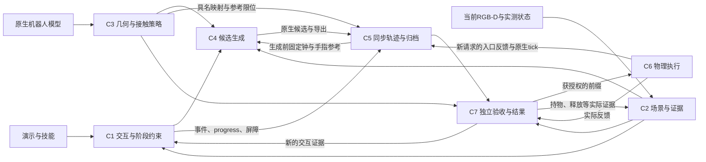

# FUNCTO Motion Planner PRD

**系统行为规格：交互约束、运动规划与物理执行**

本文把[准备稿](motion_planner_prd_preparation.md)中的意图转成可实现、可验收的系统约定。它是待用户确认的需求基线，不是“当前系统已经全部达标”的声明，也不授权更换求解器、扩大接触许可或修改任务语义。`MUST／不得`是验收要求；“已有”仅表示源码中存在相应能力，实际保证范围另列；“待补”表示尚无完整实现或证据。

本文件维护现行系统契约；组件核查、修订原因和外部资料范围见[审核记录](../sim-version-plans/2026-10-02-motion-planner-prd-review/review-record.md)。实现问题先核当前依赖的API和源码，再对照MoveIt/MTC、Isaac ROS cuMotion的定义、实现及相关issue，最后确定现有接口需要的最小适配。通用场景管理、任务容器、规划插件和控制执行机制优先复用成熟能力；不得因术语缺失而另建一套通用基础设施。本文未决项须形成具体方案后确认，不构成实施授权。

## 1. 系统整体

### 1.1 目标、用户和范围

系统把**演示表达的交互要求、当前场景证据、实测机器人状态和机器人模型**转成具名、同钟的机械臂与夹爪参考，并通过原生控制器在 robosuite/MuJoCo 中执行可获授权的前缀。规划、独立验证、物理执行和交互结果分别给出证据。使用者是技能编制、场景接入、运动规划、执行和验收组件的开发者；主要产物是明确接口及失败责任，不是新的通用任务框架。

本地验收面向单臂与独立双指平台、录制RGB-D和仿真；无真实机器人或摄像头。通用接口按 joint/body/geom/owner 名称工作，不把某个任务、源帧编号或固定“7+2”数组位置写入算法。已有模型、库和资源限制构成支持边界；不支持的输入应明确拒绝。

系统负责保留演示交互语义、物理限位、禁止碰撞、保守unknown处理、同步控制和独立验收。系统不负责凭空发明抓法、由单段观测推断未观测物理自由度、把遮挡补成自由空间、用控制命令代替反馈，或将几何成功转换成抓持成功。感知模型训练、真实硬件驱动认证、任意接触丰富动力学求解不属于本PRD交付范围；现有感知接入的输入质量与失效边界属于范围。

已知机器人模型和明确绑定的离线物体几何可按来源使用；当前物体位姿和证据不得从未授权仿真真值中补齐。完整仿真场景可用于恢复试验和独立评估，不能静默流入规划输入。具体任务的原生对象标签留在测试适配层。

### 1.2 系统整体—组件结构

下图是责任与逻辑数据依赖，不要求新增同名服务、继承层或文件。组件职责及交界由独立审核与跨组件审核核对，记录见[审核材料](../sim-version-plans/2026-10-02-motion-planner-prd-review/review-record.md)。

| 组件 | 唯一主要责任 | 当前代码落点 |
| --- | --- | --- |
| C1 | 演示来源、功能允许集、当前grounding、阶段与条件 | [skill.py](manipulation/skill.py)、[perception.py](manipulation/perception.py)、[program.py](manipulation/program.py)、[planning_problem.py](manipulation/planning_problem.py) |
| C2 | 当前场景、对象身份、自由/占据证据、unknown与场景变更 | [planning_observation.py](manipulation/planning_observation.py)、[planning_scene.py](manipulation/planning_scene.py)、[robot_coverage.py](manipulation/robot_coverage.py) |
| C3 | 同一机器人模型、几何表示、静态pair策略与局部接触规则 | [robot_geometry_check.py](manipulation/robot_geometry_check.py)、[tool_geometry.py](manipulation/tool_geometry.py)、[planning_scene.py](manipulation/planning_scene.py) |
| C4 | 在相同要求下生成IK、轨迹优化和搜索候选 | [planning.py](manipulation/planning.py) |
| C5 | 生成前同钟参考绑定、原生曲线导出、归档及重载 | [gripper_trajectory.py](manipulation/gripper_trajectory.py)、[planning.py](manipulation/planning.py)、[execution.py](manipulation/execution.py) |
| C6 | 原生控制、实际反馈、事件门、故障停止 | [robosuite_execution.py](manipulation/robosuite_execution.py)、[execution.py](manipulation/execution.py) |
| C7 | 独立模型/轨迹/实测验收及交互结果分层 | [robot_validation.py](manipulation/robot_validation.py)、[robot_geometry_check.py](manipulation/robot_geometry_check.py)、[execution.py](manipulation/execution.py)；场景专用评估在测试适配器 |

同一文件可承载多个责任，但每条事实只有一个拥有者：C1拥有交互要求，C2拥有场景证据，C3拥有模型级策略，C5拥有执行时钟，C6拥有实际反馈，C7拥有带范围的验收结论。C4只能消费这些条件，不能为求解成功改写它们。

### 1.3 统一状态、坐标与时间

| 概念 | 冻结语义 |
| --- | --- |
| `q_actual(t), dq_actual(t)` | 同一实际采样时刻、完整具名关节反馈；包括手指。历史命令和FK参考不能补缺测值。 |
| `q_ref(t)` | 待执行的名义关节参考；规划检查依其模型成立，不证明将来的实际状态。当前 `FingerTrajectory` 具体是**命令参考多项式**，不是接触停止状态预测。 |
| `q_cmd(t)`／`command_q` | 当前后端接收的位置目标，按关节类型为rad/m；不是实际关节反馈。其他控制模式必须声明独立命令类型，不能隐式改变q的单位。 |
| 原生 `actuator_ctrl` | 按执行器类型解释的输入；当前arm为N·m、finger为m。保留类型、单位和映射，不能将混合ctrl数组统称关节位置或力矩。 |
| `q_arm, q_finger` | 命名集合，按模型/执行器映射组合。两指独立反馈；只有真实驱动关系才能引入 `Aq=b`，不能推断对称。 |
| 位姿 | `T_parent_child` 将child坐标变换到parent；齐次矩阵4×4，平移m、转角rad。Torch/native四元数wxyz，SciPy xyzw只在边界显式转换。 |
| 源帧／源时间 | 原始整数frame ID与演示时间戳s；都不是数组下标，也不是执行时间。 |
| `s`／`u`／`t` | 阶段progress、归一轨迹参数、物理秒分开。`s(t)`可停留，停留期间手指仍可运动；不能由progress相同推断同一实际手形。 |
| optimizer controls | 原生优化变量；B-spline控制点不是采样关节状态。必须经对应原生transition/FK解释后再作物理判断。 |
| actual Holding／candidate attachment | 前者为有来源、同时间的实际持物证据；后者是条件规划假设。`close`、接触一次、目标位置到达均不自动产生Holding。 |

**规划验收检查名义状态和明确的场景假设；执行安全验收检查实际反馈及仍有效的场景证据。** 两类结论分别记录适用时段、模型和未检查项；规划通过不证明实际跟踪、物理接触或交互结果。

### 1.4 系统输入、输出和失效

一次请求必须具有以下逻辑输入；优先沿用现有对象和JSON/NPZ，不要求再建一套通用schema框架。

| 输入 | 必须绑定的内容 | 拥有者 |
| --- | --- | --- |
| 技能窗口 | 当前及至多下一技能、原program、源帧/事件、当前语义关联、合法pre-grasp、允许界与来源 | C1 |
| 当前状态 | 具名完整q/dq、采样时刻、基座/TCP标定、持物或释放证据；缺少的量标为未提供 | C6提供，C1/C2绑定 |
| 场景 | 当前RGB-D/标定/误差界、互斥owner关联、背景、完整度、原始自由证据、对象运动及条件 | C2 |
| 机器人 | 原生模型、独立检查模型、执行器/关节/geom映射、物理限位、球覆盖与pair来源 | C3 |
| 手指与执行约束 | 原事件对应的位置命令、名义参考、实际位置/速度保护区间、臂/TCP跟踪限值、停止限值及来源 | C5/C6 |
| 数值与资源 | 单位明确的数值容差、固定时间网格、种子/迭代/查询/内存预算 | C4/C5，不能覆盖上列物理要求 |

请求构造时，C1汇集任务、阶段与事件，C2/C3绑定模型及场景条件，C5/C6绑定同步参考和执行支持域；在C4能力准入前固定必需验收范围、时段与前置证据。原规划义务、可执行前缀和条件诊断后缀分别记录；不得在失败后删去约束或后缀，改称原请求成功。

输出必须区分：几何参考；失败诊断候选；规划通过的名义轨迹；完成该请求要求的独立验收、核对新鲜actual入口并获授权的可执行**前缀**；实际执行记录；交互证据与结果。输出保留原事件、具名关节、原生成功标志、独立残差、模型/场景来源、验收范围、首个失败见证以及未检查项。`success`只能在所属层解释，不能由“有trajectory对象／进程exit 0／文件写完”推断。

验收结论绑定模型、标定、场景证据、规则、入口和时段。执行前，用新鲜完整actual反馈核对请求入口；模型、标定、对象身份/几何、证据条件或规则已改变时，重验受影响范围。执行中，按同一物理时刻检查跟踪、阶段条件及场景假设；正常沿参考运动、载荷按有效attachment运动，不因数值变化而自动使整条参考失效。超出保护范围、丢持或发生未建模变化时，停止后续执行，重新绑定实际状态与场景并补齐验收，再决定剩余窗口是否重规划。历史报告保留原适用范围；故障候选保留原值，不以限位裁剪、角度折返或换曲线冒充原解。

### 1.5 场景与阶段状态迁移

Stage表达带上下文的状态迁移。MTC的`InterfaceState`持有场景与阶段属性，机器人状态位于场景中；FUNCTO沿用现有`PlanningProblem`、phase metadata、events/conditions及C2场景，绑定边界处的具名状态、world/attached关系、适用规则和来源，并标明actual、nominal或未来条件。阶段名和TCP位姿本身不足以表达该上下文。[MTC InterfaceState](https://github.com/moveit/moveit_task_constructor/blob/ros2/core/include/moveit/task_constructor/storage.h)

连接消费两侧已确定的上下文。允许变化的关节必须纳入同一同步参考；其余关节及未声明变更的对象、attachment和规则保持兼容。机械臂是优化变量时，手指仍可按已绑定的同钟参考运动，不能被暗中改变或强制锁死。MTC `Connect`提供两侧兼容与终点到达检查的行为参照；FUNCTO还须核对其动作身份、观测证据与局部许可，不能把上游`compatible()`视为已检查这些额外条件。[MTC Connect](https://github.com/moveit/moveit_task_constructor/blob/ros2/core/src/stages/connect.cpp)

| 语义责任 | 前置条件与持续约束 | 场景变更与证据边界 |
| --- | --- | --- |
| 自由连接 | 实测入口有效；可选择连接路径，仍受全机器人/场景约束 | 到演示来源的pre-grasp或已声明功能入口，保留两侧完整上下文 |
| 受保护接近 | 局部参考及允许界作用于整个后缀，保留源顶点/事件 | 接触许可仅在声明的材料、owner、面域和阶段生效 |
| 夹爪闭合 | 原命令与臂参考同钟，保留演示允许的臂运动 | 实际稳定Holding才支持当前持物事实，命令到时不产生该事实 |
| 持物操作 | 当前操作消费实际Holding；未来操作使用条件attachment | 载荷随对应关系运动，非接触部位继续检查；release需实际证据 |
| 释放与退回 | open意图、释放证据、退回参考独立 | 保留同一对象，以实际释放状态及后续运动条件重绑世界关系 |

表中责任可按演示时间重叠，不规定互斥串行阶段。当前`MotionPhase.kind`为`free/pose`，命令与条件叠加在整窗参考上，不引入额外停顿。MTC的`Connect`是双侧连接stage，`MoveRelative`是单侧传播stage，`CartesianPath`是直线笛卡尔插值solver；它们不等于任意演示曲线，也不代替本项目的整段允许集和事件。采用局部笛卡尔求解时仍须到达指定边界，部分路径不得按完整连接成功交接。[MTC阶段类型](https://moveit.github.io/moveit_task_constructor/basics.html)、[CartesianPath实现](https://github.com/moveit/moveit_task_constructor/blob/ros2/core/src/solvers/cartesian_path.cpp)

scene diff表达对象、附着关系和局部规则的增量变化。一次计算读取稳定场景；共享资料在使用期间不得被原位改写，候选中的关系与许可只作用于该候选，失败时丢弃候选。world→attached→world保留同一owner与几何来源，消费者看到完整关系更新，不出现重复或临时丢失对象；现有`CollisionOwner`可通过运动关系表达，无需复制两套容器。实际更新消费观测和反馈，候选释放FK不产生actual释放位姿；物体仍在下落时不能当成静止世界对象。MoveIt的diff与稳定副本用途不同；当前`clone_for_rollout`浅复制部分对象并分开查询缓存，不能证明共享几何、证据与规则已隔离。[MoveIt场景API](https://moveit.picknik.ai/main/doc/examples/planning_scene_ros_api/planning_scene_ros_api_tutorial.html)、[PlanningScene实现](https://github.com/moveit/moveit2/blob/main/moveit_core/planning_scene/src/planning_scene.cpp)

### 1.6 容差与数值层级

| 类别 | 含义与来源 | 不允许的替代 |
| --- | --- | --- |
| 算法数值容差 | 浮点比较、求解收敛、GJK/EPA算法参数；记录dtype和实际计算模式 | 不代表物理穿透许可，不补足技能自由度，也不自动构成严格误差界 |
| 技能允许界 | `pose_bounds(6,2)`及机构/功能事件约束；来自技能证据，含坐标和单位 | 不用统一epsilon、观测缺失或求解失败推导 |
| 几何/感知误差界 | 深度、模型、标定、全体素/代理包络误差的保守处理 | 不把外包几何当真实占据；不把数值舍入误差改为接触许可 |
| 物理接受限值 | 原生关节/执行器范围、实际跟踪、停止速度、明确允许接触的深度/力条件 | 不从命令、控制增益或失败峰值反推；没有来源就不是已校准限值 |

当前 `NumericalTolerance` 默认位置1e-4 m、旋转1e-3 rad，作用于目标局部**分量**；报告的向量范数不能直接与同一个分量阈值比较。物理执行限值由 `ExecutionLimits` 显式输入，不使用这些默认值补齐。物理关节限位、数值比较带和优化activation margin要分别记录，保持同名关节对应。

规划要求完整float32矩阵乘，不可仅凭tensor.dtype为float32推断精度。依赖导入改变TF32设置时必须显式恢复请求所需计算模式，覆盖forward和backward，并在退出时恢复调用方设置。异常、重复关闭和非零初速度必须有回归；不宣称当前全局Torch flag具有线程隔离性。[PyTorch数值精度说明](https://docs.pytorch.org/docs/main/notes/numerical_accuracy.html)

### 1.7 系统级可验收要求

组件表中的测试是追踪入口，不是新增框架。系统级要求通过下列集成判据验收。

| ID | MUST | 验收判据与关联 |
| --- | --- | --- |
| SYS-R1 | 交互语义和来源不被运动规划改写 | **待补** 非语义重命名用例：同一program/scene/robot仅更改显示名或不参与来源绑定的数据集标签，阶段、bounds、事件身份与判定不变；不得改变relation、motion、source、owner或坐标绑定。缺pre-grasp/物理自由度来源时明确失败；C1-R2/R3/R5 |
| SYS-R2 | nominal、command、actual及候选条件严格分离 | 故意制造命令/反馈差异，实际验收仍使用反馈；未Holding不得执行持物后缀；C1-R7、C5、C6 |
| SYS-R3 | 生成、导出、独立验收和执行绑定相同输入与物理时钟 | 修改关节顺序、模型、事件时间、起点或规则后旧授权失效；原非零dq0和共同采样时刻重载不变；C3-R1、C5、C7 |
| SYS-R4 | 限位、碰撞、局部位姿和unknown必须参与生成，且出口独立检查 | 对各项构造单独违例，记录IK/optimizer/state/edge/最终判定的作用与见证；不得仅靠出口reject；C2-R7、C4 |
| SYS-R5 | 每层成功只覆盖其实际检查范围 | L0–L6单独报状态；模拟solver success而独立检查失败，正式执行器不推进物理步；C7 |
| SYS-R6 | 预算与故障不能转成宽松成功 | 超内存/查询预算、未知状态、非有限反馈、库异常均显式失败；原因为空或检查未运行不能视为通过；C2-R8、C4、C6 |
| SYS-R7 | 复用成熟能力，通用接口不含任务特例 | 新实现评审必须列现有库/API能力、缺口和最小适配；具体任务只在数据/fixture中；库已覆盖的几何/FK/搜索/控制不自写替代；§4 |
| SYS-R8 | 每条要求有验收和状态；代码存在不代表验收通过 | 本文件各C*-R*行必须有实际测试或待补用例；报告带输入、范围、结果和未检查项；缺记录的层为未验证；§3 |

资源基线为本地16 GB内存、12 GB显存；感知重模型与规划GPU任务串行。保留现有内存准入和原生额外分配余量，不把Torch allocator cap当作全进程内存上界。受支持模型、字段和精度不因内存压力静默缩减；无法判定是否超载时先停止并交由用户决定。当前只承诺有预算的仿真/离线验证，不承诺每2 ms内完成所有CPU实体查询或真实机器人实时制动。

## 2. 组件规格

### C1 演示交互、grounding与阶段约束

**职责与接口。** C1从自包含技能资料和当前观测建立交互要求。`load_grounding_skill`载入离线资料，`ground_current_program`绑定当前观测并调用几何核，`build_planning_problem`把选定动作、源帧/源时间/事件、允许集及实测具名入口编成当前及至多下一技能的一个`PlanningProblem`。grounding输出参考与证据，不授予执行资格。object-only须显式请求，EEF请求缺Holding则失败；当前转移要求相同`tool_id/tool_frame`，不隐式支持跨工具重定向。

**演示边界。** 编制端给出最早已知接触或close的保护边界及来源；pre-grasp须是严格早于该边界的真实源观测。自由连接只到该点，其后的整段接近、闭合和原事件遵守演示参考及允许集。源帧存在与顺序校验不等于检测到了真实接触。pre-grasp已为第一帧但实际入口不同时，仍须显式连接到该入口。每阶段progress为`[i,i+1]`；源帧、源秒数与执行时间分开，停顿、反转和机构展开角不得丢失。

**允许集。** `pose_bounds(6,2)`按`[x,y,z,rx,ry,rz]`逐行给出`[lower,upper]`，误差为`[R_refᵀ(p−p_ref), Log(R_refᵀR)]`；平移单位m，旋转是rad制主值旋转向量，不是Euler角。有限相等界（含非零值）是等式，有限宽界是区间，`[-∞,+∞]`只放开该误差分量，单侧无穷只取消该侧限制；NaN、反序界及不含有限值的同号无穷界须拒绝。数值容差逐分量用于比较，不改变原bounds。局部旋转误差不能代替机构展开参数；跨π的绕数与反转由机构参考保留。

完整允许集还包括功能endpoint family、机构和事件。合法端点/frame anchor变化时，按原转移语义重算整段`T_ref`，在新参考的局部坐标应用原bounds，不能独立移动未授权端点。例如`on`可保留支撑面内平移/yaw，零bounds约束合法参考族中的对应曲线。相对约束参考的残差与`original_reference_*`偏移分别报告；后者只有独立技能阈值来源时才能参与拒绝。

一次C4请求仅处理一个已绑定问题。C1承担请求构造与动作选择责任：调用方须在进入C4前显式指定一个合法动作，并绑定其candidate身份、owner、已确定的场景解释及来源。C4的数值IK/轨迹seed、OMPL初始化和重试不得改变该绑定。同一已确定owner的其他动作尚未决，不必否定已获支持的动作；互斥场景解释仍未决时则不得构造正式请求。跨动作排名与预算分配尚未贯通，当前不承诺自动选择能力，也不能因此删除技能表达的合法动作集合或新增抓法。

当前持物操作消费同owner、同期的稳定Holding证据及实测attachment；未来技能只能使用条件attachment。执行到证据边界后，须凭交接时仍有效的实际证据与当前反馈重绑剩余工作，不能由close命令到时产生Holding，也不无条件要求重采停止后的完整稳定窗。功能事件、open、release和退回独立；actual release后由C2重绑对象的世界关系。

下表 `PP` 为 [test_manipulation_planning_problem.py](tests/test_manipulation_planning_problem.py)。

| ID | MUST与验收判据 | 现有测试／待补与范围 |
| --- | --- | --- |
| C1-R1 | 离线语义与原事件有唯一来源；几何payload不得覆盖语义或越界载入 | [skill tests](tests/test_manipulation_skill.py)：`test_geometry_metadata_cannot_silently_override_offline_semantics`、`test_bundle_cannot_read_external_payloads_and_cannot_guess_missing_semantics` |
| C1-R2 | 显式坐标/owner身份完整；改变坐标表达不改变物理结果，缺方向证据不能补完整抓取帧 | [current-program tests](tests/test_manipulation_current_program.py)：`test_binding_camera_gauge_preserves_physical_eef_and_observed_body`、`test_plane_cannot_satisfy_grasp_or_full_frame_manipulation` |
| C1-R3 | 保护真实pre-grasp后的全部接近；缺源边界拒绝，不按固定距离人工后退 | PP：`test_pregrasp_preserves_bound_tail_and_constrains_precontact_motion`、`test_grasp_requires_a_real_pregrasp_observation_before_contact`；现有零允许界夹具的1 cm偏移应拒绝，通则是不得超出已声明允许集 |
| C1-R4 | 保留源顶点/事件progress、机构停顿反转及展开角，源时间不冒充执行时间 | PP：`test_event_and_cartesian_vertex_share_the_exact_source_progress`、`test_prismatic_pause_and_reversal_remain_in_phase_reference`、`test_mechanism_interpolation_keeps_hinge_arc_and_unwrapped_winding` |
| C1-R5 | 技能bounds按上述六分量与局部参考贯通，合法端点变化不扩大bounds，缺证据不能变free | PP：`test_allowed_band_is_target_local_and_not_an_equality_centerline`；**待补** `test_skill_pose_bounds_survive_builder`，artifact→builder→归档保持值/坐标/来源；补旋转局部轴、单侧无穷、非法同号无穷及跨π参数化反例 |
| C1-R6 | C1绑定合法动作与确定场景；连接两侧满足§1.5上下文约定，数值seed不改变语义 | [registration tests](tests/test_manipulation_registration_validation.py)：`test_wrapper_does_not_upgrade_uncertain_or_inapplicable_geometry`；**待补** `test_planner_request_keeps_selected_binding_and_candidate_provenance`：两合法动作保留各自允许集，换seed/OMPL/重试不变身份与来源；未决场景、未纳入同步参考的finger变化、world/attached/规则失配均不得靠规划成功放行 |
| C1-R7 | 实际Holding缺失则当前操作失败；未来attachment只生成条件，证据屏障可停 | PP：`test_future_manipulation_uses_candidate_without_fabricating_actual_holding`、`test_current_manipulation_still_requires_real_synchronized_holding`、`test_barriers_need_declared_safe_holds_and_cannot_reuse_a_released_attachment` |
| C1-R8 | 功能事件、open、release、退回独立；窗口最多两技能，真实release才终止持物关系 | PP：`test_function_open_release_and_retreat_keep_distinct_source_boundaries`、`test_actual_holding_spans_merge_across_skills_until_the_real_release`、`test_window_rejects_more_than_current_and_next_skill` |

**当前缺口。** `MotionPhase.pose_bounds`已有低层计算，但builder没有读取技能artifact中的相应字段；选定candidate的完整身份及来源也未贯通到规划与归档。阶段边界上下文没有生产入口的完整兼容校验；非法同号无穷界、主值旋转向量在π附近的边界尚缺验收。Holding消费者只核外部标记与位姿绑定，不自行产生稳定持物证据。

### C2 当前场景、观测证据与unknown

**职责与接口。** `observed_space_from_rgbd/build_scene_from_rgbd`消费已标定RGB-D、米制camera-z深度、零skew针孔K、`T_output_camera`、互斥owner/robot掩码及带来源的实体资料；输出 `ObservedSpace/PlanningScene/CollisionOwner`等现有对象。网格索引z,y,x，origin是首体素中心。局部功能区域、当前可见面、完整owner和完整运动包络不得混称。

F是有效深度在声明的标定、像素模型和误差界下证明的**完整自由体素并集**；O是当前位姿下有来源的物理实体/内实体占据证据，K=F∪O只表示已知。加入O、机器人自滤、目标剔除或ESDF清除均不得改写原始F。网格外、坏深度、遮挡后方和无证据的表面带保留unknown；外包球、凸包、AABB或watertight拓扑本身不能证明内部为实物，空腔不得填实。

场景证据须有适用时段和静态/刚性运动假设。静态owner可在条件仍成立时复用观测，不要求每个物理步重新采图；过期、假设被反证或发生未建模变化时，重绑受影响证据。多视图须共同描述请求入口，时间戳相同不代替标定与几何校验，有依据的静态多视图也不因采集时刻数值不同被一概拒绝。[MoveIt场景监视职责](https://moveit.picknik.ai/main/doc/concepts/planning_scene_monitor.html)

当前严格机器人自由证据门要求`Vnew(q)=V(q)\V0`具有F支持，即`V(q)\(V0∪F)=∅`。V0来自同模型、同标定的完整实测入口（含双指），附带“初态有效”来源；它不是深度自由证据，不证明隐藏环境安全，也不豁免已知碰撞。V0不含固定安装障碍或载荷，请求内不得随候选或actual采样滚动扩大。新的请求使用新入口时，必须重新履行入口及场景检查。

自由证据门和接触规则共同生效。F外残差可能进入已证O，也可能进入F∪O之外的unknown；只能计算F外差集的查询应报告“自由证据不足，尚未区分”，不能自行断言物理穿透或真正unknown体积。局部接触许可不改写F，不放行O中的新增实体，也不把owner周围无证据的表面带变成可进入区域。当前严格门对这些输入保持拒绝/未支持；若D2/D4要求支持局部软接触，必须给出材料/实体对、owner、面域、阶段、误差及物理界共同作用的唯一判据。禁止用K替F或扩大V0。

机器人、静态障碍和移动载荷分别报告检查范围。载荷不继承机器人V0例外，其完整几何、未来位姿和所需自由/接触证据须独立满足请求要求。物体离开旧位姿后，旧O不再支持该位置的当前覆盖；候选移动不产生新观测，旧位置也不自动成为F。实际release后按实际释放状态及后续运动条件重绑，不能用候选释放FK宣布物体已静止。

可微采样guidance、manifold3d完整实体差集的浮点**状态查询**、连续路径保证是三种不同能力。差集非空不得按微小体积阈值放行；采样点全通过也不得替代体积查询；现有离散细分不得标为连续扫掠体证明。

`O/S/C`分别指 [observation tests](tests/test_manipulation_planning_observation.py)、[scene tests](tests/test_manipulation_planning_scene.py)、[coverage tests](tests/test_robot_coverage.py)。

| ID | MUST与验收判据 | 现有测试／待补与范围 |
| --- | --- | --- |
| C2-R1 | 观测、标定、位姿与完整反馈共同描述请求入口，并记录采集时刻及静态/运动假设 | O：`test_missing_owner_depth_and_wrong_calibration_cannot_create_geometry`；**待补** `test_scene_rejects_mixed_epochs_and_stale_validation`，混用移动对象时刻、换标定、旧反馈拒绝；有依据的静态多视图允许不同采集时刻 |
| C2-R2 | 按准确owner掩码分区，不按包围盒擦除邻物，不把局部表面升级完整实体 | O：`test_owner_partition_removes_exact_pixels_and_keeps_geometry_inside_their_aabb`、`test_closed_collision_hulls_partial_meshes_and_future_poses_are_not_occupied_evidence`；S：`test_owned_geometry_cannot_remain_in_background_under_another_partition` |
| C2-R3 | F与O分开保留，完整体素误差和矛盾占据必须检查 | O：`test_a_watertight_cavity_stays_unknown_and_whole_cell_error_margin_is_required`、`test_free_ray_and_occupied_solid_proofs_must_not_contradict`；**待补** `test_rgbd_solids_preserve_original_free_grid`，加O后F逐值不变 |
| C2-R4 | V0只绑定固定实测入口；新体积无F则拒绝，不扩大F或容忍未知薄片 | C：`test_q0_passes_with_no_observed_free_volume_but_new_volume_fails`、`test_initial_float32_binding_is_exact_and_never_used_for_future_samples`、`test_small_nonzero_sliver_has_no_user_acceptance_threshold` |
| C2-R5 | coverage不得豁免禁止碰撞；不完整或移动载荷不继承初机器人例外 | S：`test_static_partial_owner_used_for_occupied_coverage_remains_unknown`、`test_payload_keeps_noncontact_robot_collision_and_partial_cover_unknown` |
| C2-R6 | 实际关系变更消费同owner的Holding/release证据，候选关系与许可不外泄；预期运动按声明模型检查，超域变化触发重验 | S：`test_attachment_requires_exact_span_condition_and_real_release_boundary`；**待补** `test_scene_diff_invalidates_moved_occupancy_and_prior_acceptance`，对象无重复/丢失，旧O不继续授予覆盖，release不自动产生F或静止世界位姿 |
| C2-R7 | 分开报告guidance、机器人完整实体、载荷代理/实体和连续范围；F外残差须区分O、unknown及尚不能分类 | C：`test_unknown_voxel_inside_robot_volume_is_not_missed_by_surface_vertices`；**待补** `test_sparse_guidance_zero_cannot_override_full_volume_failure`、O/unknown分类、载荷借旧O通过及许可接触/未知表面带的联合反例；D2/D4给出支持域 |
| C2-R8 | 查询、几何或预算错误是拒绝，不能跳过coverage后成功 | C：`test_query_and_cpu_work_exhaustion_are_rejections`；O：`test_native_mapper_floor_is_budgeted_before_any_device_allocation` |

**当前缺口。** 多视图时间与反馈一致性、移动O失效、实际场景变化后的后缀重验尚未贯通。两个RGB-D builder加入known solids后没有独立传出原始`known_free`，与RobotCoverage组合会拒绝。RobotCoverage只计算F/V0差集，现有`unknown`诊断不能区分O；移动载荷仍采用K的球覆盖，没有机器人的完整实体F门。`clone_for_rollout`也未提供任意规则与证据隔离。继续复用Mapper、SciPy、trimesh、manifold3d及Pinocchio/Coal，补齐这些具体接口与验收。

### C3 机器人模型、几何与碰撞／接触策略

**职责与模型。** C3绑定编译后的原生模型、独立检查模型及规划实际消费模型，保留具名关节/执行器、base/TCP、逐link的碰撞geom、局部变换和固定安装件。MuJoCo碰撞几何、原生过滤与软接触参数共同定义仿真执行模型，视觉mesh不自动成为碰撞体。当前接入支持固定基座、独立有界标量关节及已实现实体类型；未映射的关节关系、模型扩展或碰撞规则在接入处明确拒绝，不能从“完整模型”推断支持任意MuJoCo模型。

**几何表示。** Pinocchio/Coal分别提供独立FK和逐实体浮点距离查询，不自动证明完整世界、步间连续运动或真实接触。cuRobo球用于快速规划，球重叠不等于原生实体穿透。球、局部坐标、后端变换与实际buffer必须绑定同一模型；保守包络结论仅覆盖已有全体积资料和数值误差处理支持的范围。代理膨胀不增加O，算法容差和碰撞buffer不授予物理接触许可。

| 现有原生geom对表示 | 判据与范围 | 不可推导的结论 |
| --- | --- | --- |
| `required` | 该启用实体对要求分离，保留raw距离与geom身份 | 数值边界不构成碰撞豁免 |
| `mechanical_contact` | 只对声明的robot-solid pair免除分离要求，保留原生物理处理及raw距离 | 该标记不证明深度、力、阶段或材料面域条件已检查 |
| `excluded` | 记录原生过滤及其原因，独立查询可保留几何重叠见证 | 过滤不证明实体分离，也不免除FK、关节限位或其他pair检查 |

**查询省略与后端投影。** 原生过滤、明确接触许可、限定模型/关节域中的分离依据分别保留来源。分离依据只省略其覆盖的查询，不把禁止相交的pair改成允许接触；邻接或有限采样未碰撞不构成该依据。导出link级ignore前，逐项核对它省略的geom查询及模型、关节域、几何和buffer假设。若依据为接触许可，必须覆盖被省略的完整范围；pad–pad、部分面域或部分阶段许可不能扩大为整指、palm、其他owner或整个窗口。后端不能保留条件时明确拒绝。[MuJoCo碰撞选择](https://mujoco.readthedocs.io/en/stable/computation/index.html#selection)

**局部场景接触。** `ContactRule`绑定actor材料、target owner、阶段、feature/patch、法向和间隙；模型级机械许可与场景规则由各自拥有者提供，C4消费同一有效范围。MoveIt ACM可借鉴命名pair和条件判定，但条件回调是进程内能力，不能通过布尔ACM消息完整往返；`touch_links`或XRDF ignore的整link跳过查询也不能承载局部patch或物理力条件。C6须使用实际geom/owner/接触点和当时有效规则检查，attachment更新不证明Holding；自由证据门仍按C2/D2/D4生效。[ACM API](https://moveit.picknik.ai/main/api/html/classcollision__detection_1_1AllowedCollisionMatrix.html)、[ACM消息导出实现](https://moveit.picknik.ai/main/api/html/moveit__core_2collision__detection_2src_2collision__matrix_8cpp_source.html)、[touch_links查询行为](https://moveit.picknik.ai/main/api/html/moveit__core_2collision__detection__fcl_2src_2collision__common_8cpp_source.html)

阶段progress与实际时间分别核对：progress停留或末步参考裁剪不延长规则物理有效时段。原阶段规则能否覆盖屏障后的末步尾部，取决于已声明的保持条件、证据时效和同一接触范围；不得自动启用下一阶段规则。

| ID | MUST与验收判据 | 现有测试／待补与范围 |
| --- | --- | --- |
| C3-R1 | 支持域内完整模型树、轴向、限位、TCP、固定件和geom一致；静态篡改及未映射扩展拒绝，合法新反馈不破坏模型绑定 | [fixture tests](tests/test_robot_fixture.py)：`test_source_export_reload_and_tamper_checks_allow_new_joint_feedback`、`test_fixed_primitives_survive_export_without_becoming_robot_spheres` |
| C3-R2 | 实体逐件保持，变换/scale只应用一次；报告数值边界，不以算法tolerance豁免碰撞 | [geometry tests](tests/test_robot_geometry_check.py)：`test_world_base_fixed_frame_and_local_geometry_applied_once`、`test_nested_solids_report_penetration_even_without_surface_crossing`、`test_near_tolerance_is_reported_without_waiving_collision` |
| C3-R3 | 球的全体积覆盖、实际buffer及数值变换范围共同支持包络结论，表面采样或固定余量不能独自证明 | 已有fixture资料；**待补** `test_transformed_sphere_cover_preserves_enclosure`，限定模型及计算路径的变换误差界不超过包络余量；超域或无依据时不授予保守结论。非对称手形/极值探针只作回归，不要求另建通用误差认证设施 |
| C3-R4 | 正式geom对表示唯一，过滤/接触许可/查询省略依据分别可追溯；link-ignore投影不得扩域 | [validator tests](tests/test_robot_validation.py)：`test_pair_inventory_and_native_exclusion_are_explicit_and_preserved`、`test_explicit_mechanical_contact_preserves_boundary_and_overlap_evidence`；fixture：`test_partial_permission_rejects_same_link_other_enabled_geometry`、`test_mechanical_contact_cannot_silently_disable_physics`；**待补** 分离依据不得改写成接触许可、条件丢失不得升级ALWAYS的反例 |
| C3-R5 | 场景接触同时满足材料、owner、时段、面域/法向；安装排除不传给运动物体 | [scene tests](tests/test_manipulation_planning_scene.py)：`test_local_contact_permission_does_not_remove_palm_or_other_owner`、`test_feature_footprint_and_normal_guard_contact_margin`、`test_partial_moving_or_stale_installation_cannot_inherit_exclusion`、`test_exclusion_preserves_other_robot_links_payload_background_and_unknown` |
| C3-R6 | 名义闭合模型矛盾必须阻止授权，不能换arm IK或扩大pad许可掩盖 | validator：`test_actual_finger_state_is_independent_of_the_command_and_collision_is_mandatory`；**待补** `test_nominal_zero_closure_retains_two_forbidden_pairs`，固定审计fixture需保留两对拒绝见证，不能预设实际接触闭合也失败 |
| C3-R7 | 模型策略与阶段scene变更分属明确拥有者，候选/阶段许可不得影响其他候选或实际场景 | **待补** `test_scene_diff_contact_policy_isolation`，检查兄弟候选、失败候选丢弃及阶段退出；现有clone缓存隔离不足以证明 |

**当前缺口。** 已审模型的名义双指零位有两对禁止接触实体冲突，独立于arm姿态；实际空闭合通过不修复名义模型，接触停止手形见D2。[具体见证](../sim-version-plans/2026-10-01-functo-long-task/constraint-generation-audit/audit-result.md)留在对应fixture和审计中。现`mechanical_contact`只免除分离，`ContactRule`主要检查规划几何条件；所需实际深度/力/面域判据未贯通。指定fixture的分块球覆盖及分离依据只支持其模型与计算范围，不能推广到未验模型、buffer或GPU变换。

### C4 运动候选生成

**职责与请求准入。** `plan_trajectory(problem, scene, robot, *, budget=None, device="cuda:0")`求解C1绑定的一个问题，输出`PlanningResult(success, trajectory, diagnostics)`。借用MoveIt `canServiceRequest`的职责，现有入口在生成前核对起点、模型/TCP、动作与场景、目标允许集、全过程要求、阶段/事件、时钟及预算均可被当前适配表达和消费；不支持项须指出字段、阶段与原因，不能丢字段、转成软偏好或退化成仅终点规划。无需增加插件注册表或约束DSL。[PlannerManager](https://moveit.picknik.ai/main/api/html/classplanning__interface_1_1PlannerManager.html)

原请求必需的后续open/close须有相应参考和约束消费位置；首屏障后延续末nominal手形或仅保存事件身份不构成支持。缺少时明确不支持的阶段及原因，保留条件诊断，不授予原完整同步请求成功；不得事后删事件、缩范围或截失败候选前缀升级。

优化变量集合与完整同步关节集合分开绑定。当前free controls只有active arm joints；几何与限位仍使用同钟名义手指状态。C5声明的手指运动可以与臂并行，不因未进入arm controls就被锁死或删除。流程为参考IK初始化→cuRobo整窗优化→逐候选native/export检查；refinement与OMPL初始化均消费原请求预算，OMPL成功后仍须完整优化与验收。初始化不得覆盖实测起点、目标、演示允许集或场景解释；域内但目标未收敛的IK可作初始化，不能称为已通过任务约束的解。[MoveIt请求语义](https://raw.githubusercontent.com/moveit/moveit_msgs/ros2/msg/MotionPlanRequest.msg)

| 条件 | IK／每轮优化 | OMPL／最终规划检查 | 不等价边界 |
| --- | --- | --- | --- |
| 物理限位 | native POSITION／STATE有限罚 | 物理范围、状态/边检查；导出另有解析加速度检查 | 当前有限罚没有绝对位置投影；不能提供生成域保证 |
| 自碰撞、场景、手形 | native self、场景项、同钟nominal手形 | 相同pair/phase语义；独立实体检查另属C7 | 代理球、实体查询及真实接触不能互相代替 |
| 局部位姿、功能与停点 | IK当前目标；优化整个阶段和精确源anchors | 等式投影、不等式及完整过程检查 | 下游支持bounds不代表上游已经传入 |
| 自由证据与unknown | 可微实体采样guidance | 状态/边及导出的完整体积差判定 | guidance与体积门零集不同，native metrics没有该实体项；当前F外原因分类与载荷范围见C2 |

**生成域与约束作用域。** IK消费当前目标及目标阶段场景/手形；整窗优化保留全部阶段、源anchors、公共边界和事件；OMPL用等式投影及状态/边回调检查相应要求，有限带和自由轴不得变成中心线。四类约束须在所需生成位置实际生效，schedule替换不丢项。物理q硬域覆盖IK交接seed、被接受的优化迭代及跨轮继续候选、搜索接纳状态/边、固定边界和解码连续曲线；有限罚、裁剪或仅出口拒绝不能替代。库私有梯度/line-search/投影试探可按原值诊断，但一旦被接纳或交接即受硬域约束，不能改名scratch规避。IK任务失败与q越限分别判断，控制点合法不自动证明段内极值合法。

**预算与失败。** 同一请求的候选、refinement和重试共用seed、iteration、solve、查询与内存上限；搜索边界准备消费同一搜索子预算，OMPL成功后仍需完整求解额度。`search_seconds`不是全请求墙钟期限。成功必须来自同一候选同时通过native和导出检查；全部未通过时公开`trajectory=None`。保留输入无效/不支持、入口违例、预算内未找到、资源/查询耗尽、非有限/库接口故障、导出违例及每次尝试原因；未找到解不证明任务不可行。失败曲线只作为带分类的诊断产物。

`P/Q`分别为 [planning tests](tests/test_manipulation_planning.py)、[problem tests](tests/test_manipulation_planning_problem.py)。

| ID | MUST与验收判据 | 现有测试／待补与范围 |
| --- | --- | --- |
| C4-R1 | 每个seed分别通过native与导出检查；全失败公开轨迹为空，失败保留分层原因而不推导不可行 | P：`test_native_and_exported_curve_must_both_pass_without_candidate_leakage`、`test_second_seed_with_native_and_export_success_cannot_be_discarded`；**待补** 不支持、预算耗尽、库故障与曲线拒绝不能统一成任务不可行的用例 |
| C4-R2 | 物理q硬域覆盖被接纳迭代、全部生成交接、固定边界及连续曲线，不靠有限罚、裁剪或出口拒绝替代 | **待补且当前未满足** `test_physical_domain_at_every_generator_handoff`、`test_cubic_position_extrema_remain_in_domain`；分别注入域内任务未收敛IK与域外IK，前者可继续初始化、后者不得交接；核非零dq0、跨轮、图边、曲线及私有试探不外泄；D1决定实现 |
| C4-R3 | 每轮及schedule替换后四类约束仍影响生成；梯度与验收作用需分别核对 | P：`test_export_full_volume_rejection_is_hard_even_when_all_gpu_costs_zero`、`test_transition_binding_keeps_cspace_types_limits_and_smoothness_private`；**待补** 四项独立违例的逐轮接线及FD测试，不能以总目标下降替代 |
| C4-R4 | 源pose bounds原样贯通，不将等式、有限允许区间和自由轴混同 | Q：`test_allowed_band_is_target_local_and_not_an_equality_centerline`、`test_numerical_acceptance_does_not_mutate_declared_skill_bounds`；上游贯通与C1-R5共用待补用例 |
| C4-R5 | whole-window保留全部源义务，并完成原请求范围内相应生成/验收；事件metadata或条件诊断不算完整同步成功；搜索成功只作seed，重做完整求解 | P：`test_ompl_success_is_only_a_seed_and_cannot_bypass_the_final_complete_solve`；**待补** 生产OMPL边末端违例回归；[OMPL探针](tests/planning/probe_ompl_constraints.py)不算完整机器人成功 |
| C4-R6 | 生成、密集采样和手形保持同钟，实际计算模式满足几何精度要求 | [clock tests](tests/test_native_clock.py)：`test_native_clock_adapter_keeps_two_seed_buffers_and_rejects_knot_drift`；[precision tests](tests/test_planning_precision.py)：`test_initialization_failure_restores_settings_after_dependency_side_effect`、`test_request_restores_both_callers_and_repeated_close_does_not_reapply`。这些是CPU调用/生命周期契约，GPU数值回放范围见C5，不证明全部目标梯度正确 |
| C4-R7 | 单batch，全部候选/重试共用请求预算；搜索含边界准备且留完整求解额度，必需源anchors不得删除 | P：`test_total_source_and_pause_overflow_fail_before_native_construction`、`test_curve_refinement_reoptimizes_whole_candidates_with_a_hard_solve_cap`；**待补** 宿主RAM与设备/原生峰值联合准入、重试不重置预算的用例；不由搜索子预算推导总墙钟期限 |
| C4-R8 | 在现有入口完成请求能力准入，所有必需目标/过程/手形/几何要求有实际消费位置，不支持项不得被忽略 | **待补** 注入无法表达的非空要求或首屏障后必需open/close而仅有持值后缀，须在生成前给字段/阶段/原因；受支持请求仍保留同钟finger和全阶段约束；对象构造成功、MoveIt消息兼容均不足以通过 |

**当前缺口。** 当前整窗arm优化使用首屏障后的末nominal finger保持值，后续原open/close动作尚未展开；native/export数值通过不能补足完整同步语义。保留现有两技能lookahead，未覆盖部分作为条件诊断，D2/D5决定接触后手形和事件贯通。失败IK和跨轮solution的交接没有物理q硬域保证，原生POSITION/STATE仍为有限罚；这不满足C4-R2，原因并非所有失败IK都必然越限。完整能力准入、失败分类和主机/设备联合资源准入尚未贯通；现`complete_process_optimization_not_feasible`只能解释为本次求解未找到通过者。两项scene/unknown梯度差异仍待隔离，export复用cuRobo FK，不能称为独立实体验收。继续使用cuRobo/OMPL现有扩展点；其他优化器即使有bounds，也须证明保留全部任务约束后才可提出替换方案。[OMPL约束规划接口](https://ompl.kavrakilab.org/core/constrainedPlanning.html)

### C5 同步轨迹、夹爪、物理时钟与归档

**职责与接口。** C5在候选生成前绑定请求时间原点、固定曲线时钟、progress/事件映射及手指参考，供C4生成和场景查询使用；生成后负责原生候选导出与无改写存取。借用`JointTrajectory`的具名顺序、相对起点秒数与关节单位，沿用现有cuRobo、SciPy、JSON/NPZ。新入口反馈只用于新请求绑定，不得在执行中静默修改已接受参考。[标准JointTrajectory](https://github.com/ros2/common_interfaces/blob/rolling/trajectory_msgs/msg/JointTrajectory.msg)

本项目`JointTrajectory`保存臂的times/q/dq、progress、原事件身份、条件和残差，以SciPy Hermite重建；`FingerTrajectory`保存从同次actual q/dq开始的具名C¹命令参考、入口身份及预定activation tick。`FixedFingerTargets`只绑定原事件目标与来源，不另带一份事件时间。当前controls只含active arm joints；locked/non-optimized fingers仍进入同钟手形查询，不得混入controls维数或用默认开度替代实际入口。

名义手指参考须在绑定的执行截止期内满足q/dq/ddq界，不预测接触停止位置或Holding。当前后端支持的双平移指位置执行器与unit-gear限制属于设备适配域；actual区间是运行保护条件，全行程并集不代表某一时刻手形。有界ramp搜索未找到解，应报告当前参考不可构造/未找到候选，不延后事件或推断任务不可行。

**固定钟。** `native_dt`、knot间隔K、dense/export采样dt与physics timestep分别保存，使用同一时间原点和物理秒；同钟不要求同频率。当前适配仅接受原生float32与保存binary64时间轴均能严格保持K的整数细分网格，不支持比例在原生分配前拒绝，knot漂移拒绝，controls、有效长度和非零入口导数不变。raw/dense只在共同物理时刻按声明的数值判据对照；NPZ/Hermite重载核对同一组q/dq/t数组，不能据此宣称连续曲线及高阶导数数学等价。控制点不是q样本，padding不是有效轨迹。

当前不提供物理重定时。MTC按waypoint合并后重计时、MoveIt TOTG拟合/重采样的结果都须重新验收，不能作为保留本请求固定钟、非零dq0和事件的透明处理。未来若获准重定时，必须一起处理arm/finger、入口导数、事件/屏障/截止期及场景条件；改变路径还须重验几何和技能允许集。cuMotion的插值dt与速度缩放也是不同操作，其默认值不覆盖本项目时钟。[MTC merge实现](https://github.com/moveit/moveit_task_constructor/blob/ros2/core/src/merge.cpp)、[MoveIt时间参数化](https://moveit.picknik.ai/main/doc/examples/time_parameterization/time_parameterization_tutorial.html)

**事件与屏障。** 原skill/event身份、源帧/源时间保留；本请求通过progress映射首次绑定的执行`time/hold_until`随后冻结，平台两端保留验证anchor。命令只能在首个不早于其执行time的原生tick获得激活资格；预定tick与延迟不等于已下发。仅time及activation均严格早于首屏障的命令可在本次前缀应用；屏障同刻及之后的原事件仍保留，本次不得下发。同tick保留全部事件身份，只有实际通过门并下发者记applied，其余记superseded/unapplied，被覆盖事件所需证据仍未满足。

屏障stop限制参考与新事件授权。非网格屏障处，最后参考采样裁于stop，actual来自完成的原生整步，时刻可能更晚；必须保存原stop、参考/控制/actual时间及差值，不能伪造同刻反馈或漏掉最后样本。仅当原阶段保持条件、owner/接触规则的有效时段覆盖最后整步，且该请求必需的actual检查纳入此步时才支持该前缀，否则执行前报告不支持；不能用参考裁剪延长到期许可；实际检查的离散/连续范围仍按D4报告。实际未达stop不得报告已到达，参考结束不等于物理停住。

**连续性与保存。** 导出Hermite保证C¹；float32 q/dq重建不能无条件继承理想B-spline的C²。q/dq/ddq按具名上下界检查每段与结点两侧，记录加速度跳变；现有要求不增设C²/C³、jerk连续或实际扭矩连续门。reference、command、actual分开保存，重载保留原分类、残差及范围，不重生finger、不换曲线、不升级失败或未验结果。整条臂曲线、已生成同步手形的时段、获授权前缀与实际执行时段分别报告。

| ID | MUST与验收判据 | 现有测试／待补与范围 |
| --- | --- | --- |
| C5-R1 | reference、command、actual分别保存；名义闭合不宣称接触后手形或Holding | [simulation tests](tests/test_recorded_simulation.py)：`test_zero_closing_command_never_relabels_stalled_actual_fingers_or_certifies_holding`；该mock只验语义，物理接触模型见D2 |
| C5-R2 | 从同一次具名反馈保留q0及非零dq0，不假定双指对称或补零速度；原生驱动映射必须匹配 | [finger tests](tests/test_gripper_trajectory.py)：`test_measured_q_and_nonzero_dq_are_preserved_before_the_first_open_target`；simulation：`test_installed_unscaled_grip_preserves_asymmetric_raw_native_commands` |
| C5-R3 | C4生成前绑定固定钟、finger及实际覆盖范围；原事件对应参考未生成须显式报告；raw/dense/export各自dt/K和有效长度正确；controls不变，非法网格及一ULP漂移拒绝 | [planning tests](tests/test_manipulation_planning.py)：`test_exact_grid_supports_general_representable_clock_and_rejects_retiming`；[adapter tests](tests/test_native_clock.py)：`test_native_clock_adapter_keeps_two_seed_buffers_and_rejects_knot_drift`；**待补** 生成中改钟/换finger使旧绑定失效 |
| C5-R4 | 源时间与t/u/s分开，首次绑定的执行时刻冻结；平台两端保留验证点，原事件不复制，arm/finger不得独立重定时 | planning：`test_plateau_has_two_validation_anchors_but_one_original_event_trigger`；**待补（仅在获准retiming后）** `test_retiming_invalidates_all_synchronized_acceptance`，当前不提供该功能 |
| C5-R5 | 按实际多项式声明C¹，逐段及结点两侧检查具名加速度界；不增设未约定的C²门 | planning：`test_left_acceleration_limit_and_reordered_asymmetric_bounds`、`test_c1_curve_with_acceleration_jump_is_accepted_inside_existing_bounds`；finger：`test_native_reference_bounds_and_c1_are_checked_without_a_c2_gate` |
| C5-R6 | 激活不早于绑定的执行time，同tick区分applied/superseded/unapplied；屏障参考与末步actual时段分别检查，不到达不得报完成 | finger：`test_non_grid_event_is_not_moved_or_issued_early`、`test_unreachable_deadline_and_late_native_activation_are_rejected`；simulation：`test_superseded_events_and_commands_at_barrier_are_not_reported_as_applied`、`test_native_step_clock_records_all_commands_and_actual_state_at_barrier`；**待补** stop在physics网格右侧一ULP、末步越过许可时限及被覆盖必需事件的反例 |
| C5-R7 | 保留seed/batch/active names、dt/K、有效长度/padding及分类；保留原请求、原事件和未生成/未验范围；重载、截前缀不得改曲线、重生finger或升级失败 | [archive tests](tests/test_recorded_task_planning.py)：`test_native_record_keeps_seed_layout_padding_and_distinct_clocks`、`test_curve_record_keeps_classification_and_separates_full_curve_from_barrier`；simulation：`test_saved_finger_polynomial_requires_matching_metadata_and_all_arrays`；**待补** 无finger时arm时间/progress/event/duration元数据一致性拒绝用例 |

**当前范围与缺口。** 完整saver/loader在测试适配器`recorded_task_planning.save_curve`、`recorded_simulation.load_saved_trajectory`；已有原生时钟回放仅覆盖共同物理时刻数值及NPZ/Hermite重载，未完成生产接受结果绑定。`FingerTrajectory`仅为首屏障前事件构造动作，之后保持末nominal值；后缀原open/close未展开，不能据此声明整窗同步动作已生成或验收。非网格末步虽保留参考/actual双时间，但其完整许可和场景时段未闭合；step-count减epsilon取整还需右侧一ULP回归。归档或插值一致性不补足这些时段、手形和物理证据缺口。

### C6 物理执行、控制器与实际反馈

**职责与接口。** `TrajectoryExecutor.execute` 消费 C5 的原臂曲线、同步 finger 参考、原命令 targets、完整入口反馈、`ExecutionLimits` 和必需的独立 validator，并核对 C7 对该前缀的接受范围。`RobosuiteExecutionBackend` 绑定已初始化仿真，复用原生 `JointPositionController` 和 `SimpleGripController`；录制恢复属于测试适配器。`apply_control` 只写控制，`step` 推进一个原生步并刷新 actual；当前每个物理步更新控制和执行保护。cuMotion 的规划结果仍需驱动执行，MTC 的成功场景 diff 也不产生实际 Holding 证据。本项目采用这些职责边界，不另造 action server、控制器或状态监视框架。[cuMotion 集成](https://nvidia-isaac-ros.github.io/v/release-4.5/repositories_and_packages/isaac_ros_cumotion/isaac_ros_cumotion_moveit/index.html)、[MTC 执行实现](https://raw.githubusercontent.com/moveit/moveit_task_constructor/ros2/capabilities/src/execute_task_solution_capability.cpp)

**状态与时钟。** actual 必须是同一有效采样域内的具名完整反馈，包括双指独立 q/dq、原生模型及基座/TCP 绑定、采样身份和时间。当前同步仿真以 MuJoCo time 为物理钟，`time.monotonic()` 只统计墙钟耗时；暂停仿真不产生新的物理采样。外部来源若进入支持范围，必须明确采样钟与执行钟的对应、最大年龄/同步偏差及缺量处理；不能直接比较不同钟域数值或用新接收时间给旧样本改戳。逐关节完整性、新鲜性与速度是否提供分别核对，借鉴 `CurrentStateMonitor` 的完整性/时间检查边界。[MoveIt CurrentStateMonitor](https://moveit.picknik.ai/main/api/html/current__state__monitor_8hpp_source.html)

actual 每步更新不要求场景每步重拍。C2 的静态证据可在其有效时段和静态假设下复用；仍成立的 attachment 可用 actual TCP 更新载荷。正常沿参考运动不自动废弃原验收；丢持、身份/几何/标定/规则变化或证据条件失效时，停止后续执行并重验受影响范围。

**控制与验收容差。** 入口一致性、途中跟踪、最终目标和实际停止分别判定。入口容差只允许已声明的反馈/导出表示误差，不修复另一入口；途中按 C5 同钟参考检查臂 q/dq、TCP 和 actual finger 保护区间。事件原锚点检查另保留 event time 与实际 activation time，不能冒充同刻跟踪。终点是否达到请求允许集由终点条件决定，屏障是否可停由实际速度及声明稳定条件决定；终点到达、停住和 Holding/release 不能互相代替。若允许终点额外收敛时间或保持采样，它必须事先处于获准物理时段，保留原事件和屏障，不自动延长授权。[FollowJointTrajectory 的 path/goal/time 契约](https://github.com/ros-controls/control_msgs/blob/master/control_msgs/action/FollowJointTrajectory.action)

臂位置命令、请求力矩、裁剪后 ctrl、实际 actuator force 分开记录；手指 ctrl 是位置。q/dq/qacc 及力按关节/执行器类型给出 rad、m、N、N·m 与相应时间单位。步前 ctrl 通常 N 行，初态加每个完成步的 actual 通常 N+1 行，按物理时刻/步骤关联，不能按相同行号当同期值。contacts 保留 geom 身份、接触坐标系、距离、力及有效性；`mj_contactForce` 提供力数据，不判定许可、稳定持物或物理上限。[MuJoCo 接触力 API](https://mujoco.readthedocs.io/en/stable/APIreference/APIfunctions.html#mj-contactforce)

原生过滤导致不生成contact，与请求必需接触数据漏采分别记录；均不能证明实体分离或物理接触合格。分离豁免不免除请求另外要求的力、深度和局部接触判据；未要求与未实现的范围分别报告。

C5的非网格末步若用终点参考推进到下一个原生tick，须保留真实步区间；原阶段保持、owner证据和接触许可的有效时段须覆盖该区间，且请求必需的actual检查纳入此步，否则执行前拒绝可预知的不支持范围。`ContactRule.interval`当前是progress闭区间，不是物理有效期；progress在端点保持既不无限续期许可，也不自动使全部接触在stop失效。声明的证据或规则若在stop到期，就不能推进跨过该截止的整步。几何接口已收到含actual时间的feedback及裁剪后的参考时间；缺口是未将两类时段纳入完整判据。离散样本通过仍只报告离散范围，步间连续要求按D4明确。屏障同刻新事件和后续阶段始终不获许可。

接管不得重置原生actual q/dq或预先覆盖当前ctrl来掩盖暂态。原生位置控制器使用实际速度阻尼，曲线 dq 连续不保证控制输出连续。只可在 D6 明确验收的接管域执行；代码当前既未证明任意运动接管，也没有已实现的静止入口限制。不得清零 qvel、换轨迹或依据某次失败峰值放宽阈值来制造通过。

下表未另注的已有测试位于 [simulation tests](tests/test_recorded_simulation.py)；列名中的待补是验收义务，不代表当前实现。

| ID | MUST 与正反验收判据 | 已有证据／缺口 |
| --- | --- | --- |
| C6-R1 | 完整 actual、reference、command 分开；同域有效完整反馈通过，缺任一双指 q/dq、错误名字/frame、混钟、过期或时钟回退反馈在控制前拒绝，不写 actual qpos/qvel 修复。 | `test_existing_native_state_and_actuator_semantics_survive_binding_and_control`、`test_full_actual_entrance_checks_both_fingers_and_their_velocities`、`test_initial_frame_or_tcp_relabelling_fails_before_creating_output`；**待补** 时间域/年龄/复位与完整单位声明。 |
| C6-R2 | 入口 q/dq 匹配并保留非零速度；获准接管域内通过，域外零步拒绝；接管暂态按来源明确的物理阈值检查。 | [takeover probe](tests/planning/probe_controller_takeover.py)为诊断；**待补** `test_nonzero_velocity_takeover_acceptance`，D6决定支持域。 |
| C6-R3 | 正式执行绑定原曲线、限值、C2/C3 条件与 C7 接受范围；同输入当前前缀可执行，伪标 accepted、换曲线、失效场景或未覆盖非网格末步拒绝。屏障后事件零下发。 | `test_native_step_clock_records_all_commands_and_actual_state_at_barrier`；**待补** `test_execution_rejects_unaccepted_or_stale_scene`及非网格末步条件覆盖；生产接受结果绑定尚未贯通。 |
| C6-R4 | 每个完成步保留 actual、原生动力学及该请求必需的 contacts/几何判据；实际机器人、world/unknown、owner/attachment 按 C2 有效证据一起检查。合法静态复用通过；漏样、失效 owner、丢持、禁止接触或新增 unknown 拒绝。先前守卫失败导致其他检查未运行时如实标记，不补 pass。 | `test_post_step_geometry_rejection_retains_the_completed_sample_and_pair_distances`；**待补** `test_actual_world_unknown_and_contact_coverage`。mandatory validator只覆盖机器人/安装实体，必需contacts、actual world/unknown及连续范围待补。 |
| C6-R5 | 分别检查途中跟踪、终点目标、屏障停止与力/加速度/接触物理限值；记录请求力矩、裁剪 ctrl、实际力。不以无裁剪、有限值或机械接触许可推导无 spike/力或深度合格。反例须包含途中合格而最终未达、到位仍运动、接触获许可但超力/深度界。 | `test_native_dynamics_and_requested_applied_torque_are_recorded_without_differencing`、`test_force_limit_samples_are_distinct_from_tracking_and_disabled_ranges`；已有q/dq/TCP/finger保护与动力学记录，独立终点/稳定停止及所需力、加速度、接触上限待D2/D4/D6。 |
| C6-R6 | close 目标 0 不重命名实际手形、不要求接触后 actual 必达 0，也不产生 Holding；实际关节/实体/接触要求仍检查。空闭合不持物的正例和超限/非法 pair 反例须同时保留。 | `test_zero_closing_command_never_relabels_stalled_actual_fingers_or_certifies_holding`；[validator tests](tests/test_robot_validation.py)：`test_actual_finger_state_is_independent_of_the_command_and_collision_is_mandatory`；未来接触手形由D2处理。 |
| C6-R7 | 首次失败保留已完成样本、首因和最后实际下发目标，停止后续任务步/事件。停止积分、hold 计算、ctrl 下发和物理停住分别报告。preflight 拒绝须零 ctrl/零物理步；步后失败不能丢完成样本或通过 fault handling 下发被拒事件。 | `test_close_gate_uses_original_anchor_and_never_sends_rejected_close`、`test_post_step_failures_retain_actual_sample_and_cannot_advance_to_close`；`prepare_abort_hold`只计算prospective ctrl，未下发/推进物理，现有`physical_stop_confirmed=false`保留；实际制动/恢复待D6。 |
| C6-R8 | 新窗口必须重新核对当前入口、仍有效的 Holding/release 证据、C1 场景迁移及受影响的 C7 接受范围，不能仅因 evaluator pass 自动继续。证据窗须覆盖交接时仍成立的事实；旧窗后丢持、两指不同对象、未观测释放或窗长不足拒绝。 | [hand-binding tests](tests/test_manipulation_gripper_state.py)：`test_unconfirmed_or_stale_holding_cannot_create_hand_model`；**待补** `test_barrier_rejects_lost_holding_and_unobserved_release`及生产谓词/下一窗口交接。允许到实际交接仍有效的停前稳定窗；若要求停后采样，须另有获准保持时段。 |

**当前范围与缺口。** 当前同步仿真可记录原控制和逐步 actual，已有入口、途中跟踪和部分实际几何保护；尚未完整覆盖正式接受结果、末步实际授权、实际环境/unknown、接触物理界、独立终点判据及物理停止。稳定 Holding/release evaluator 在测试适配器，后抓生产绑定只核证据来源与一致性。`stopped_for_evidence`仅是当前执行器的排程结束标签；实际到达原屏障、物理停住和下一窗口获准须分别核对。

### C7 独立验收、证据与任务结果

**职责与范围。** C7 消费同一请求、模型/场景、原参考和具名同步 actual 反馈，输出有范围的判定、原始残差、首个违例和未检查项。请求构造时，C1 声明任务、阶段、事件与前置交互证据，C2/C3 声明场景假设和模型/几何规则，C5/C6 声明同步参考、屏障和执行支持域；这些要求在 C4 能力准入与求解前固定。C7 只核对它们是否完成，不能事后删去 world、载荷、finger、unknown、失败区段或放宽阈值来升级原结果。不支持必需范围时明确拒绝。沿用既有对象与报告，不新增通用需求注册表、证书或授权服务。

**规划与实际证据。** 名义验收使用原参考和明确场景假设；实际验收使用对应物理时刻的完整反馈、有效对象/attachment 证据和规则，两者分别报告。原生 FK 出口检查属于规划门；独立模型检查只覆盖实际调用的实体、状态和时段。`RobotStateValidator.preflight` 当前只检查 actual 入口机器人/安装件、FK 和屏障前臂多项式 q/dq 内部极值，没有未来参考碰撞、world/载荷/unknown 或步间连续保证。名义 finger 参考可以参与规划检查，但不能冒称未来 actual 手形；接触阻止零目标到达时，仍按 actual 限位、接触和阶段要求判定。

**正式入口的最小绑定。** 正式 executor 必须消费同一 `PlanningResult` 所指原轨迹及其请求/验收资料，核对原始规划成功、规划前固定的本次执行前义务均已通过、当前模型/场景假设与规则仍有效，以及新鲜完整actual入口。前置交互证据必须已存在；本次运行尚待产生的L5/L6按§3.1评价，不要求预先通过。具名关节、臂与 finger 原曲线、事件/屏障、限值及其来源须相互一致；直接传对象与归档重载走同一检查，模式或 classification 字符串不能补足缺失结果。继续用现有对象和 JSON/NPZ 保留这些关联即可，不要求签名、哈希或独立生命周期引擎。诊断候选保留原失败状态，只在明确授权的隔离诊断中运行，并经过同样的 actual 保护门。

**时段与停止。** 名义参考前缀止于原屏障；实际运行记录到最后一个完成物理步，若离散时钟导致最后样本更晚，其完整 tick 仍受获准的执行支持域、实际几何/场景与接触规则约束，不能应用屏障之后的新事件或许可。事件不得早于原事件时刻激活。`curve_finished`、`stopped_for_evidence`、命令采样到屏障、跟踪到位、actual 静止、物理制动完成、Holding 及功能成功分别判定；停止积分或准备 hold 本身不证明物理停止。

**交互与结果。** Holding、release 和功能终态分别由 C1 已声明且当前适用的观测谓词、对象身份、时间窗和阈值来源评价。稳定窗不足、反馈缺失或谓词未实现为未验证，不能补 pass；实际完整证据反驳谓词时才记该交互失败。release 需要先观察到同目标接触，再有规定的消失窗口；它不证明放置、容纳或机构目标完成。新的交互证据仅允许重新绑定和检查下一前缀，不自动解除屏障，也不把历史失败规划改为成功。

| ID | MUST与验收判据 | 现有测试／待补与范围 |
| --- | --- | --- |
| C7-R1 | 生成前冻结必需范围；报告绑定输入/模型/规则、具名顺序、参考或actual域、时段和见证；不得事后缩范围或拼接报告升级通过 | [archive tests](tests/test_recorded_task_planning.py)：`test_curve_record_keeps_classification_and_separates_full_curve_from_barrier`；**待补** 不同场景/规则/反馈报告拼接不能授权的用例 |
| C7-R2 | 独立实体对保留策略、来源、raw距离与数值边界；机械许可不豁免关节或FK | [validator tests](tests/test_robot_validation.py)：`test_mechanical_contact_cannot_exempt_joint_or_fk_checks`、`test_numerical_contact_boundary_is_not_a_contact_permission`；nominal失败与actual空闭合通过可同时成立 |
| C7-R3 | 检查原barrier前同一多项式内部q/dq极值；不能靠端点或改曲线通过，不虚构未来手形 | validator：`test_preflight_finds_interior_position_overshoot_without_endpoint_sampling`、`test_preflight_finds_interior_speed_peak_when_endpoint_speeds_are_zero`、`test_preflight_preserves_original_barrier_and_does_not_invent_future_fingers`；完整world/unknown/步间几何待补 |
| C7-R4 | 正式入口消费同一PlanningResult、原轨迹及其输入/验收关联；不能靠分类字符串、重载、截前缀或另一份报告升级诊断候选 | [planning tests](tests/test_manipulation_planning.py)：`test_native_and_exported_curve_must_both_pass_without_candidate_leakage`；**待补** 直接调用生产executor伪标accepted、换曲线或过期场景仍被拒绝的集成用例 |
| C7-R5 | preflight失败零原生ctrl写入、零物理步，被拒事件目标不应用；准备但未下发的hold独立报告，不称物理制动；步后失败保留完成样本和异常见证，再停止后续 | [simulation tests](tests/test_recorded_simulation.py)：`test_rejected_preflight_persists_its_verdict_without_any_native_control_or_step`、`test_post_step_geometry_rejection_retains_the_completed_sample_and_pair_distances` |
| C7-R6 | Holding绑定同对象、同期反馈/观测和实测attachment；`verified=True`不代替物理检测 | [hand-binding tests](tests/test_manipulation_gripper_state.py)：`test_unconfirmed_or_stale_holding_cannot_create_hand_model`；**待补** 窗末至交接间丢持、两指触不同对象、稳定窗不足均拒绝；仍有效的停前稳定窗可作为证据，不强制等待停后整窗 |
| C7-R7 | Holding、release、功能终态各有来源明确的观测谓词；无谓词为未验证，结果不自动解除barrier | 测试evaluator的release已有同目标先接触再消失逻辑；**待补** 从未接触不得称release、release成立但任务终态未验、缺证据禁止继续三类回归；生产谓词与下一窗口交接仍缺 |

**当前缺口。** 生产 executor 尚未接同一规划结果/场景验收绑定，classification 一致性主要位于测试 loader；完整未来/实际 world、载荷、unknown 与步间安全尚不完整。`NativeSkillPhysicsEvaluator` 仅为测试场景适配器：当前 grasp 检查同目标双侧接触与相对稳定，manipulation 功能成功未实现；现有 0.2 s/0.1 s 是测试配置来源，不是所有任务通用阈值。首屏障之后缺失的 finger 动作不能由后缀持值代替，条件 lookahead 在重新获得 actual 证据并补齐同步参考与验收前不得执行。

## 3. 验收体系与发布判据

### 3.1 L0–L6是不同义务，不是自动升级的勾选表

L0–L6 是不同证据责任，不是每条轨迹必须先全部通过才能执行的串行关卡。每项保留 `passed / failed / partial / not_run` 及明确范围；这些是报告语义，不要求新增同名枚举。`partial` 不代表完整通过；`not_run` 表示尚未检查；不适用须有规划前固定的请求依据，不能为消除失败事后改为不适用。

执行前，核对本请求前缀适用的模型/入口、原规划与导出、独立验收，以及当前阶段已经要求的实际交互证据；它们缺失或失败不得推进。本次运行尚未产生的 L5/L6 可以为 not_run，不阻止该前缀在上述前置门通过后开始；执行中产生 actual 证据，结束或到屏障后独立评价相应交互结果。若当前请求已是持物操作，入口 Holding 仍是前置条件，不能将它混入“未来 L6”而免除。

L2 表示目标状态存在合法见证的范围，可以来自独立 IK 或最终合格完整解；单次初始化 IK 失败、但 seed 处于合法物理域时可继续求解，不要求所有 seed 通过 L2。所有 accepted seed/handoff 和最终曲线仍须满足 C4-R2 的物理域，最终原请求必须通过完整规划要求。C4-R8 负责在生成前拒绝不支持的必需约束，不能等 C7 检查失败再删掉该约束。

L5 只报告该已执行范围的 actual 检查与停止状态；L6 分别报告 Holding、release 和声明的功能终态。某层失败不抹掉其他层已取得的真实事实，但其他层事实也不将失败自动升级。全窗口 arm 优化、条件后缀及当前可执行同步前缀必须保留各自范围，不能拼成未曾生成或检查的完整同步轨迹。

| 层级 | 要证明的事情 | 必须保留的范围／不能推导的结论 |
| --- | --- | --- |
| L0 Model Validity | 坐标、单位、完整模型映射、几何和接触规则自洽 | 指定模型及手形/关节域；一个fixture通过不代表所有nominal手形有效 |
| L1 Static State Validity | 指定实际时刻q/dq、FK和所声明几何/场景门通过 | 实测入口、检查对象/未检查量；不证明未来可达或隐藏环境安全 |
| L2 IK Feasibility | 指定目标、手形和规则下有合法关节见证 | 位姿误差、物理限位和几何条件同时列出；失败搜索不证明不可达 |
| L3 Planned Trajectory Validity | 原物理钟上的导出参考满足过程、事件、导数与规划门 | 全曲线或前缀、解析或采样、有效长度；不证明真实跟踪 |
| L4 Independent Geometric Validation | 独立模型检查所要求的机器人/安装件/world/载荷/unknown | 明确状态/时段/采样与未认证区间；不能由planner球检查代替 |
| L5 Physical Execution | 原前缀实际执行并通过该范围内的反馈、控制和物理门 | actual逐步记录、首因、停止状态；到barrier不等于交互成功 |
| L6 Interaction Success | 同对象上Holding、释放、功能终态分别满足声明谓词 | 实际证据窗口及阈值来源；不扩大到未执行下一技能 |

各层判定以同一输入和实际检查范围为准。具体任务当前状态与历史见证见[源头审计](../sim-version-plans/2026-10-01-functo-long-task/constraint-generation-audit/audit-result.md)，不作为通用能力通过声明。

### 3.2 验收用例组合

组件需求表已经给出每条要求的测试入口或待补判据。发布还须通过以下组合用例；具体任务名只用于测试数据，不进入生产接口。

| 组合用例 | 输入与检查 | 明确预期 |
| --- | --- | --- |
| 模型一致性与篡改 | 原生模型→独立模型→球代理，固定安装、非对称双指、具名映射；改一个静态参数 | 正常同域对应；篡改在分配/控制前拒绝；C3-R1/R3/R4 |
| 实际空闭合 | 同一完整安装平台，原close命令及许可，逐physics step检查实际手形/力/实体 | 可验实际接触停止；不要求actual达到零，不产生Holding；单次fixture通过不能替代D2名义模型验收 |
| known-start／unknown-future | 实测V0有效而F为空或有限；随后新增微小实体体积进入无证空间 | 起点无需相机重证，新增体积拒绝；同时保持已知障碍和安装碰撞检查；C2-R4/R5/R7 |
| 软目标诱导越限 | 固定输入，在非法q方向总成本下降；再构造离散点合法但段内越限 | 硬域生成方案不能输出域外交接状态/曲线；诊断原值保留；C4-R2、C7-R3 |
| 接近段与允许集 | 真实pre-grasp源边界、等式/有限宽/自由轴及允许endpoint family | 合法自由度保留，超声明界拒绝，末端到位不能掩盖中段偏离；C1-R3/R5、C4-R4/R5 |
| 同钟归档重载 | 非零入口dq、progress平台、非网格事件、两seed、finger及限值完整归档 | 相同物理时刻/关节身份一致；分类、数组、元数据失配拒绝；不得扩大成连续数学精确等价；C5-R2–R7 |
| 接触与场景变更 | 同一owner从world到条件attachment，再由真实证据进入actual持物/释放 | 不双计/丢失对象、不泄漏临时许可；旧O及验收按变化失效；O与unknown原因分开；C2-R6/R7、C3-R7 |
| 执行入口与故障 | 伪accepted、过期反馈、禁止接触、步后越界、漏样及未满足barrier | 控制前失败零步，步后失败保存见证并停后续；无自动Holding/安全制动声明；C6/C7 |
| 原请求范围与后续手指动作 | 两技能原请求的首屏障后仍有open/close；后缀目前只有持值 | 能力准入明确未支持；整窗arm留作条件诊断。删除事件、截前缀、改classification不得升级原结果；C4-R5/R8、C5-R7、C7-R1/R4 |
| 非网格末步与条件有效性 | 保留原stop及actual_end；分别覆盖规则在stop到期、获准覆盖到actual_end、stop在网格右侧一ULP | 已知过期或未支持则执行前拒绝；获准保持时保留实际末步和已要求检查；不到原stop不得报到达，后阶段许可不提前应用；C5-R6、C6-R3/R4 |
| 接触许可投影与物理义务 | 局部patch转link-ignore、ACM条件消息往返、获许可但超声明物理界 | 不能扩大许可或丢条件后写ALWAYS；query跳过不充当物理界证据；C3-R4/R5、C6-R5 |
| 入口、跟踪、目标、停止与交互 | 途中合格但终点未达，到位仍运动，停前稳定但交接前丢持，release成立但功能未证 | 分别判定；当前仍有效的稳定窗可用，未来本次L5/L6尚未产生不构成执行前循环门；C6-R2/R5/R8、C7-R6/R7 |
| 同一场景端到端正例 | 相同模型、观测规则、限值与实际生产入口；生成→独立验证→存取→执行→证据 | 所需L0–L6分别有记录；合成空背景或禁用手指的成功不得替代当前场景正例 |

报告至少区分：输入/身份/数值无效；输入合法但当前能力不支持；查询、内存或时间等预算耗尽；在约定搜索内未找到合格解；已得候选被规划或独立校验拒绝；必需检查尚未执行或缺证据；实际执行违例；交互谓词失败或未验证。失败原因、检查状态和产物分类分别记录，避免用一个 success 布尔承担全部含义。保留原始库错误、产生组件与首因；`no_solution_found` 不是不可行证明，`unchecked` 不是物理失败，`physical_failed` 必须有 actual 见证。

任务测试、mock、原生 GPU 路径和仿真运行各自只支持其已核范围。已有测试未运行不写通过；某接口能构造对象不等于其整条生产路径已验收。

### 3.3 发布前不可跳过的门

发布针对明确支持的请求、模型、场景和控制域。正式执行前必须满足同一原产物的规划/导出要求、规划前固定的独立验收范围和新鲜 actual 入口；必需 world、载荷、finger 或 unknown 范围缺失时不得删除该义务后放行。当前前缀通过并不授予未检查后缀的执行资格；原请求失败时，也不得靠缩短报告区间将原结果重新命名为 accepted。

运行时按获准范围采集和监督 actual；执行完成后才评价本次 L5/L6。发布集成验收要求同一场景、同一接口路径取得生成→独立验证→存取→执行→交互证据的正例，并保留失败反例；这个发布级端到端证据不是每次新运行预先提交未来物理结果的循环门。连续几何安全是否属于发布必需及采用何种方法由 D4 固定；在此之前只能陈述已有离散/解析范围，不能宣称完整连续保证。

当前 D1–D6 缺口须在对应支持域补齐；可以保留已验证的窄场景能力与明确授权的诊断，但不能据此宣称通用抓取或全部安全契约完成。每个新增要求须能对应现有组件、一个具体失败风险和可操作验收，不为统计层级新增框架、任意任务谓词库或无限通用证明系统。

## 4. 成熟能力复用与禁止事项

### 4.1 直接沿用的行为与现有适配落点

下表定义应采用的成熟职责与行为，并指定现有C1–C7对象和函数作为适配落点；完成度以各组件需求表和当前缺口为准。MoveIt/MTC及Isaac ROS cuMotion未被本项目作为运行框架接入；迁入ROS或更换规划后端须另行确认。cuMotion具体接口参照release-4.5，不能与旧Python节点、本机cuRobo V2或其他发行版混称。

| 成熟概念与官方依据 | 本项目直接采用的行为 | 适配落点及不能直接继承的保证 |
| --- | --- | --- |
| [MTC Stage／InterfaceState](https://moveit.github.io/moveit_task_constructor/basics.html) | 阶段传递具备场景和属性的边界上下文；区分生成、传播、连接职责 | C1现有phase、events/conditions及C2 scene承载。保留actual/nominal/条件身份；阶段可重叠，不新建通用Stage运行器。 |
| [Connect](https://github.com/moveit/moveit_task_constructor/blob/ros2/core/src/stages/connect.cpp)、[CartesianPath](https://github.com/moveit/moveit_task_constructor/blob/ros2/core/src/solvers/cartesian_path.cpp) | 两侧已定状态先核兼容，再连接到指定终点；直线插值是可选solver | C1/C4保留演示来源的受保护后缀与允许集。`compatible()`不证明本项目全部规则一致；同钟finger可运动，部分路径和任意直线不能替代原完整过程。 |
| [PlanningScene diff／clone](https://github.com/moveit/moveit2/blob/main/moveit_core/planning_scene/src/planning_scene.cpp) | 场景增量属于候选/阶段，计算读取稳定视图；实际更新与条件分支分开 | C2隔离现有owner关系、规则和共享资料。diff可继承parent后续变化，不能当不可变快照；无需通用提交回滚、revision或事务服务。 |
| [ACM](https://moveit.picknik.ai/main/api/html/classcollision__detection_1_1AllowedCollisionMatrix.html)、[FCL touch_links处理](https://moveit.picknik.ai/main/api/html/moveit__core_2collision__detection__fcl_2src_2collision__common_8cpp_source.html) | 具名pair声明碰撞许可，并按适用范围检查 | C3保留geom来源和C2局部ContactRule；进程内条件回调不能无损随布尔ACM消息往返，touch_links可能跳过查询。整link许可不替代材料patch、物理接触检查或Holding。 |
| [MTC场景修改](https://moveit.github.io/moveit_task_constructor/_autosummary/pymoveit_mtc.stages.ModifyPlanningScene.html)、[cuMotion attachment](https://nvidia-isaac-ros.github.io/v/release-4.5/repositories_and_packages/isaac_ros_cumotion/isaac_ros_cumotion_object_attachment/index.html) | 同一物体在world/attached关系间转换，持物几何进入机器人碰撞描述 | C1/C2保留owner及来源，actual attach消费Holding证据。cuMotion以Marker几何生成球并更新XRDF；ESDF清除不增加F，模型更新不产生抓稳证据。 |
| [PlannerManager](https://moveit.picknik.ai/main/api/html/classplanning__interface_1_1PlannerManager.html)、[PlanningPipeline](https://moveit.picknik.ai/main/api/html/classplanning__pipeline_1_1PlanningPipeline.html) | 请求能力准入、求解、结果处理职责有序；起点、目标、路径及参考初始化的作用域分开 | C4在现有入口补齐能力准入，先指出不支持字段，再有界求解；不自建插件系统。不照搬起点修复/扰动等会改写actual或原任务的adapter。 |
| [MTC Fallbacks](https://moveit.github.io/moveit_task_constructor/howto.html#fallbacks) | 某策略失败后有序尝试另一个策略，并保留各次原因 | C4现有OMPL只提供新seed，仍回到cuRobo完整求解和验收。全部尝试共用任务条件和预算；不得以替代策略改变抓法或许可。 |
| [JointTrajectory](https://github.com/ros2/common_interfaces/blob/rolling/trajectory_msgs/msg/JointTrajectory.msg)、[MTC merge](https://github.com/moveit/moveit_task_constructor/blob/ros2/core/src/merge.cpp)、[TOTG](https://moveit.picknik.ai/main/doc/examples/time_parameterization/time_parameterization_tutorial.html) | 具名关节与时间从起点计秒；组合轨迹和重定时属于显式操作 | C5沿用固定钟。按waypoint合并后重计时不能保证原固定钟、事件时刻及非零入口dq不变；TOTG可能改变路径。当前不支持透明retiming，任何获准变换须重验全部受影响条件。 |
| [CurrentStateMonitor](https://moveit.picknik.ai/main/api/html/current__state__monitor_8hpp_source.html)、[FollowJointTrajectory](https://github.com/ros-controls/control_msgs/blob/master/control_msgs/action/FollowJointTrajectory.action) | 分别核状态完整性/新鲜性及途中、终点、额外收敛时间 | C6消费同步原生反馈，保留入口、跟踪、目标、停止四类判据；新消息不证明所有关节及dq完整同期。无需在同步仿真中重建ROS监视器；不照搬零容差的默认/跳过语义。 |
| [ValidateSolution实现](https://raw.githubusercontent.com/moveit/moveit2/main/moveit_ros/planning/planning_response_adapter_plugins/src/validate_path.cpp)、[PlanningScene实现](https://raw.githubusercontent.com/moveit/moveit2/main/moveit_core/planning_scene/src/planning_scene.cpp) | 检查结果时保留范围、失败状态和违例waypoint | C7独立模型与actual检查另行负责。该adapter使用同一PlanningScene，对已有waypoint核碰撞、feasibility及path constraints；调用未传goal constraints，不自动提供q/dq界、连续碰撞、独立L4或物理成功。 |
| [MTC执行](https://raw.githubusercontent.com/moveit/moveit_task_constructor/ros2/capabilities/src/execute_task_solution_capability.cpp)、[cuMotion planning context](https://github.com/NVIDIA-ISAAC-ROS/isaac_ros_cumotion/blob/release-4.5/isaac_ros_cumotion_moveit/src/cumotion_planning_context.cpp) | 规划结果、控制执行及成功后的场景效应分别处理 | C6/C7以同一结果交接并保留实际反馈。MTC成功回调的scene diff、cuMotion返回trajectory均不证明Holding；停止请求也不等于已物理停住。 |

cuMotion还提供两个具体接入参照：URDF与XRDF分别承载模型和扩展碰撞/运动信息；joint state、MoveIt scene与ESDF的来源及请求期更新分别声明。C2/C3/C4应在当前适配中同样明确来源、更新时间和支持范围，不能把碰撞场清除当观测自由，也不能将XRDF ignore/buffer当局部接触许可。[release-4.5 planner接口](https://nvidia-isaac-ros.github.io/v/release-4.5/repositories_and_packages/isaac_ros_cumotion/isaac_ros_cumotion/index.html)、[XRDF](https://nvidia-isaac-ros.github.io/v/release-4.5/concepts/manipulation/xrdf.html)

该版本的MoveGroup入口映射首个goal constraints；原生grasp/retract路径另外构造线性平移和常姿态约束。应逐入口检查能力，既不能称它完整支持FUNCTO全部过程约束，也不能称它完全没有路径约束。其action正常完成与响应内规划成功码也须分开。固定offset的grasp流程不替代演示pre-grasp，插值或速度缩放默认值不覆盖本项目固定钟。[release-4.5实现](https://raw.githubusercontent.com/NVIDIA-ISAAC-ROS/isaac_ros_cumotion/release-4.5/isaac_ros_cumotion/src/cumotion_planner.cpp)

### 4.2 当前数值与执行依赖

| 问题 | 当前已用能力 | FUNCTO保留的最小适配 |
| --- | --- | --- |
| FK、IK、原生轨迹与球查询 | cuRobo V2 | 演示/场景约束接线、硬域、预算、结果与时钟合同；不另写FK或碰撞CUDA核 |
| 状态/边搜索与等式投影 | OMPL StateValidityChecker、MotionValidator、Constraint、ProjectedStateSpace、RRTConnect | 相同场景与过程要求接入扩展点；默认离散边检查不证明连续有效 |
| 独立实体FK与距离 | Pinocchio/Coal | 原生模型映射、精确pair策略及范围报告；不重写GJK/EPA |
| 新占据体积 | manifold3d、trimesh、SciPy | F/O/V0语义、来源、完整度与预算；不自研CSG引擎 |
| 参考曲线与功能运动 | NumPy/SciPy；物体功能运动路径使用CasADi/IPOPT | 原功能约束与源身份；不将未部署的优化器构想当现有能力 |
| 观测建图 | cuRobo Mapper及既有感知/刚体估计适配 | owner分区、原始F保存、标定与失效条件 |
| 物理与控制 | robosuite/MuJoCo | 具名IO、原生时间、事件门和逐步监督；不复制控制器/积分器 |

OMPL明确将状态和边有效性留给调用方，默认采样可能漏掉段内违例；复用算法仍须交付本项目约束消费和验收范围。[OMPL有效性](https://ompl.kavrakilab.org/stateValidation.html)

库行为问题先核本机实际API/源码，再查官方文档、对应发行版和issue，最后做最小复现。issue只提供定位线索，不证明本地同因或已修复；例如cuMotion的关节维数报告提示核对active/mimic映射，cuRobo图路径碰撞报告提示核对边及插值后曲线。不能据此跳过本地接线，也不自行安装升级。[cuMotion #65](https://github.com/NVIDIA-ISAAC-ROS/isaac_ros_cumotion/issues/65)、[cuRobo #641](https://github.com/NVlabs/curobo/issues/641)

### 4.3 明确禁止

以下禁止事项分别由对应需求行验收，不另建例外系统：

- 自主新增抓法、固定后退距离的pre-grasp或lift策略来绕过演示要求；C1-R3/R6。
- 由缺测推断自由DOF、把unresolved假设当合法选项、把未知空间补成free；C1-R5/R6、C2-R3/R4。
- 将整个手指行程包络当当前手形，或将零命令当actual零位/Holding；C3-R6、C5-R1、C6-R6。
- 将球重叠写成实体穿透，将原生过滤写成几何分离证明，将局部接触许可扩大为整手豁免；C3-R2/R3/R4/R5。
- 只在出口检查限位/碰撞，调权重冒充硬约束，或裁剪/重定时后仍宣称是原解；C4-R2/R3、C5-R3/R7。
- 执行只有planner内部通过、来源失配或超出证据屏障的曲线；C6-R3、C7。
- 用单个任务失败峰值放宽全局数值或物理阈值，用假反馈、旧成功报告或不同场景正例填补验收；SYS-R3/R5、C6-R1/R5、C7。
- 添加旧格式自动修补、隐式缺省几何、无检查fallback，或把测试数据集分支移入生产通用接口；SYS-R6/R7。

## 5. 当前缺口与需确认的实现决定

以下行为要求已经在上文定义；待决的是满足要求的具体实现边界。不能把“待决”当作允许越限、伪造Holding或跳过验收的例外，也不能在文档编写期间擅自实施架构变化。

| 决策 | 已明确的目标与当前缺口 | 实施前必须给出的具体方案／验收 |
| --- | --- | --- |
| D1 生成期物理关节域 | C4-R2；有限罚与当前交接不能保证硬域 | 核现成库能否保留全部自定义约束，并使seed、接纳迭代、固定边界、图边及解码连续曲线保持域；明确私有试探与交接边界；用越限降成本、非零dq0及段内越限反例验收，不预选新solver。 |
| D2 闭合命令与物理手形 | C3-R6、C5-R1；nominal零位冲突，命令参考不预测接触停止状态 | 核原生模型、精确许可与接触手形，给出规划采用预测状态或有证据状态集合的具体支持域及来源；与D4共同裁决许可软接触进入O或未观测表面带的判据，未确认时保持严格门及未支持。列明首屏障后条件手形与事件参考的接口；不直接改成某次实测开度或扩大pair许可。 |
| D3 场景与执行结果交接 | C2-R1/R6、C3-R7、C6-R3/C7-R4；候选隔离、受影响范围失效与生产结果绑定未贯通 | 用现有对象/JSON/NPZ给出一次请求稳定视图、候选关系/规则隔离、world/attached完整更新及actual证据消费；正式入口直接核同一PlanningResult、原轨迹和验收关联。正常实际运动不作全局失效；不用新事务、revision或证书引擎。 |
| D4 几何验收与连续范围 | C2-R7、C3-R5、C6-R4/C7；world/载荷/unknown和步间范围不完整 | 规划前固定机器人、安装件、world、载荷及unknown的必需范围，分别定义生成、独立和actual判据。与D2联合验许可接触进入O/表面未观测带、禁止接触进入O、真正unknown新增占据；第一类按获批合同给唯一结论，其余拒绝。接触物理深度/力及来源另核，不以mechanical_contact豁免。连续要求先评估成熟库和保守界，资源内不能满足就明确未支持；不以离散分辨率代替证明，不用K替F或扩大V0。 |
| D5 技能、后续事件与交互证据 | C1-R5/R6/R7、C4-R8、C5、C6-R8；bounds及动作来源未贯通，后屏障手指动作未展开，生产交互谓词不完整 | 明确artifact字段、局部坐标、候选来源与等式/有限界/自由分量；保留后续原事件并贯通同钟参考和对应手形支持域。为Holding、release、功能完成分别定义观测、身份、有效时间窗及阈值来源；当前条件arm后缀不冒充完整同步成功，不改整窗求解架构。 |
| D6 接管、终点、停止与物理阈值 | C6-R1/R2/R5/R7；运动接管域、末步时段、终点与物理停止未完整验收 | 给出同控制器继续、稳定后接入或运动接管的具体支持域；保留actual q/dq/ctrl。分别定义反馈时钟/年龄、入口、途中、最终goal、停止和力/加速度/暂态门及来源；非网格末步需有效保持/场景/规则覆盖，额外收敛或采样时间须预先获准；hold准备、ctrl下发与物理停止分别核验，不从失败峰值倒推阈值。 |

当前固定时间网格、最多两技能窗口、C¹参考与有预算的串行仿真是明确支持边界，不自动扩展任意重定时、无限lookahead或实时硬件控制。后续实现先在**原模型、同场景规则和同一接口路径**取得最小端到端正例，再扩展交互；保留能运行的链路，按需求ID记录修改、验收和失败原因。具体任务的当前证据与失败见证保留在对应审计和fixture中，不因文档完成而升级结果。
